<div align="center">


# Tempolight

**Music-reactive lighting for WLED that understands the song, not just the volume.**

A modern, lightweight alternative to LedFx. Tempolight finds the beat, the bars, the build-ups and the drops, picks
effects to match, and treats every LED in your room as one canvas: strips, rings, frames, poles, hexagon panels
and matrices.

[](https://github.com/D4RKGEEK/tempolight/actions/workflows/ci.yml)
[](LICENSE)
[](https://nodejs.org)
[](package.json)
[](#install)

[**Try the online demo**](docs/deploy-cloudflare.md) · [Install](#install) · [Features](#features) · [Screenshots](#screenshots) · [How it works](#how-it-works) · [API](docs/api.md) · [FAQ](#faq) · [Contributing](CONTRIBUTING.md)


</div>

## Why Tempolight

Most music-reactive LED software reacts to how loud the music is right now. Tempolight listens like a lighting
designer: it knows where the beat is, which part of the song you're in, and what's coming next.

- **It anticipates.** Songs you play are analysed in about two seconds before they start, so a build-up effect starts
  on the right bar and the room explodes exactly on the drop. Live audio gets beat prediction, so lights land on the
  beat instead of just after it.
- **It fits the music.** Party, pop/rock, hip-hop, chill and ballad each get their own effects and their own energy.
  Slow, sad songs get slow, warm light, not strobes.
- **It never goes dark.** Quiet passages fade into a soft ambient effect; only the planned pause before a drop is
  allowed to be a blackout.
- **It's one room, not one strip.** Draw your room once (or pick a preset); effects sweep across walls, spin around
  rings and ripple out from the centre, whatever your wiring.
- **It's light.** Node.js and nothing else: no Python environment, no native audio libraries, no build step. About 7%
  of one CPU core for 700 LEDs at 60 fps.

## Features

| | |
| --- | --- |
| 🎵 **Song analysis** | Tempo, beat grid, downbeats, bars, build-ups, drops and music style, from the whole song before it plays |
| 🎧 **Live listening** | This computer's sound or a microphone from the browser; a sound card on a Raspberry Pi with no browser open |
| ✨ **95 effects** | Every effect works on every layout: Warp Tunnel, Kick Shockwave, Spiral Galaxy, Laser Show, Fireworks, Thunderstorm, Aurora, Candlelight… ([full list](docs/effects.md)) |
| ❤️ **Make it yours** | Like or ban effects, tune each one (speed, intensity, colour, mirror), add an accent layer, and split the room into zones with their own effect or brightness |
| 🧠 **Song memory and shows** | Songs you play are remembered and recognised when they play again from anywhere (Spotify, a DJ); each gets an effect timeline you can edit. Vocal detection, Pro DJ Link beat grid from CDJs |
| 🧩 **Make your own effects** | Build effects from parts (pattern, direction, what moves it, colours) without code, and share them as codes |
| 📷 **Camera LED mapping** | A phone or laptop camera finds where every LED really is |
| 🎉 **Parties** | Phones become extra lights by scanning a QR code; guests request songs and vote; screen sync turns a film or game into room light |
| ⏱️ **One-tap timing fix** | Plays clicks, listens with the microphone and sets the light delay for your speakers, Bluetooth included |
| 🔌 **Power limit** | Tell it your power supply's amps and the strip never draws more |
| 🎛️ **Live pads** | Flash, strobe, blackout, freeze, build & drop, drop now, next effect, boost, tap tempo, colour hold, with keyboard shortcuts |
| 🏠 **Room layouts** | Presets (four walls, TV, gaming desk, bedroom, living room, matrix, club, rings), drag-and-drop editing, any LED ranges per shape, one click to write segments into WLED |
| 🔎 **Plug and play** | Finds WLED controllers on your network (mDNS and a network scan), reads their LED counts, notices when one changes address |
| 🕒 **Scenes & schedules** | Save a look as a scene; switch scenes, power or brightness at set times, at sunrise or sunset |
| 🌙 **Night mode** | Late at night the lights stay dim and warm, with no strobes |
| 🎹 **MIDI, clips, backups, updates** | Play the pads from a MIDI controller, record a 15-second clip to share, back up your whole setup to one file, update with one click |
| 🔒 **PIN lock** | Guests at a party can pick effects and use the pads, but can't touch your setup |
| 👁️ **Photosensitive-safe mode** | No more than three big flashes per second (WCAG 2.3.1) |
| 🔌 **Integrations** | DDP, E1.31 (sACN) and Art-Net output, Govee lights (beta), OpenRGB (PC lighting), Nanoleaf, Philips Hue (basic), HTTP + WebSocket API, OSC (TouchOSC, Companion, lighting desks), WLED audio sync, Home Assistant (MQTT discovery, appears by itself) |
| 📱 **An app on your phone** | Add it to your iPhone or Android home screen; it opens full screen with its own icon. Works offline in the online demo |
| 🌐 **Online demo** | The whole app in the browser with pretend lights, deployed to Cloudflare on every push |

## Screenshots

<table>
  <tr>
    <td width="50%">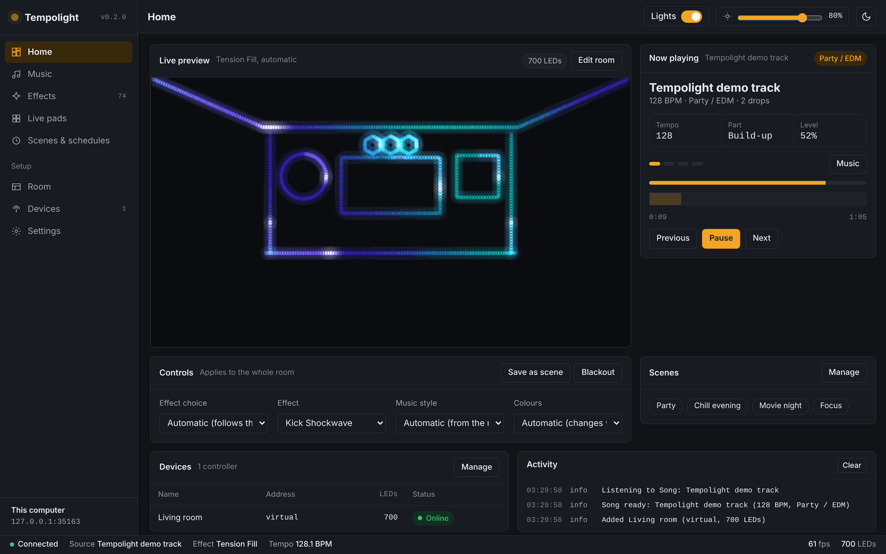<br><sub><b>Home</b>: live preview, now playing, controls</sub></td>
    <td width="50%">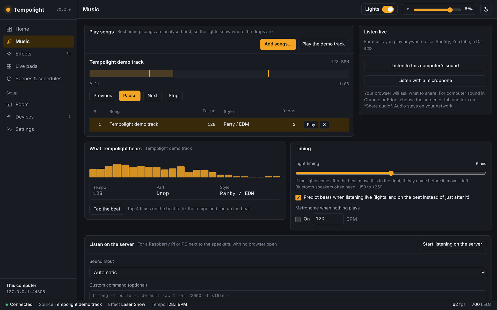<br><sub><b>Music</b>: songs analysed before playing, drop markers, live listening</sub></td>
  </tr>
  <tr>
    <td>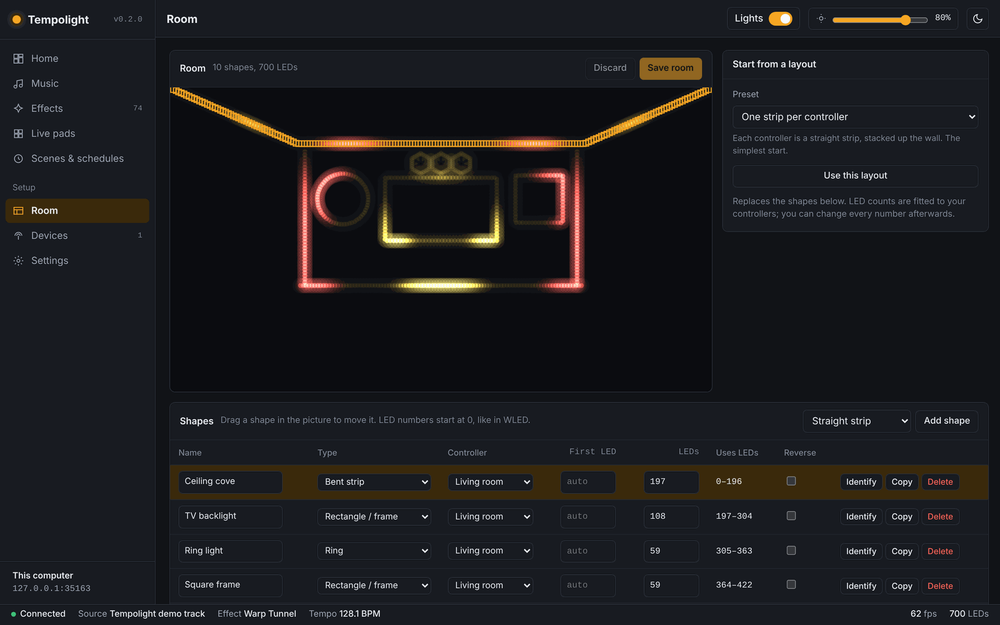<br><sub><b>Room</b>: presets, drag shapes, LED ranges per controller</sub></td>
    <td>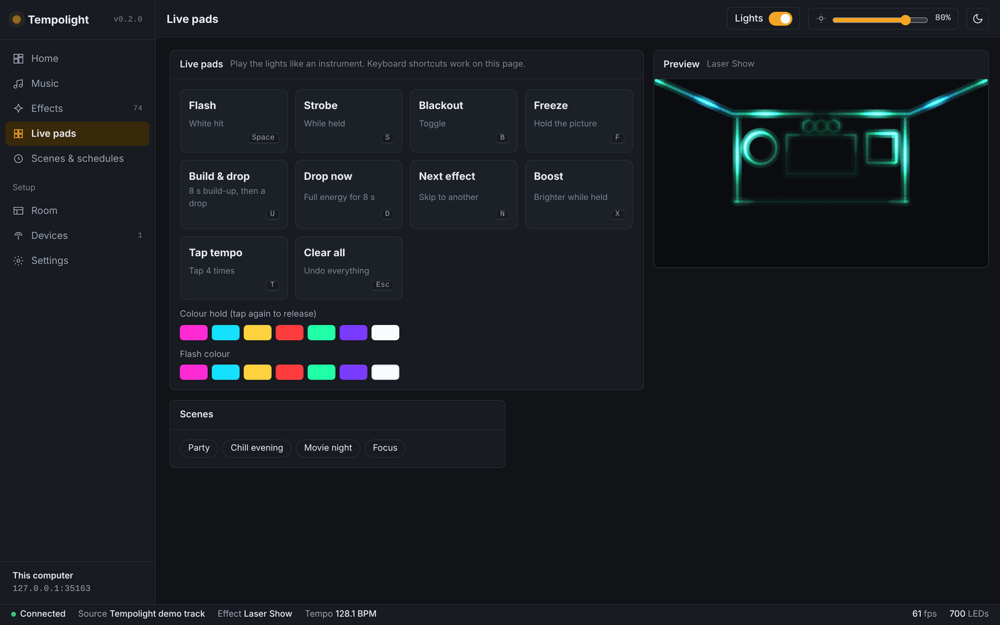<br><sub><b>Live pads</b>: play the lights like an instrument</sub></td>
  </tr>
  <tr>
    <td>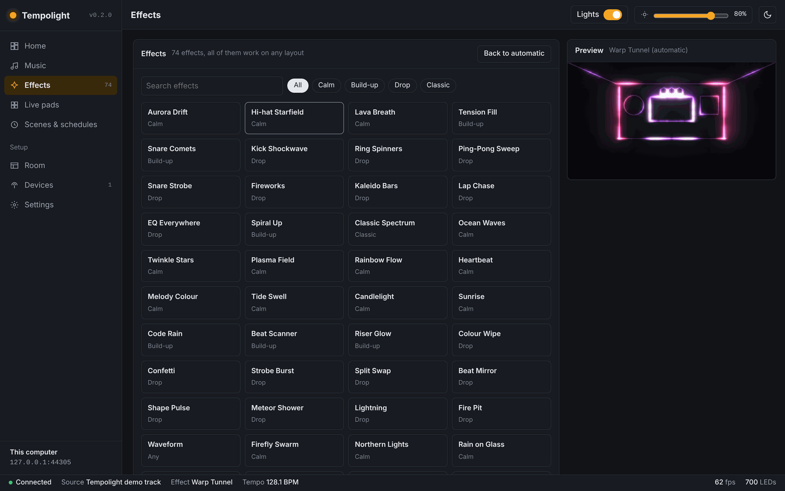<br><sub><b>Effects</b>: 95 effects, automatic or by hand</sub></td>
    <td>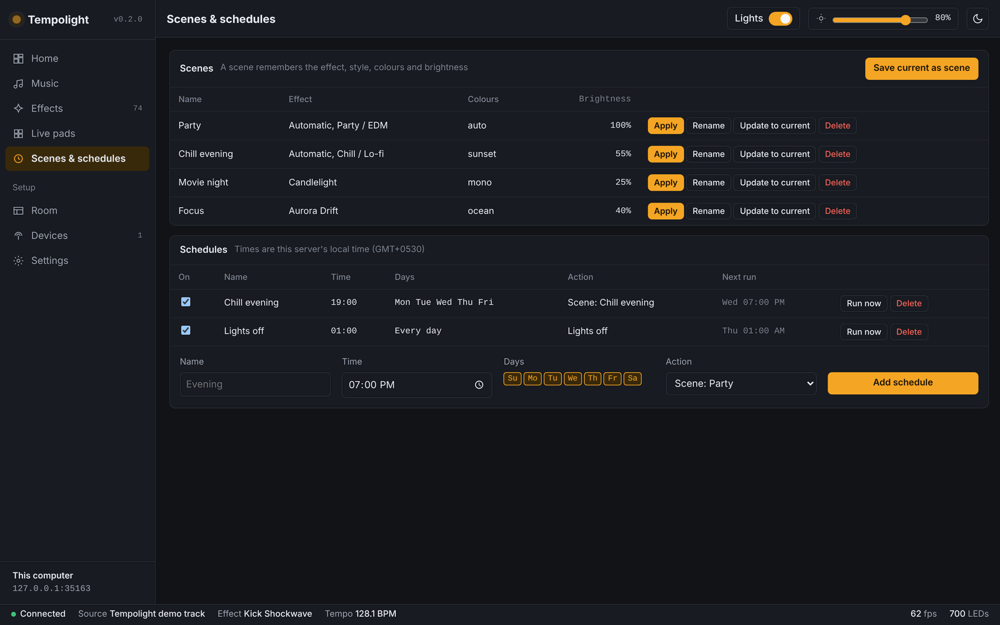<br><sub><b>Scenes & schedules</b></sub></td>
  </tr>
  <tr>
    <td>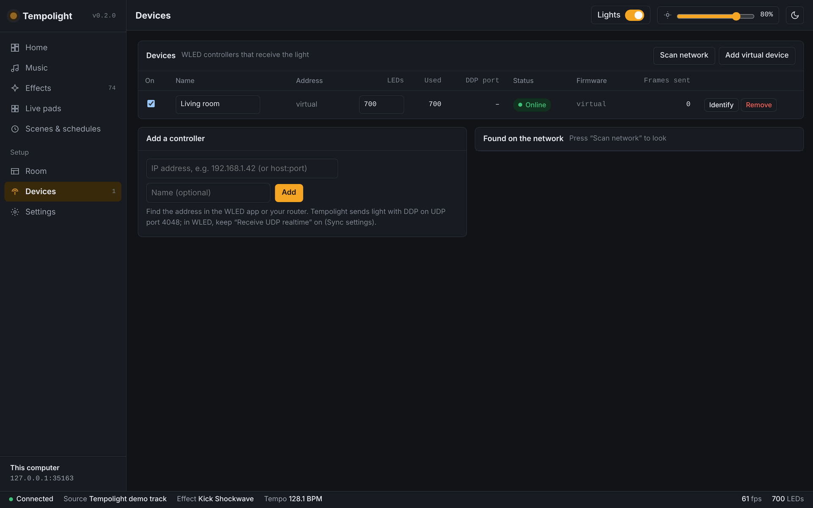<br><sub><b>Devices</b>: scan, add, identify, send segments</sub></td>
    <td>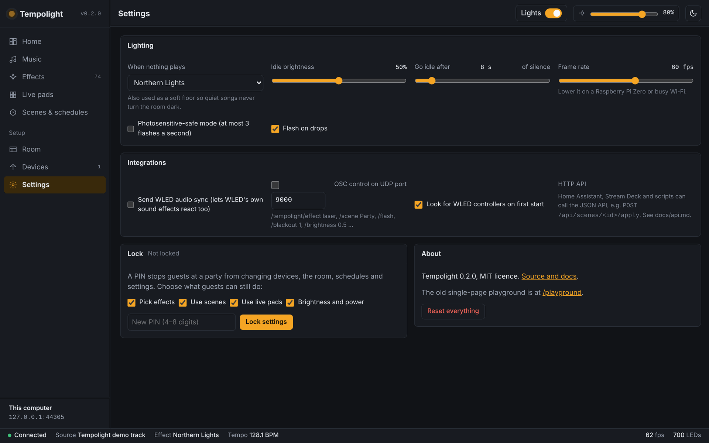<br><sub><b>Settings</b>: ambient light, safe mode, OSC, PIN lock</sub></td>
  </tr>
</table>

<p align="center">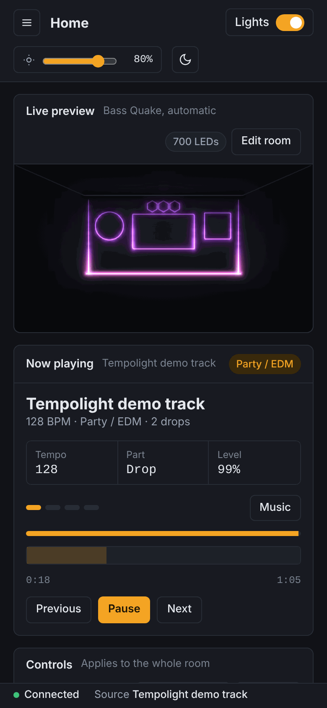 &nbsp; 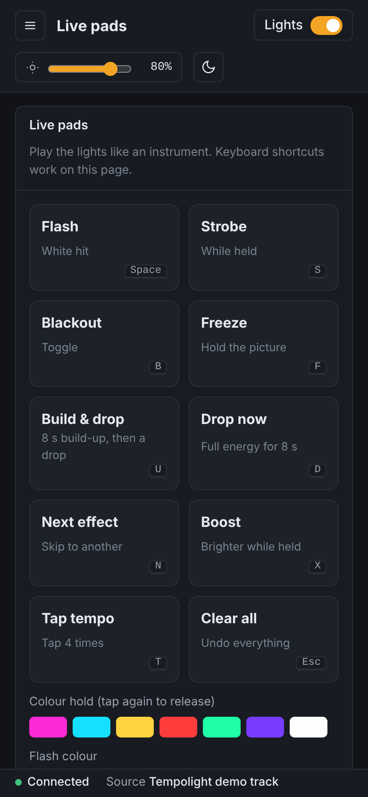 &nbsp; 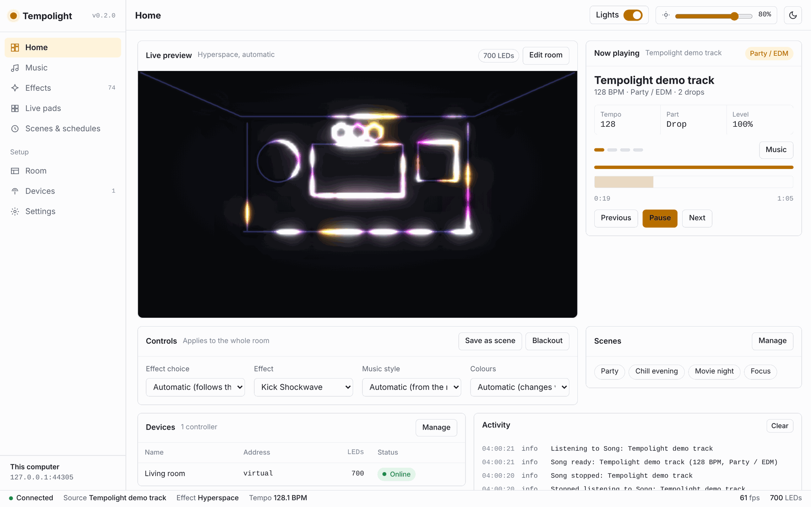</p>

## Install

You need **WLED controllers** (any ESP8266/ESP32 running [WLED](https://kno.wled.ge)) and a computer on the same
network: Windows, macOS, Linux or a Raspberry Pi 3/4/5.

> **Note:** the one-line installers download from this repository, so they work once it is public. Until then, use
> [From source](#from-source).

### Linux, Raspberry Pi, macOS

```bash
curl -fsSL https://raw.githubusercontent.com/D4RKGEEK/tempolight/main/install/install.sh | sh
tempolight --open
```

On a Raspberry Pi that should run all the time, add `--service` to start Tempolight at boot (systemd):

```bash
curl -fsSL https://raw.githubusercontent.com/D4RKGEEK/tempolight/main/install/install.sh | sh -s -- --service
```

### Windows

In PowerShell:

```powershell
irm https://raw.githubusercontent.com/D4RKGEEK/tempolight/main/install/install.ps1 | iex
```

It installs Node.js if needed and adds Tempolight to the Start menu and desktop. When Windows asks, allow it on
private networks so your lights and phone can reach it.

### Docker

```bash
git clone https://github.com/D4RKGEEK/tempolight.git && cd tempolight
docker compose up -d          # Linux / Raspberry Pi: host networking, so it can find WLED and stream to it
docker compose -f docker-compose.desktop.yml up -d   # Docker Desktop on Windows or Mac
```

Docker Desktop has host networking off by default, so use the desktop file there (or turn on *Settings → Resources →
Network → Enable host networking*). Then add your controllers by IP on the Devices page.

### From source

```bash
git clone https://github.com/D4RKGEEK/tempolight.git
cd tempolight
npm start                     # Node.js 20+; opens http://localhost:8080. No npm install needed
```

### On your phone, as an app

Open Tempolight in Safari on an iPhone (or Chrome on Android), tap **Share** → **Add to Home Screen**, and it opens
full screen with its own icon, like any app. Works for the online demo and for your home install
(`http://<your computer's IP>:8080`).

### Online demo

The whole app also runs in a browser with pretend WLED lights, no install needed: the same code, deployed to
Cloudflare on every push. See [docs/deploy-cloudflare.md](docs/deploy-cloudflare.md) to host your own.

## Getting started

1. **Start Tempolight.** On first start it looks for WLED controllers on your Wi-Fi and adds each one as a strip.
   Nothing found? Add one by IP address on the Home page, or press **Try it without lights** for a virtual room.
2. **Play music.** On **Music**, add songs from your computer (they play in the browser and are analysed first), or
   press **Listen to this computer's sound** for Spotify, YouTube or a DJ app.
3. **Optional: draw your room.** On **Room**, pick a layout like *One strip around four walls*, set which LEDs each
   part uses, and press **Send segments to WLED**. Effects now move around the room the way it really is.

More detail, hardware tips and troubleshooting: [docs/getting-started.md](docs/getting-started.md).

### Headless on a Raspberry Pi

Connect your music source to a USB sound card's input, then:

```bash
tempolight --list-audio       # sound inputs this machine can capture from
tempolight --audio auto       # listen (also switchable on the Music page)
tempolight --audio song.mp3   # play a file through it to test the setup (needs ffmpeg)
```

### Command line

```text
tempolight [--port 8080] [--host 0.0.0.0] [--data ~/.tempolight] [--open] [--no-discover] [--audio <source|file>] [--list-audio]
```

Settings live in one JSON file in `~/.tempolight` (or `$TEMPOLIGHT_DATA`). Back it up to keep your room and scenes.

## How it works

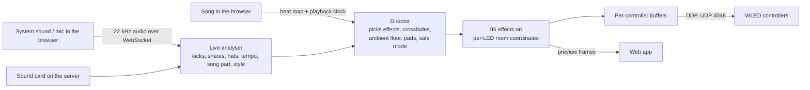

- **Engine** (`packages/engine`, pure JavaScript, no I/O): whole-song analysis, live analysis, the director, room
  layouts and the effects. The same code runs in the browser and on the server.
- **Outputs** (`packages/outputs`): DDP exactly as WLED expects it, the WLED JSON API, discovery, audio sync.
- **Server** (`packages/server`): HTTP API, WebSocket, render loop, scenes, schedules, OSC, sound capture, lock.
- **Web app** (`apps/web`): plain JavaScript modules and CSS. No framework, no build, works offline.

Read more in [docs/architecture.md](docs/architecture.md) and [docs/protocols.md](docs/protocols.md).

## Integrations

**HTTP API**: everything the app does. [docs/api.md](docs/api.md) has every call and a Home Assistant example.

```bash
curl -X POST http://tempolight.local:8080/api/scenes/party/apply
curl -X PATCH http://tempolight.local:8080/api/show -H 'content-type: application/json' -d '{"effect":"tunnel"}'
```

**OSC** (enable in Settings, default UDP 9000): `/tempolight/effect laser` · `/tempolight/scene Party` ·
`/tempolight/flash` · `/tempolight/blackout 1` · `/tempolight/brightness 0.5` · `/tempolight/power 0` · `/tempolight/next`

**WLED audio sync**: Tempolight can send WLED's own sound-sync packets, so WLED's built-in sound-reactive effects run too.

## FAQ

<details><summary><b>How is this different from LedFx?</b></summary>

LedFx is a great project and the inspiration for this one. Tempolight takes a different approach: it analyses songs
ahead of time (beat grid, build-ups, drops, style), treats all your LEDs as one room with real shapes and positions,
chooses effects by song part and style, and runs on Node.js alone with no Python or native dependencies. It's MIT
licensed and contains no LedFx code.
</details>

<details><summary><b>Do I need to flash anything special to my ESP32?</b></summary>

No. Stock WLED works (use a recent release). Tempolight streams with DDP, which WLED supports out of the box. Keep
*Receive UDP realtime* turned on in WLED's Sync settings (it is by default).
</details>

<details><summary><b>Can it hear Spotify / YouTube / Apple Music?</b></summary>

Yes. On the Music page press **Listen to this computer's sound** and share your screen or the tab with audio
(Chrome or Edge on Windows share all system sound). On macOS, sharing a browser tab works; for all system sound use a
loopback device such as BlackHole with server capture. Songs you add to Tempolight itself get the best timing.
</details>

<details><summary><b>The lights are a little behind the music.</b></summary>

Move **Light timing** on the Music page. Bluetooth speakers usually need +150 to +250 ms. Keep **Predict beats**
on for live listening.
</details>

<details><summary><b>It doesn't find my controllers.</b></summary>

Make sure they're on the same network and subnet as the computer, then press **Scan network** on Devices, or add
them by IP address. Guest Wi-Fi and some mesh systems block discovery; adding by IP always works. In Docker, use host
networking.
</details>

<details><summary><b>How many LEDs can it drive?</b></summary>

Thousands. The limit is usually Wi-Fi: each controller gets one DDP frame per refresh, 480 LEDs per packet. For big
installs use wired Ethernet controllers or lower the frame rate in Settings.
</details>

<details><summary><b>Is it safe for people with photosensitive epilepsy?</b></summary>

Turn on **Photosensitive-safe mode** in Settings: it limits big brightness jumps to three per second. Calm music
styles already avoid strobing.
</details>

## Development

```bash
npm test                  # 27 tests: analysis, live listening, effects, DDP, discovery, server API, lock, schedules, OSC, capture
npm run serve             # run without opening a browser
npm run fake-wled         # a pretend WLED controller (127.0.0.1:18080) to develop without hardware
npm run test:browser      # clicks through every page in a real browser (needs Playwright)
npm run site && npm run test:demo   # build the online demo and test it in a browser
npm run docs              # regenerate docs/effects.md
```

New effects are the easiest way to contribute: one object in `packages/engine/src/effects.js`. See
[CONTRIBUTING.md](CONTRIBUTING.md).

## Roadmap

Next: Ableton Link, Hue Entertainment streaming, an online effect gallery and multi-room. What's done and what's
left is in [docs/roadmap.md](docs/roadmap.md). Ideas welcome in [issues](https://github.com/D4RKGEEK/tempolight/issues).

## Acknowledgements

[WLED](https://github.com/wled/WLED) makes cheap LED controllers wonderful, and [LedFx](https://github.com/LedFx/LedFx)
showed what music-reactive WLED can be.

## Licence

[MIT](LICENSE) © 2026 D4RKGEEK and Tempolight contributors.
