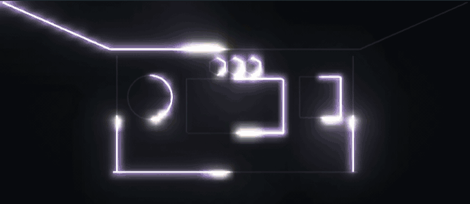

<div align="center">


# Tempolight

**Music-reactive lighting for WLED and many other lights.**

Tempolight finds the beat, the build-ups and the drops, and plays one show across every light in your room.
In our beat tests the lights land on 91% of beats, live, with no song file.

[](https://github.com/D4RKGEEK/tempolight/actions/workflows/ci.yml)
[](LICENSE)
[](https://nodejs.org)
[](package.json)

[**Try the online demo**](https://tempolight.pages.dev/demo/) · [**Read the docs**](https://tempolight.pages.dev/docs/) ·
[Set up with Claude](docs/setup-with-claude.md) · [Website](https://tempolight.pages.dev/)



</div>

## What it is

Tempolight is a free, open-source app that turns music into a light show. It runs on a computer, a Raspberry Pi, in
Docker or as a Home Assistant add-on. You use it from a browser or from your phone. It is plain JavaScript for
Node.js 20 or newer, with no dependencies and no build step.

## What it does

- **Follows the beat live.** A new beat tracker holds the beat through breaks, finds it again in under a second and
  hears kicks under heavy bass. It finds beat 1 of the bar too.
- **Flashes every light at once.** Hue, WiZ and WLED react at different speeds. Tempolight sets each light's delay by
  itself, so a kick lands on all of them together.
- **Knows the drop is coming.** Songs are studied before they play. For a song it has never heard, it hears the
  build-up and counts down 3 to 5 seconds ahead. The lights build up, dip, then hit the drop.
- **Picks one look per song.** One effect and palette that fit the song, kept for the whole song. Press **Not this
  one** or **Keep**. Or pick more change with **Variety**: One look, Song parts or Show.
- **Shows how well it follows.** The **In sync** meter says Locked, Finding the beat or Not hearing, with one plain
  hint. The song map shows the parts, the drops and where you are.
- **Lets you set the feel.** **Punch** sets how hard the room pumps on each kick. **Drama** sets how much brighter
  drops are than calm parts.
- **Colours with the music.** The key and mood pick the palette. With chord colours, the colour steps when the chord
  changes. With stereo sound, the side of the room a hit came from lights up more.
- **Learns your music.** Add your music folder and every song is studied ahead, so it is in sync from its first play.
  Songs it knows are recognised in about 8 seconds from any source.
- **Hears any source.** Song files, Spotify, this computer's sound (BlackHole on a Mac, Stereo Mix on Windows, the
  output monitor on Linux), a microphone, Pioneer Pro DJ Link, Ableton Link and MIDI clock.
- **Drives many lights as one room.** WLED, E1.31 and Art-Net, DMX fixtures, Philips Hue, Nanoleaf, Govee, LIFX,
  WiZ, TP-Link Kasa, Yeelight, Twinkly, OpenRGB and your guests' phones.
- **Plays live.** Live pads for flash, strobe, blackout and build-up, with keys and MIDI controllers.
- **Fits your home.** Home Assistant, Apple Home, voice control, scenes, schedules, a wake-up sunrise and night mode.

Every feature, with where to find it in the app: [What you can do](docs/guides/what-you-can-do.md).

<table>
  <tr>
    <td width="50%"></td>
    <td width="50%"></td>
  </tr>
  <tr>
    <td></td>
    <td></td>
  </tr>
</table>

## Install

You need lights on the same network as the computer that runs Tempolight. For LED strips, any ESP8266 or ESP32
with [WLED](https://kno.wled.ge). No lights yet? Use the [online demo](https://tempolight.pages.dev/demo/), or press
**Try without lights** on first start. Every way to install, in detail: [docs/install.md](docs/install.md).

**With Node.js 20 or newer**

```bash
npx tempolight --open
```

**One-file app.** Download it from the [latest release](https://github.com/D4RKGEEK/tempolight/releases/latest). Node.js
is inside.

- Windows: `tempolight-windows-x64.exe`. It isn't signed yet: *More info* → *Run anyway*.
- Mac: `Tempolight-macos-arm64.dmg` (Apple silicon) or `Tempolight-macos-x64.dmg` (Intel). Drag it to Applications,
  then right-click → **Open** the first time.
- Linux: `tempolight-linux-x64.tar.gz` or `tempolight-linux-arm64.tar.gz`.

**Docker**

```bash
docker run -d --name tempolight --network host -v tempolight:/data --restart unless-stopped ghcr.io/d4rkgeek/tempolight
```

Add `-v /path/to/Music:/music:ro -e TEMPOLIGHT_MUSIC=/music` for your own music. Details: [Docker](docs/guides/docker.md).

**Raspberry Pi image.** Flash `tempolight-<version>-pi-arm64.img.xz` from the
[releases](https://github.com/D4RKGEEK/tempolight/releases) with Raspberry Pi Imager. Join the **Tempolight-Setup**
Wi-Fi from your phone to pick your network, then open http://tempolight.local. Guide:
[docs/raspberry-pi.md](docs/raspberry-pi.md).

**Home Assistant add-on.** In Home Assistant, open **Settings → Add-ons → Add-on store → ⋮ → Repositories**, add
`https://github.com/D4RKGEEK/tempolight`, then install **Tempolight**. With the Mosquitto broker it shows up in Home
Assistant by itself. Details: [add-on docs](homeassistant/tempolight/DOCS.md).

Homebrew, winget, Scoop, installer scripts and building from source are in [docs/install.md](docs/install.md).

Then open http://localhost:8080. The setup wizard finds your lights, picks a room, fixes the timing and plays a test
song. Next steps: [Your first show](docs/guides/first-run.md).

## Set up with Claude

Paste one prompt into Claude Code, or the Claude app with access to your computer, and it installs and sets up
Tempolight for you. It asks before installing anything system-wide.
Get the prompt: [Set up Tempolight with Claude](docs/setup-with-claude.md).

## Docs

The docs are at **[tempolight.pages.dev/docs](https://tempolight.pages.dev/docs/)**, built from [docs/](docs/).

| To | Read |
| --- | --- |
| Install and start | [Install](docs/install.md), [Your first show](docs/guides/first-run.md) |
| See every feature | [What you can do](docs/guides/what-you-can-do.md) |
| Connect lights | [Connect your lights](docs/guides/connect-lights.md) |
| Get the music in | [Music sources](docs/guides/music-sources.md), [Hearing the music](docs/hearing-music.md), [Spotify](docs/spotify.md), [Your own music](docs/guides/your-music.md) |
| Fix a problem | [Troubleshooting](docs/guides/troubleshooting.md), [FAQ](docs/guides/faq.md) |
| Script it | [HTTP and WebSocket API](docs/api.md), [Architecture](docs/architecture.md) |

## Demo

The [online demo](https://tempolight.pages.dev/demo/) runs the real engine in your browser with pretend lights.
Press **Play the demo track** on the Music page.

## Contributing

Contributions are welcome. New effects are the easiest start: one object in `packages/engine/src/effects.js`. Read
[CONTRIBUTING.md](CONTRIBUTING.md) first (no runtime dependencies, the engine stays pure, a performance budget per
effect, photosensitivity rules) and the [code of conduct](CODE_OF_CONDUCT.md). Report security issues as described in
[SECURITY.md](SECURITY.md). The changes so far are in the [changelog](CHANGELOG.md).

```bash
npm start                 # run from source on http://localhost:8080
npm test                  # the test suite, with the beat and feel checks
npm run fake-wled         # a pretend WLED controller, to work without lights
npm run docs:check        # check the docs' links, images and diagrams
```

Tempolight takes ideas from [LedFx](https://github.com/LedFx/LedFx) but contains none of its code, and it stands on
[WLED](https://github.com/wled/WLED).

## Licence

[MIT](LICENSE) © 2026 D4RKGEEK and Tempolight contributors.
