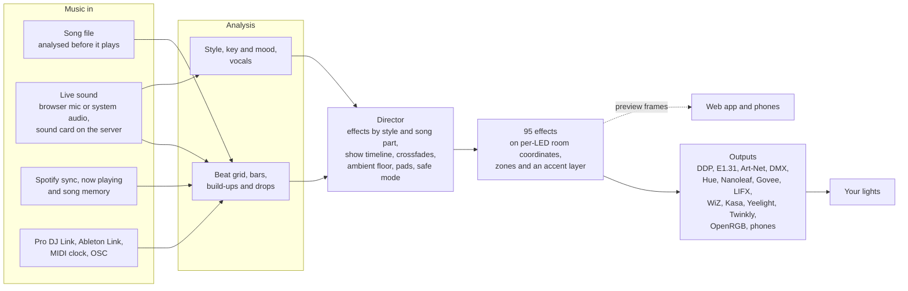
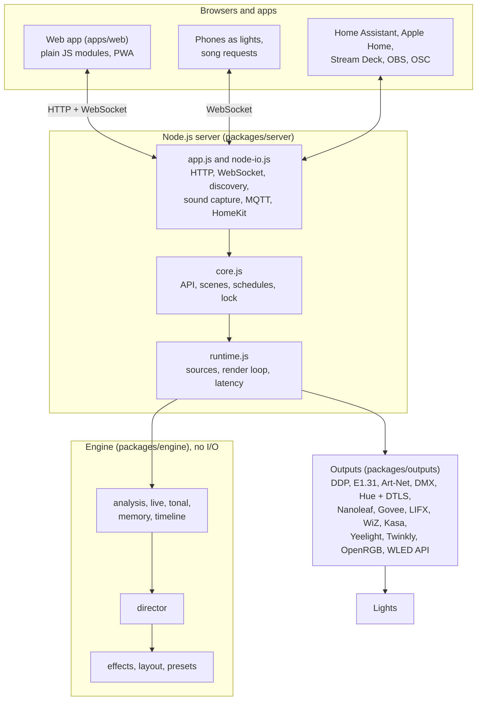

<div align="center">


# Tempolight

**Music-reactive lighting that understands the song, not just the volume.**

Tempolight finds the beat, the bars, the build-ups and the drops, often before they happen, picks effects to match,
and plays them across every light in your room as one canvas: WLED strips, rings, frames and matrices, DMX fixtures,
smart bulbs, PC lighting and your guests' phones.

[](https://github.com/D4RKGEEK/tempolight/actions/workflows/ci.yml)
[](https://d4rkgeek.github.io/tempolight/)
[](LICENSE)
[](https://nodejs.org)
[](package.json)
[](#quick-start)

[**Try the online demo**](https://tempolight.pages.dev) · [**Documentation**](https://d4rkgeek.github.io/tempolight/) ·
[Quick start](#quick-start) · [Features](#features) · [How it works](#how-it-works) · [Contributing](#contributing)


</div>

## What it is

Tempolight is an open-source app that turns music into a light show. It runs on a computer, a Raspberry Pi, in Docker
or as a Home Assistant add-on, and you use it from a browser or as an app on your phone. It is written in plain
JavaScript for Node.js 20+ with **no dependencies**: no Python, no native audio libraries, no build step. About 7% of
one CPU core drives 700 LEDs at 60 frames a second, and a low-power mode (picked by itself) suits a Pi Zero 2 or Pi 3.

Most music-reactive LED software reacts to how loud the music is right now. Tempolight listens like a lighting
designer: it knows where the beat is, which part of the song you're in, and what's coming next.

- **It anticipates.** Songs are analysed before they play, Spotify songs are learned on their first play, and songs
  it has heard before are recognised live, so the build-up starts on the right bar and the room explodes exactly on
  the drop. Live audio gets beat prediction, so lights land on the beat instead of just after it.
- **It fits the music.** Party, pop/rock, hip-hop, chill and ballad each get their own effects and energy, and the
  song's key and mood pick the colours. Slow, sad songs get slow, warm light, not strobes.
- **It never goes dark.** Quiet passages fade into a soft ambient look; only the planned pause before a drop may be a
  blackout.
- **It's one room, not one strip.** Draw your room once, pick a preset or map it with your phone's camera; effects
  sweep across walls, spin around rings and ripple out from the centre, whatever your wiring.

### How is it different from LedFx?

[LedFx](https://github.com/LedFx/LedFx) is a great, mature project and the inspiration for this one. Tempolight
takes a different approach. It contains no LedFx code.

| | LedFx | Tempolight |
| --- | --- | --- |
| What drives the lights | The sound right now (frequency bands, volume, onsets) | A beat grid and song structure: bars, build-ups and drops known ahead (song analysis, Spotify sync, song memory, Pro DJ Link), plus live analysis |
| Choosing effects | You pick effects and scenes per device | A director picks effects by music style and song part, crossfades, and follows a show timeline; you can still pick by hand, like or ban effects |
| Layout | Devices and virtual strips (1D, and 2D matrices) | A room: shapes with real positions (walls, rings, matrices, freehand, camera-mapped), zones with their own effect |
| Runs on | Python with native audio libraries | Node.js alone (or a one-file app with Node inside), zero dependencies; the same engine runs in the browser |
| Beyond LEDs | LED controllers and some PC and smart lights | Also DMX fixtures, Hue, Nanoleaf, smart bulbs, OpenRGB, Home Assistant, Apple Home, OBS, Stream Deck, games, Twitch |

## Features

<table>
<tr><td width="50%" valign="top">

**🎵 Understands the music**
- **Song analysis** before playing: tempo, beat grid, downbeats, bars, build-ups, drops and style
- **Live listening** to this computer's sound, a microphone (in the browser) or a sound card on the server, with
  beat prediction and vocal detection
- **Key and mood colours**: the key, major or minor, and mood set the palette
- **Song memory**: songs played once are recognised when they play again from anywhere (about 15 s), and follow
  their stored beat map, drops included
- **Sync with Spotify**: Spotify's exact position, songs learned on their first play, optional shared beat maps on
  your own Cloudflare Worker
- **Now playing**: reads Spotify, Apple Music and other players on the same computer, so remembered songs need no
  microphone
- **Auto-generated shows** for every remembered song, and a **show editor** on the waveform

</td><td width="50%" valign="top">

**✨ Effects and control**
- **95 effects** that work on every layout ([full list](docs/effects.md)), chosen automatically by style and song
  part, with crossfades and an ambient floor
- **Make it yours**: like or ban effects; per-effect speed, intensity, colour shift, saturation and mirror; an accent
  layer; zones with their own effect or brightness
- **Effect builder**: make effects from parts without code and share them as `TL1:` codes
- **Live pads**: flash, strobe, blackout, freeze, build & drop, drop now, next, boost, tap tempo, colour hold, with
  keyboard shortcuts and **MIDI controllers**
- **Text scroller** for LED matrices, **screen sync** (a room-sized ambilight), 15-second **clip recording**
- **Photosensitive-safe mode**: at most three big flashes a second

</td></tr>
<tr><td valign="top">

**🏠 Your room, set up in minutes**
- **Setup wizard**: five big steps on first start
- **Discovery** of WLED (mDNS and a network scan) and smart lights; address changes are followed
- **Room presets**, a shape editor with LED ranges per controller, one click to write segments into WLED
- **Camera LED mapping**: a phone or laptop camera finds where every LED really is
- **One-tap timing fix** (clicks measured with the microphone, Bluetooth speakers included) and a **live latency
  meter** per light with Wi-Fi warnings
- **Power limit** per controller, so a strip never draws more than its supply

</td><td valign="top">

**🏡 Smart home**
- **Home Assistant** through MQTT discovery (appears by itself; built-in MQTT client) and an **add-on**
- **Apple Home**: Tempolight is a HomeKit bridge (no Homebridge), so Siri and the Home app work
- **Voice control** with Google Assistant and Alexa through Home Assistant
- **Scenes and schedules**, including sunrise and sunset times worked out offline
- **Wake-up sunrise** linked to your phone's alarm, a **sleep timer**, an hourly **ambient plan**, **night mode**
- **PIN lock** with guest permissions, **backup and restore**, **one-click updates**

</td></tr>
<tr><td valign="top">

**🎉 Parties, DJs and streaming**
- **Phones as lights**: guests scan a QR code and their screen joins the show
- **Guest song requests** with votes
- **Pioneer Pro DJ Link** beat grid from CDJs/XDJs (listen-only), **Ableton Link** (listen-only, beta), **MIDI
  clock**, **OSC** (TouchOSC, Companion, lighting desks)
- **Stream Deck** plugin, **OBS** scene mapping, tally light and browser source, **CS2 and Dota 2** game events,
  **Twitch** chat commands and alerts, **Discord** posts

</td><td valign="top">

**📦 Runs anywhere**
- **One-file app** for Windows, macOS (a `.dmg` with Tempolight.app) and Linux: Node.js inside
- **Homebrew, winget, Scoop** and `npx tempolight`
- **Docker** images for amd64 and arm64 on ghcr.io
- **Raspberry Pi image** with Wi-Fi setup from your phone (a setup hotspot)
- **Home Assistant add-on**
- An **installable app** (PWA) on iPhone and Android, and an **online demo** with pretend lights
- **Low-power mode**, picked by itself on a Pi Zero/3 or a slow computer
- **Tempolight Lite** (beta): a WLED usermod for an ESP32 with a microphone, no computer needed

</td></tr>
</table>

### Lights it can drive

| Lights | How | Notes |
| --- | --- | --- |
| **WLED** (ESP8266/ESP32) | DDP, or E1.31 (sACN) / Art-Net per device; WLED audio sync | Stock WLED, nothing to flash; segments written for you |
| **Any E1.31 / Art-Net receiver** | sACN or Art-Net | Pixel controllers, Falcon, FPP and so on |
| **DMX fixtures** | Art-Net or sACN to a DMX node | Pars, dimmers, strobes, moving heads, lasers (drops only, off by default), fog (a burst before the drop); custom channel lists. Packets are tested; not yet checked on a real node and fixtures |
| **Philips Hue** | Bridge API (basic, ~10 updates/s) or **Entertainment** streaming (up to 50/s, built-in DTLS) | Entertainment mode is tested against a test server and OpenSSL, not yet a real bridge; falls back to basic |
| **Nanoleaf** | extControl streaming, 30 fps | Panels placed where they really are |
| **Govee** | LAN API, one colour or DreamView segments | Beta; segments on some models only |
| **LIFX, WiZ, TP-Link Kasa, Yeelight, Twinkly** | Their local protocols (Yeelight music mode, Twinkly realtime with its real layout) | Newer; Kasa per-zone strips are beta and unconfirmed on hardware |
| **OpenRGB** | OpenRGB SDK server | PC RAM, fans, keyboards, motherboards, GPUs |
| **Phones and tablets** | A web page, through a QR code | Each phone shows its own part of the room |

Every protocol is described in [docs/protocols.md](docs/protocols.md).

## Screenshots

<table>
  <tr>
    <td width="50%"><br><sub><b>Home</b>: live preview, now playing, controls</sub></td>
    <td width="50%"><br><sub><b>Music</b>: songs analysed before playing, drop markers, live listening</sub></td>
  </tr>
  <tr>
    <td><br><sub><b>Room</b>: presets, drag shapes, LED ranges per controller</sub></td>
    <td><br><sub><b>Live pads</b>: play the lights like an instrument</sub></td>
  </tr>
  <tr>
    <td><br><sub><b>Effects</b>: 95 effects, automatic or by hand</sub></td>
    <td><br><sub><b>Scenes & schedules</b></sub></td>
  </tr>
  <tr>
    <td><br><sub><b>Devices</b>: scan, add, identify, send segments</sub></td>
    <td><br><sub><b>Settings</b>: ambient light, safe mode, integrations, PIN lock</sub></td>
  </tr>
</table>

<p align="center"> &nbsp;  &nbsp; </p>

## Quick start

You need lights on the same network as the computer that runs Tempolight (for LED strips: any ESP8266/ESP32 with
[WLED](https://kno.wled.ge)). No lights yet? Try the [online demo](https://tempolight.pages.dev), or press **Try it
without lights** on first start for a virtual room. Every way to install, in detail: **[docs/install.md](docs/install.md)**.

> **Note:** the one-line installers and package managers download from this repository's releases, so they work once
> a release is published. [From source](#from-source) always works.

### Windows

Download `tempolight-windows-x64.exe` from the [latest release](https://github.com/D4RKGEEK/tempolight/releases/latest)
and double-click it (it isn't signed yet: *More info* → *Run anyway*). Or:

```powershell
winget install D4RKGEEK.Tempolight
# or the installer script (installs Node.js, adds Start menu and desktop shortcuts, updates from Settings):
irm https://raw.githubusercontent.com/D4RKGEEK/tempolight/main/install/install.ps1 | iex
```

When Windows asks, allow Tempolight on private networks so your lights and phone can reach it.

### macOS

Download `Tempolight-macos-arm64.dmg` (Apple silicon) or `Tempolight-macos-x64.dmg` (Intel) from the
[latest release](https://github.com/D4RKGEEK/tempolight/releases/latest) and drag Tempolight to Applications. It isn't
notarised yet, so the first time right-click it → **Open**. Or:

```bash
brew install d4rkgeek/tempolight/tempolight && tempolight --open
```

### Linux

```bash
curl -fsSL https://raw.githubusercontent.com/D4RKGEEK/tempolight/main/install/install.sh | sh
tempolight --open
```

Or the one-file `tempolight-linux-x64.tar.gz` / `-arm64.tar.gz`, Homebrew, or `npx tempolight --open` with Node.js 20+.

### Raspberry Pi

Flash `tempolight-<version>-pi-arm64.img.xz` from the [releases](https://github.com/D4RKGEEK/tempolight/releases) with
Raspberry Pi Imager, power the Pi on, join the **Tempolight-Setup** hotspot from your phone to pick your Wi-Fi, then
open **http://tempolight.local**. Works on a Pi 5, 4, 3, Zero 2 W and Pi 400/500 ([guide](docs/raspberry-pi.md)).
On an existing Pi OS: the Linux installer with `--service` starts Tempolight at boot.

```bash
curl -fsSL https://raw.githubusercontent.com/D4RKGEEK/tempolight/main/install/install.sh | sh -s -- --service
```

### Docker

```bash
docker run -d --name tempolight --network host -v tempolight:/data --restart unless-stopped ghcr.io/d4rkgeek/tempolight
```

Host networking lets it find and stream to your lights. On Docker Desktop (Windows, Mac) use
[docker-compose.desktop.yml](docker-compose.desktop.yml) and add lights by IP.

### Home Assistant

**Settings → Add-ons → Add-on store → ⋮ → Repositories**, add `https://github.com/D4RKGEEK/tempolight`, then install
**Tempolight**. With the Mosquitto broker add-on it shows up in Home Assistant by itself
([add-on docs](homeassistant/tempolight/DOCS.md)).

### From source

```bash
git clone https://github.com/D4RKGEEK/tempolight.git
cd tempolight
npm start          # Node.js 20+; opens http://localhost:8080. No npm install needed
```

### On your phone

Open Tempolight in Safari on an iPhone (or Chrome on Android), tap **Share → Add to Home Screen**, and it opens full
screen with its own icon. Works for your install (`http://<your computer's IP>:8080`) and the online demo.

### ESP32 with a microphone, no computer

[Tempolight Lite](docs/tempolight-lite.md) (beta) is a WLED usermod with beat, build-up and drop detection and 9
Tempolight effects. Flash it from the browser with the [web installer](https://d4rkgeek.github.io/tempolight/flash/).
Its algorithm is tested on a computer with synthetic songs; thresholds may need tuning on real hardware.

### Then

1. **Start Tempolight.** The setup wizard finds your lights, helps you pick a room, fixes the timing and plays a test
   song.
2. **Play music.** On **Music**, add songs (analysed before they play), turn on **Sync with Spotify**, or press
   **Listen to this computer's sound** for YouTube, a DJ app or anything else.
3. **Make it your room.** On **Room**, pick a layout or map it with the camera, then **Send segments to WLED**.

More: [Getting started](docs/getting-started.md), with hardware tips and troubleshooting.

## How it works



1. **Music in.** A song you add is decoded and analysed in the browser before it plays; live sound streams to the
   server at 22 kHz; Spotify and other players give an exact position for songs Tempolight already knows; DJ gear
   and Link give the beat grid directly.
2. **Analysis** finds kicks, snares and hi-hats, the tempo and the beat phase, which part of the song this is
   (calm, build-up, drop), the style, the key and the mood.
3. **The director** chooses what to show: an effect from the style's pools for the current part (or the song's show
   timeline), crossfades, the ambient floor, drop flashes, the live pads and the photosensitivity limiter.
4. **Effects** paint every LED from its position in the room, the beat and the song signals.
5. **Outputs** send each light what it can take, at the rate it can take it, with a latency offset per device.

### Architecture



- **Engine** (`packages/engine`): song and live analysis, key and mood, song memory, the director, room layouts and the
  effects. Pure JavaScript with no I/O, so the same code runs in Node.js, in the browser and in tests.
- **Outputs** (`packages/outputs`): every light protocol, discovery and WLED's API, including a small DTLS client for
  Hue Entertainment.
- **Server** (`packages/server`): an environment-free core (`core.js`, every API call) and a Node layer (`app.js`,
  `node-io.js`) for the network, sound cards and integrations. The online demo runs the same core in the browser with
  pretend lights.
- **Web app** (`apps/web`): plain JavaScript modules and CSS, no framework and no build step; heavy pages load only
  when opened.

Read more in [docs/architecture.md](docs/architecture.md), [docs/api.md](docs/api.md) and
[docs/protocols.md](docs/protocols.md).

## Documentation

The full documentation is at **[d4rkgeek.github.io/tempolight](https://d4rkgeek.github.io/tempolight/)** (built from
[docs/](docs/index.md) with VitePress). Good places to start:

| I want to… | Read |
| --- | --- |
| Install it and connect my first lights | [Getting started](docs/getting-started.md), [Install](docs/install.md) |
| Run it on a Raspberry Pi that's always on | [Raspberry Pi image](docs/raspberry-pi.md) |
| Sync with Spotify | [Sync with Spotify](docs/spotify.md) |
| Browse the effects | [Effects](docs/effects.md) |
| Use voice, wake-up lights and the ambient plan | [Voice control](docs/voice.md), [Wake-up and sleep](docs/wake-up.md) |
| Connect OBS, games, Twitch, Discord, Stream Deck | [Integrations](docs/integrations.md), [Stream Deck](docs/streamdeck.md) |
| Run lights from an ESP32 alone | [Tempolight Lite](docs/tempolight-lite.md) |
| Script it or build on it | [API](docs/api.md), [Architecture](docs/architecture.md), [Protocols](docs/protocols.md) |
| Host my own online demo | [Online demo on Cloudflare](docs/deploy-cloudflare.md) |

### Quick API taste

```bash
curl -X POST http://tempolight.local:8080/api/scenes/party/apply
curl -X PATCH http://tempolight.local:8080/api/show -H 'content-type: application/json' -d '{"effect":"tunnel"}'
```

OSC (Settings, default UDP 9000): `/tempolight/effect laser` · `/tempolight/scene Party` · `/tempolight/flash` ·
`/tempolight/blackout 1` · `/tempolight/brightness 0.5` · `/tempolight/next`

## Status

Tempolight is young and moving fast: the next release (0.3) is in the [changelog](CHANGELOG.md) under *Unreleased*.
Some parts are written from published protocols and tested against pretend devices, but haven't been confirmed on
real hardware yet:

- **Beta:** Govee (LAN), Kasa per-zone strips, Ableton Link (not yet checked against Ableton Live), Tempolight Lite
  firmware (tested on a computer; the ESP32 build runs in CI).
- **Not yet tested on real hardware:** Hue Entertainment streaming (tested against a test server and OpenSSL), DMX on
  a real node and fixtures (moving-head aiming differs per fixture: use a custom profile).
- **Still to do:** an online effect gallery (share codes work today), multi-room. See the
  [roadmap](docs/roadmap.md).

Reports from real rooms are very welcome in [issues](https://github.com/D4RKGEEK/tempolight/issues).

## FAQ

<details><summary><b>Do I need to flash anything special to my ESP32?</b></summary>

No. Stock WLED works (use a recent release). Tempolight streams with DDP, which WLED supports out of the box. Keep
*Receive UDP realtime* on in WLED's Sync settings (it is by default). [Tempolight Lite](docs/tempolight-lite.md) is
optional, for an ESP32 that should react to music on its own.
</details>

<details><summary><b>Can it hear Spotify, YouTube or Apple Music?</b></summary>

Yes. Spotify is followed exactly with **Sync with Spotify** ([guide](docs/spotify.md)). For anything else, on the
Music page press **Listen to this computer's sound** and share the screen or the tab with audio (Chrome or Edge on
Windows share all system sound). On macOS a browser tab works; for all system sound use a loopback device such as
BlackHole with server capture. Songs you've played before are recognised and followed with their beat map.
</details>

<details><summary><b>The lights are a little behind the music.</b></summary>

Use the one-tap timing fix on the Music page (it plays clicks and listens with the microphone), or move **Light
timing** by hand: Bluetooth speakers usually need +150 to +250 ms. The latency meter shows each light's delay and
warns about weak Wi-Fi.
</details>

<details><summary><b>It doesn't find my controllers.</b></summary>

Make sure they're on the same network and subnet as the computer, then press **Scan network** on Devices, or add
them by IP address. Guest Wi-Fi and some mesh systems block discovery; adding by IP always works. In Docker, use host
networking.
</details>

<details><summary><b>How many LEDs can it drive?</b></summary>

Thousands. The limit is usually Wi-Fi: each controller gets one DDP frame per refresh, 480 LEDs per packet. For big
installs use wired Ethernet controllers or lower the frame rate in Settings.
</details>

<details><summary><b>Is it safe for people with photosensitive epilepsy?</b></summary>

Turn on **Photosensitive-safe mode** in Settings: it limits big brightness jumps to three a second (WCAG 2.3.1), and
chat, games and pads respect it too. Calm music styles already avoid strobing; night mode turns strobes off.
</details>

<details><summary><b>Does it need the cloud or an account?</b></summary>

No. Everything runs on your network. Optional extras talk to the internet only when you turn them on: the Spotify
Web API, shared beat maps (on a Cloudflare Worker you deploy yourself), Twitch and Discord.
</details>

## Contributing

Contributions are welcome, and new effects are the easiest start: one object in `packages/engine/src/effects.js`.
Please read [CONTRIBUTING.md](CONTRIBUTING.md) (no runtime dependencies, the engine stays pure, a performance budget
per effect, photosensitivity rules) and the [code of conduct](CODE_OF_CONDUCT.md). Security issues: see
[SECURITY.md](SECURITY.md).

```bash
npm test                  # the whole test suite (Node's built-in runner)
npm run serve             # run without opening a browser
npm run fake-wled         # a pretend WLED controller to develop without hardware
npm run test:browser      # clicks through every page in a real browser (needs Playwright)
npm run site && npm run test:demo   # build the online demo and test it in a browser
npm run docs              # regenerate docs/effects.md
npm run docs:check        # docs: Mermaid diagrams compile, links and images resolve
npm run docs:dev          # the documentation site on your computer (VitePress, in website/)
```

## Acknowledgements

[WLED](https://github.com/wled/WLED) makes cheap LED controllers wonderful, and [LedFx](https://github.com/LedFx/LedFx)
showed what music-reactive WLED can be. The docs site is built with [VitePress](https://vitepress.dev) and
[Mermaid](https://mermaid.js.org).

## Licence

[MIT](LICENSE) © 2026 D4RKGEEK and Tempolight contributors.
