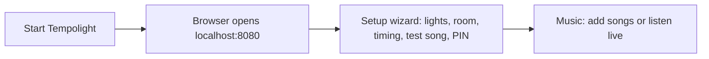

# Getting started

The short version. For every click, with pictures, see [Your first show](guides/first-run.md); all the guides are
listed in [guides/](guides/README.md).

## What you need

- **Lights on your network.** Best for music: LED strips on an ESP32 or ESP8266 board running
  [WLED](https://kno.wled.ge) (the web installer takes two minutes; ESP32 is recommended above about 300 LEDs or for
  high frame rates). Tempolight also drives Govee, OpenRGB, Nanoleaf, Philips Hue, LIFX, WiZ, TP-Link Kasa, Yeelight,
  Twinkly, DMX fixtures and phones: [Connect your lights](guides/connect-lights.md). No lights? Try it with a virtual
  room, or in the [online demo](https://tempolight.pages.dev).
- **A computer on the same network** to run Tempolight: Windows 10/11, macOS, Linux, or a Raspberry Pi 3, 4 or 5.
  A Pi Zero 2 works for small setups at a lower frame rate.
- **Nothing else.** The one-file app and the Pi image include everything; [install.md](install.md) lists every way to
  install.

## First run

1. Start Tempolight (the app, `tempolight --open`, the Start menu shortcut, or `npm start` from source). Your browser
   opens **http://localhost:8080**; the window also prints the address for your phone.
2. The setup wizard opens: it finds your lights, lets you pick a room layout, fixes the timing with the microphone and
   plays a test song. Run it again any time from **Settings → About → Run setup again**.
3. Open **Music** and press **Add songs…** or **Play the demo track**. The lights react within a second.

## WLED settings

1. In WLED, set the LED count, type and colour order under *Config → LED Preferences*.
2. Under *Config → Sync Interfaces*, keep *Receive UDP realtime* on (the default). Tempolight streams with DDP on UDP
   port 4048.
3. Give each controller a fixed address in your router (a DHCP reservation). Tempolight finds a controller that moved
   by its name, but a fixed address is the most reliable.
4. Name your controllers in WLED (*Config → User Interface → Server description*). Tempolight uses that name.

More, including E1.31/Art-Net and segments: [connect-lights.md](guides/connect-lights.md#wled).

## Draw your room

The **Room** page turns your strips into a room, so effects move across it the way it really is.

- **Presets.** *One strip around four walls* takes one strip and splits it into left, back, right and front walls.
  LED counts are fitted to your controller; change them in the table.
- **LED ranges.** Each shape has a *First LED* and an LED count. Leave *First LED* on auto to continue after the
  previous shape on the same controller. Example: one 300-LED strip, LEDs 0–99 on the left wall, 100–199 on the
  back wall, 200–299 on the right wall.
- **Direction.** If a chase runs the wrong way, tick *Reverse* for that shape.
- **Identify.** Lights one shape in white with LED 0 blinking, so you can check which is which.
- **Send segments to WLED** writes your ranges into WLED as segments, handy for WLED's own effects too.
- **Map with the camera** finds where every LED really is; **Zones** give parts of the room their own effect.

All of it: [room-and-zones.md](guides/room-and-zones.md).

## Music sources

| Source | Best for | How |
| --- | --- | --- |
| Songs in Tempolight | Parties, best timing | Music → Add songs… Each song is analysed before it plays; drops are marked on the progress bar |
| This computer's sound | Spotify, YouTube, DJ apps | Music → Listen to this computer's sound, then share a screen or tab with audio |
| Microphone | Live music, a speaker in the room | Music → Listen with a microphone |
| Server sound card | A Raspberry Pi with no screen | Music → Listen on the server, or `tempolight --audio auto` |
| Spotify | Spotify anywhere, with the beat map | Music → Sync with Spotify ([spotify.md](spotify.md)) |
| DJ gear | CDJs, Link apps, MIDI clock | Settings → Integrations, Live pads → MIDI controller |
| Metronome | Testing, or ambient beat | Music → Timing → Metronome when nothing plays |

Browsers only allow audio capture on `localhost` or HTTPS. To listen from another device, run the browser on the
computer that plays the music, or use server capture. Which source to choose:
[music-sources.md](guides/music-sources.md); setting up capture on each system: [hearing-music.md](hearing-music.md).

## Troubleshooting

| Problem | Fix |
| --- | --- |
| No controllers found | Same network and subnet? Try **Scan network** on Devices, or add by IP. Guest Wi-Fi and Docker without host networking block discovery |
| Controller shows offline | Check its address in your router; WLED's web page should open at `http://<address>` |
| Lights flicker or stutter | Weak Wi-Fi. Lower the frame rate in Settings (30–40 fps), move the controller closer to the router, or use an Ethernet ESP32 |
| Lights are behind the beat | Music → Timing → **Fix the timing automatically**, or move Light timing right. Bluetooth speakers need about +200 ms |
| Only part of a strip lights up | The LED count in Devices or the shape counts in Room are lower than the strip |
| Colours are wrong (red is green) | Set the colour order (GRB/RGB) in WLED's LED Preferences |
| Port 8080 is in use | Start with `--port 8081` |
| Windows asks about the firewall | Allow private networks, so phones and controllers can reach it |

Everything else, with the latency meter explained: [troubleshooting.md](guides/troubleshooting.md).
