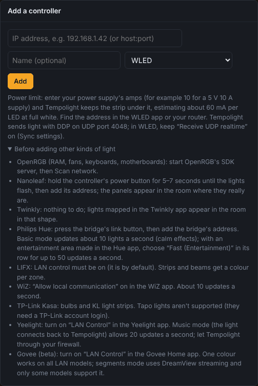
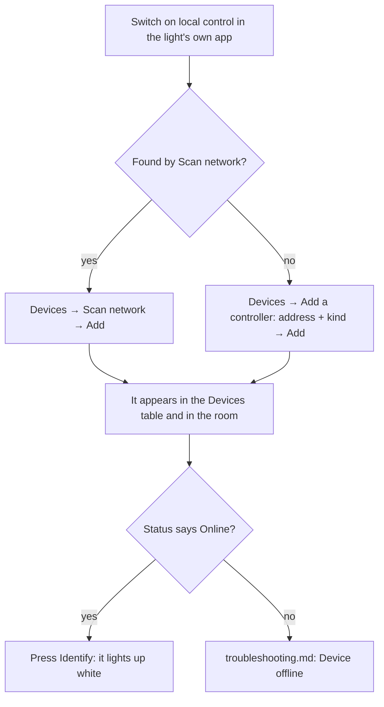
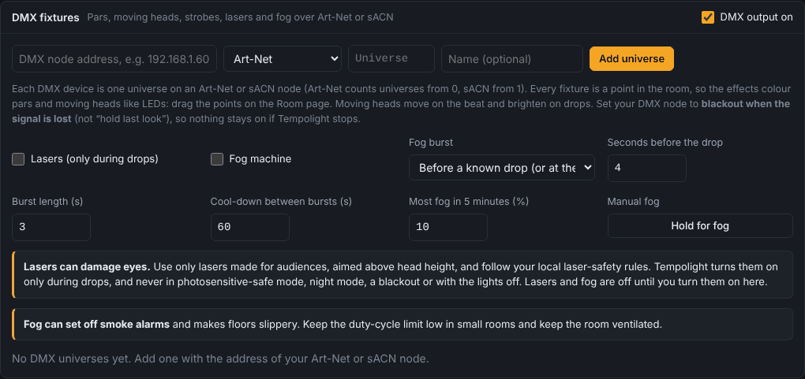

# Connect your lights

Tempolight drives many kinds of light at once, as one show. This page has a section for each kind: what to switch on
in its own app, how to add it in Tempolight, and what to expect. Everything happens on the **Devices** page (under
*Setup* in the menu), which is locked when you set a PIN.

Two ways to add a light:

- **Scan network** (top of the Devices page): the lights found are listed under *Found on the network*; press **Add**
  next to each. Finds WLED, Govee, OpenRGB, LIFX, WiZ, Kasa, Yeelight and Twinkly.
- **Add a controller**: type the address (an IP address such as `192.168.1.42`, or `host:port`), optionally a name,
  pick the kind in the list, and press **Add**. Needed for Philips Hue, Nanoleaf and DMX, and for anything the scan
  doesn't find.

Every light you add is placed in the room by itself: a strip as a line, a bulb as a point, Nanoleaf and Twinkly in
their real layout. Move them where they really are on the Room page ([room-and-zones.md](room-and-zones.md)).

In the Devices table each light has: **On** (send the show to it or not), its name and address, LED count, the
**Protocol** column (how Tempolight talks to it; for some kinds a mode choice), **Power limit (A)**, **Status**
(*Online* with Wi-Fi bars, or *Offline*), **Delay** (the live latency meter, see
[troubleshooting.md](troubleshooting.md#the-latency-meter)), and the buttons **Identify** (lights it up white),
**Check** and **Remove**.

## Which light, which mode

| Light | Found by scan | Updates a second | Best for | Status |
| --- | --- | --- | --- | --- |
| [WLED](#wled) (DDP, the default) | yes | your frame rate (60 by default) | everything: every LED on its own | stable |
| [WLED with E1.31 / Art-Net](#e131-sacn-and-art-net) | as WLED | your frame rate | Falcon, FPP and other pixel controllers, or WLED set up that way | stable |
| [Govee](#govee), one colour | yes | about 10 | calm effects, whole-light colour | beta |
| [Govee](#govee), segments | yes | 25 | models with DreamView | beta |
| [OpenRGB](#openrgb-pc-lighting) | yes | up to 40 | PC fans, RAM, keyboards | stable |
| [Nanoleaf](#nanoleaf) | no | 30 | panels, each panel its own colour | stable |
| [Philips Hue, basic](#philips-hue) | no | about 10 for the whole bridge | calm effects, a few lamps | stable |
| [Philips Hue, fast (Entertainment)](#philips-hue) | no | up to 50 | beat effects on Hue | beta, not yet tried on a real bridge |
| [LIFX](#lifx) | yes | up to 20 per light | bulbs; strips and beams per zone | stable |
| [WiZ](#wiz) | yes | about 10 | bulbs | stable |
| [TP-Link Kasa](#tp-link-kasa) | yes | about 10 | bulbs; KL strips | per-zone strips beta |
| [Yeelight](#yeelight), music mode | yes | 20 | bulbs and strips | stable |
| [Twinkly](#twinkly) | yes | about 25 | strings, curtains, Squares, in their mapped shape | stable |
| [DMX fixtures](#dmx-fixtures) | no | about 40 | pars, moving heads, strobes, lasers, fog | not yet checked on a real node |
| [Phones](#phones-as-lights) | (QR code) | your frame rate | guests at a party | stable |

The rule of thumb: for music, WLED (or any light that updates 25 times a second or more) is what makes the show feel
tight. Lights that take about 10 updates a second follow the colours and the mood well, but a fast strobe or a chase
looks smoother on WLED. You can mix them freely, and with [zones](room-and-zones.md#zones) give slow lights calm
effects while the strips party.

The wire details of every protocol are in [protocols.md](../protocols.md).

## WLED

[WLED](https://kno.wled.ge) is free firmware for ESP8266 and ESP32 boards that drive LED strips. It's what Tempolight
was made for.

### Put WLED on a board

1. Plug the ESP32 (recommended, especially above about 300 LEDs) or ESP8266 into a computer with a USB **data** cable.
2. Open [install.wled.me](https://install.wled.me) in Chrome or Edge, pick the newest version, press **Install** and
   choose the board's port. Or use Tempolight's own [installer page](../flash/index.html), which installs WLED with
   [Tempolight Lite](../tempolight-lite.md) (music-reactive even without a computer) on a classic ESP32.
3. The installer may offer to set up Wi-Fi straight away. Otherwise join the Wi-Fi **WLED-AP** (password `wled1234`)
   with your phone, open `http://4.3.2.1`, and enter your home Wi-Fi under **WiFi Setup**.

### Set it up in WLED

Open the controller's page (`http://<its address>`) → **Config**:

1. **LED Preferences**: the LED count, the LED type (WS2812B, SK6812, …), the data GPIO and the colour order. If red
   shows as green, change the colour order (GRB or RGB).
2. **Sync Interfaces**: keep **Receive UDP realtime** on (it is by default). Tempolight streams with DDP on UDP port
   4048.
3. **User Interface → Server description**: a name such as "Desk". Tempolight uses it.
4. In your router, give the controller a fixed address (a *DHCP reservation*). Tempolight follows a controller that
   moved by its name, but a fixed address is the most reliable.

### Find its IP address

Any of these: the WLED app lists it; WLED's own page under **Info**; your router's list of devices; or simply
**Scan network** in Tempolight, which finds WLED by its announcement (mDNS) and by asking every address on your
network.

### Add it

**Devices → Scan network → Add**, or type the address under **Add a controller** with the kind **WLED**. If the
controller doesn't answer you see *Couldn't reach a WLED controller at … Check the address, or add it anyway.*;
confirm to add it anyway (useful while it's switched off).

**What to expect:** *Online*, the firmware version (for example `0.15.0`), the LED count WLED reports, and **Frames
sent** counting up. WLED shows the stream instead of its own effect while Tempolight sends, and goes back to its own
effect a few seconds after Tempolight stops.

### Segments

The room's LED ranges (which LEDs are the left wall, which the desk, …) live in Tempolight. **Send segments** (in the
device's row, or **Send segments to WLED** on the Room page) writes the same ranges into WLED as segments, handy when
you also use WLED's own effects or presets.

### Power limit

Enter your power supply's amps in **Power limit (A)** (for example `10` for a 5 V 10 A supply). Tempolight estimates
about 60 mA per LED at full white and caps brightness so the strip stays under it. **Drawing now** shows the estimate,
with *capped* while it holds brightness back. WLED's own limiter (LED Preferences) still applies too.

### E1.31 (sACN) and Art-Net

DDP is the best choice for WLED. Use E1.31 or Art-Net for pixel controllers that don't speak DDP (Falcon, FPP, many
commercial ones), or a WLED you've already set up for them.

1. In the device's **Protocol** column choose **E1.31 (sACN)** or **Art-Net**.
2. In **Port / universe** set the first universe. Defaults: E1.31 starts at 1, Art-Net at 0. Each universe carries 170
   pixels, so a 500-LED strip uses three universes in a row.
3. In WLED: **Config → Sync Interfaces → Network DMX input**: type E1.31 or Art-Net, the same start universe, DMX mode
   *Multi RGB*.

### Several strips on one controller, or one strip on several

One WLED controller can drive one long strip split into several room shapes (left wall, back wall, …): set the LED
ranges on the Room page. Several controllers are simply several devices; Tempolight keeps them in sync.

## Govee

Beta: tested with Govee's documented LAN protocol, on a few models.

1. In the **Govee Home** app: open the light → settings (gear icon) → turn on **LAN Control**. Only models with LAN
   Control can be used; the light and Tempolight must be on the same network.
2. In Tempolight: **Scan network → Add**, or add it by IP with the kind **Govee (LAN, beta)**.
3. In the **Protocol** column choose:
   - **Govee: one colour**: works on every LAN model. The light shows one colour, about 10 times a second, only when it
     changes.
   - **Govee: segments (beta)**: one colour per segment, 25 times a second, using the DreamView streaming mode. Enter
     the light's number of segments (1 to 60) in the next column. Only some models support it: if the light stays on
     one colour, go back to one colour.

## OpenRGB (PC lighting)

[OpenRGB](https://openrgb.org) controls RAM, fans, keyboards, mice, motherboards and graphics cards of most brands.

1. Install and open OpenRGB on the PC, check it sees your devices, then open the **SDK Server** tab and press **Start
   server** (port 6742). Turn on starting the server with OpenRGB in its settings if you want it every time.
2. In Tempolight: **Scan network** lists each OpenRGB device with its LED count; **Add** the ones you want. Or add by
   address with the kind **OpenRGB (PC lighting)**: the address fills in `127.0.0.1` when OpenRGB runs on the same
   PC.
3. Each OpenRGB device is one Tempolight device (`OpenRGB #0`, `#1`, …). If you see *Couldn't reach OpenRGB …*, the SDK
   server isn't running.

## Nanoleaf

Shapes, Canvas, Elements and Lines. The scan doesn't find Nanoleaf, so you add it by address:

1. Find the controller's IP address in your router's device list.
2. **Hold the power button** on the Nanoleaf controller for 5 to 7 seconds, until the lights flash.
3. Within 30 seconds: **Devices → Add a controller**, type the address, kind **Nanoleaf panels**, **Add**.

If you were too slow you see *Hold the power button on the Nanoleaf controller for 5-7 seconds until the lights flash,
then press Add again within 30 seconds.* **What to expect:** the panels appear in the room in their real layout, each
panel its own colour, 30 times a second.

## Philips Hue

Hue lights go through the Hue bridge. Each colour light becomes one point in the room.

### Basic mode

1. Find the bridge's IP address: in the Hue app's settings (tap your bridge to see its details), or in your
   router's device list.
2. Press the **round link button** on top of the bridge.
3. Within 30 seconds: **Devices → Add a controller**, type the bridge's address, kind **Philips Hue bridge**, **Add**.

If you see *Press the round link button on the Hue bridge, then press Add again within 30 seconds.*, press the button
and Add again. **What to expect:** the bridge takes about 10 commands a second in total, shared by all its lights, so
Tempolight sends the light that changed most first. Calm effects and colour changes look good; fast strobes don't.

### Fast mode (Entertainment)

Beta: Tempolight has its own small streaming client for this, tested against a test server, not yet a real bridge.
Tell us how it goes.

1. In the Hue app: **Settings → Entertainment areas → +**, and put the lights you want in an area (up to 20).
2. On the Devices page, the bridge's **Protocol** column now offers **Hue: fast (Entertainment)**. Choose it.
3. If the bridge was added before fast mode existed, Tempolight asks you to press the link button again first.

**What to expect:** up to 50 updates a second for the lights in the area; lights outside it stay as they are. If
streaming can't start, Tempolight falls back to basic mode and tries again every 30 seconds.

## LIFX

1. LAN control is on by default (check the LIFX app's settings if the scan doesn't find the light).
2. **Scan network → Add**, or add by IP with the kind **LIFX**.

**What to expect:** bulbs show one colour; strips and beams show one colour per zone (*LIFX, 16 zones*); tiles and
candles get one colour. Up to 20 updates a second per light.

## WiZ

1. In the WiZ app, turn on **Allow local communication** (in the app's settings, under privacy or security).
2. **Scan network → Add**, or add by IP with the kind **WiZ**.

About 10 updates a second, only when the colour changes. WiZ has a minimum brightness: below it the light switches off.

## TP-Link Kasa

Kasa colour bulbs (KL and LB models) and the KL400, KL420 and KL430 light strips.

1. Set the light up in the Kasa app as usual.
2. **Scan network → Add**, or add by IP with the kind **TP-Link Kasa**.
3. Strips: the **Protocol** column offers **Kasa: whole strip** or **Kasa: N zones (beta)** (per-zone colours, not
   yet confirmed on hardware).

**Not supported:** Tapo lights, and Kasa devices with the newer firmware that needs a TP-Link account login. About 10
updates a second.

## Yeelight

1. In the Yeelight app: open the light → settings → turn on **LAN Control**.
2. **Scan network → Add**, or add by IP with the kind **Yeelight**.
3. The **Protocol** column: **Yeelight: music mode (20/s)** (the default) or **Yeelight: normal (1/s)**.

In music mode the light connects back to Tempolight, so your computer's firewall must let it in: when Windows or
macOS asks about incoming connections, allow them (private networks), and on Linux open incoming TCP for Tempolight.
If the light can't connect, Tempolight shows one colour a second and tries music mode again every 15 seconds. Music
mode doesn't work from Docker Desktop ([docker.md](docker.md)).

## Twinkly

Nothing to switch on. **Scan network → Add**, or add by IP with the kind **Twinkly**. If you mapped the lights in the
Twinkly app (with its camera), they appear in the room in that shape; otherwise as a line. About 25 frames a second.

## DMX fixtures

Pars, dimmers, strobes, moving heads, lasers and fog machines, through an Art-Net or sACN node (a box that turns
network into DMX). The packets and channel values are tested; it hasn't been tried with a real node and real fixtures
yet, and moving-head and colour-wheel values differ per fixture (use a custom profile when they do).

1. Connect the node to your network and the fixtures to the node with DMX cables, and give each fixture a DMX address
   (on the fixture's display) so their channels don't overlap.
2. Set the node to **blackout when the signal is lost** (not "hold last look"), so nothing stays on if Tempolight
   stops.
3. On the Devices page, in **DMX fixtures**: enter the node's address, pick **Art-Net** or **sACN (E1.31)**, the
   universe (Art-Net counts from 0, sACN from 1) and a name, then **Add universe**.
4. Under the universe, for each fixture: pick its profile, enter its DMX address (the next free one is filled in),
   optionally a name, **Add fixture**. Profiles: *RGB par*, *RGBW par*, *RGBA par*, *Dimmer*, *Strobe (intensity,
   rate)*, *Moving head* (8- or 16-bit, RGB or colour wheel), *Laser (on/off, pattern)*, *Fog machine*, and *Custom
   (your channel list)*, for example `dimmer, red, green, blue, fixed:0`.
5. Moving heads have a **Movement**: Circle, Figure 8, Sweep, Point at a place, or Still. They move on the beat and
   brighten on drops.
6. **Channels now** shows every channel's value live, so you can check a fixture before the party.

Each fixture is a point in the room: drag them where they hang on the Room page.

**Lasers and fog are off until you turn them on**, with **Lasers (only during drops)** and **Fog machine**.

- **Lasers can damage eyes.** Use only lasers made for audiences, aimed above head height, and follow your local
  laser-safety rules. Tempolight runs them only during drops (for at most a minute), and never in photosensitive-safe
  mode, night mode, a blackout or with the lights off.
- **Fog** gives a burst before a drop the song analysis knows about (or at the drop when listening live), with a
  cool-down between bursts and a limit on how much fog in 5 minutes. Fog can set off smoke alarms and makes floors
  slippery: keep the limit low in small rooms and ventilate. **Hold for fog** (and the **Fog** pad on Live pads, key
  G) fogs by hand for up to 10 seconds.
- Strobes flash only on the strobe pad and the first two seconds of a drop, never in photosensitive-safe or night
  mode.

## Phones as lights

Every phone in the room can be a light. **Live pads → Phones as lights** shows a QR code; guests on the same Wi-Fi
scan it, tap **Start**, and their screen becomes part of the room. Details in [party-and-dj.md](party-and-dj.md#phones-as-lights).

## Virtual devices

**Add virtual device** adds a pretend controller that's only drawn on screen. Use it to try layouts and effects before
the lights arrive, or for a [Stream Deck](../streamdeck.md) or [OBS](creators.md) setup without lights.

## Advanced

- **Frame rate.** Settings → Lighting → Frame rate (20 to 90, 60 by default). Lower it to 30–40 on busy Wi-Fi or a Pi
  Zero; **Performance → Low power** does that and more on small computers.
- **Non-default ports.** WLED's DDP port is in the **Port / universe** column; a DMX node or OpenRGB on another port
  takes `host:port` as the address.
- **WLED audio sync.** Settings → Integrations → *Send WLED audio sync*: WLED's own sound-reactive effects (and
  Tempolight Lite) then react to what Tempolight hears, for controllers you leave on their own effects.
- **API.** `POST /api/devices` adds any of these; see [api.md](../api.md).
