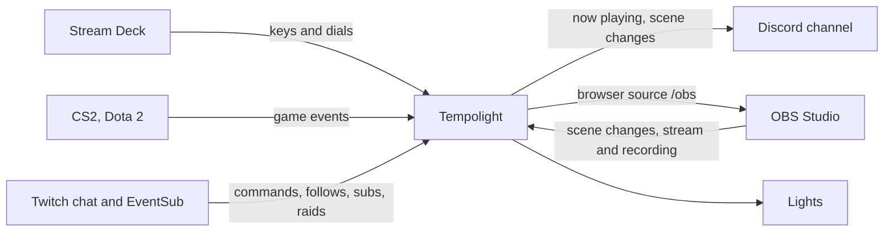

# Streamers, gamers and creators

The **Integrations** page (under *Setup* in the menu) connects the lights to a Stream Deck, OBS Studio, your games,
Twitch and Discord. These need Tempolight running on your computer or a Pi, not the online demo. Full details, every
option and the security notes are in [integrations.md](../integrations.md); this page is the quick start.

| I want… | Set up | Guide |
| --- | --- | --- |
| scene, effect and pad keys, a brightness dial | Stream Deck plugin: Integrations → Stream Deck → **Download the plugin** | [streamdeck.md](../streamdeck.md) |
| the room to change with my OBS scenes, a red tally light while live | OBS → Tools → WebSocket Server Settings → enable; Integrations → OBS Studio: `ws://127.0.0.1:4455` and the password | [integrations.md](../integrations.md#obs-studio) |
| my lights and what's playing in the stream | an OBS Browser source with `http://<tempolight>:8080/obs` | [integrations.md](../integrations.md#obs-studio) |
| health, flashbangs and the bomb timer on the lights | Integrations → Games: turn the game on, **Download the config file**, put it in the game's `cfg` folder | [integrations.md](../integrations.md#games-valve-game-state-integration) |
| chat to change the lights (`!scene party`, `!flash red`) | Integrations → Twitch: your channel name, pick the commands | [integrations.md](../integrations.md#chat-commands) |
| follows, subs, raids and cheers to flash the room | your own Twitch app's Client ID, **Connect Twitch**, enter the code at twitch.tv/activate | [integrations.md](../integrations.md#follows-subs-raids-and-cheers) |
| now playing and scene changes posted in Discord | a channel webhook pasted into Integrations → Discord | [integrations.md](../integrations.md#discord) |

## Where game and stream colours go

Game colours, the OBS tally and Twitch colours are drawn on top of the music show, under the live pads. Each one has
a **target**: the whole room, a zone, or one controller. **Blend in** mixes it with the show; **Take over** replaces
the show in that zone. A good start: make a zone of the lights behind your monitor ([room-and-zones.md](room-and-zones.md#zones))
and send game colours there, so the rest of the room keeps the music.

## Safe for viewers

Settings → Lighting → **Photosensitive-safe mode** is respected everywhere: no strobe from chat or events (a single
flash instead), gentler game flashes and slow, smooth pulses. Chat strobe (`!strobe`) is off by default.

## Screen sync and clips

- **Screen sync** (Music page): **Share a screen…** with a game, film or music video and the room takes its colours,
  like a room-sized ambilight. Works in Chrome, Edge and Firefox on a computer.
- **Record clip** (Home page): 15 seconds of the live preview with the music, to share.

## Without a PC on all the time

The Stream Deck and OBS talk to Tempolight over the network, so Tempolight can run on a Raspberry Pi
([raspberry-pi.md](../raspberry-pi.md)) while you stream from the PC: use the Pi's address in the plugin and the
browser source. Games post to Tempolight's address too; the downloaded config file holds the address your browser used,
so open the Integrations page from the gaming PC before downloading it.
