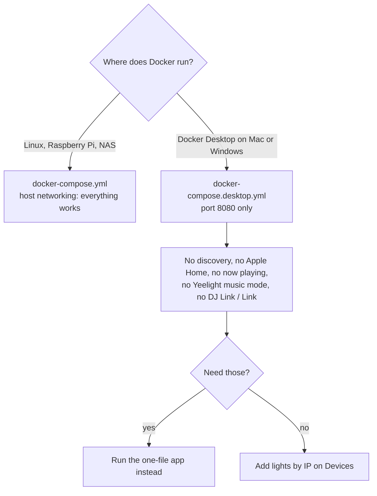

# Tempolight in Docker

Docker is a good way to run Tempolight on a Linux server, a NAS or a Raspberry Pi. On a Mac or Windows PC, Docker
Desktop works too, with limits: there, the one-file app ([install.md](../install.md)) does more.



## Linux and Raspberry Pi

With the source (git clone) and Docker Compose:

```bash
git clone https://github.com/D4RKGEEK/tempolight.git
cd tempolight
docker compose up -d --build
```

Then open `http://<this machine's address>:8080`. [docker-compose.yml](../../docker-compose.yml) uses **host
networking**, so Tempolight sees your network as if it ran directly on the machine: it finds WLED and the other
lights, streams to them over UDP, and Apple Home, Pro DJ Link and Ableton Link work.

Without the source, with the published image:

```bash
docker run -d --name tempolight --network host -v tempolight:/data --restart unless-stopped ghcr.io/d4rkgeek/tempolight
```

The image is built for `amd64` and `arm64` (Raspberry Pi 4/5 with a 64-bit OS).

**Listening to a USB sound card** (Music → Listen on the server): uncomment the `devices: - /dev/snd:/dev/snd` lines
in docker-compose.yml (or add `--device /dev/snd` to `docker run`), then `docker compose up -d`. The image includes
ffmpeg and alsa-utils.

**Your own music** (Music → Your own music): the container only sees folders you mount into it. Uncomment the music
lines in docker-compose.yml (`- /home/you/Music:/music:ro` and `TEMPOLIGHT_MUSIC=/music`), or add
`-v /home/you/Music:/music:ro -e TEMPOLIGHT_MUSIC=/music` to `docker run`. In the panel the folder is `/music`, the path
inside the container. See [Your own music](your-music.md).

## Docker Desktop (Mac, Windows)

Docker Desktop runs containers inside a small virtual machine, so the container doesn't see your home network
directly. Use the desktop compose file, which maps port 8080 and switches discovery off:

```bash
git clone https://github.com/D4RKGEEK/tempolight.git
cd tempolight
docker compose -f docker-compose.desktop.yml up -d --build
```

Open **http://localhost:8080**. Then add your lights **by IP address** on the Devices page (Add a controller): the
container can still send to them, it just can't find them.

### What doesn't work in Docker Desktop, and why

| Feature | Why not | Instead |
| --- | --- | --- |
| Scan network, finding lights | discovery uses multicast and broadcast on your network (mDNS, Govee, LIFX, …), which doesn't reach the virtual machine | add lights by IP |
| Apple Home | iPhones find the HomeKit bridge by mDNS and connect to it on its own port; neither crosses the virtual machine | run Tempolight natively |
| Now playing on this computer | the container is a small Linux system: it can't see the Spotify or Music app on your Mac or PC (it says *Install playerctl (or dbus-send) to see what's playing*) | connect your Spotify account (the Web API works from Docker): [spotify.md](../spotify.md) |
| Yeelight music mode | the light has to connect back into the container | Yeelight falls back to one colour a second |
| Pro DJ Link, Ableton Link | they're broadcasts and multicast on the network | run Tempolight natively |
| Listen on the server | the container has no access to your computer's sound card | **Listen live** in a browser on the same computer |
| One-click updates | an image is updated by rebuilding it | see [Update](#update) |

Song files, live listening in the browser, effects, the room, scenes, schedules, Home Assistant (MQTT), the Spotify
Web API and streaming to WLED by IP all work.

The Spotify sign-in works from the computer running Docker: its redirect address
`http://127.0.0.1:8080/api/nowplaying/spotify/callback` reaches the container through the mapped port. Keep the mapping `8080:8080` for this: with `8081:8080` the redirect
address Tempolight shows would still say 8080.

## Everyday commands

| What | Command |
| --- | --- |
| Start (build first if needed) | `docker compose up -d --build` (Desktop: add `-f docker-compose.desktop.yml` after `compose`) |
| Stop | `docker compose down` (your settings stay in the `tempolight` volume) |
| See what it's doing | `docker logs -f tempolight` (or `docker compose logs -f`) |
| Restart | `docker restart tempolight` |
| Is it healthy? | `docker ps` shows *(healthy)*; it checks `/api/health` every 30 s |

## Update

Settings → About → **Check for updates** says *Running in Docker* and shows the command, because a container can't
update itself.

- **From the source:** `git pull`, then `docker compose up -d --build` (with `-f docker-compose.desktop.yml` on
  Docker Desktop).
- **From the published image:** `docker pull ghcr.io/d4rkgeek/tempolight`, then `docker rm -f tempolight` and the
  same `docker run` command as before.

Your devices, room, scenes and settings are in the `tempolight` volume (`/data` inside the container) and survive
both.

## Problems

| What you see | Fix |
| --- | --- |
| `Conflict. The container name "/tempolight" is already in use` | an older container has the same name: `docker rm -f tempolight` (settings are in the volume, not the container), then start again |
| `port is already allocated` / *Port 8080 is already in use* | something else uses 8080 (perhaps Tempolight running outside Docker). Stop it, or change the left number in `ports:` (`"8081:8080"`) and open `http://localhost:8081` |
| No lights found (Linux) | check `network_mode: host` is in the compose file (or `--network host`) |
| No lights found (Docker Desktop) | expected: add them by IP |
| A light shows *Offline* | from the Docker machine, can you open `http://<light address>`? A VPN or a guest network blocks it |
| Lost the settings after recreating | the volume was removed (`docker compose down -v` or `docker volume rm`). Restore from Settings → Backup |
| `exec format error` | the image doesn't match the machine: use a 64-bit OS on the Pi, or build it there with `--build` |

## Advanced

- **Environment:** `TEMPOLIGHT_DATA=/data` and `PORT=8080` are set in the image; `TEMPOLIGHT_NO_DISCOVER=1` turns off
  the first-start search (the Desktop file sets it); `TEMPOLIGHT_MQTT_URL`, `TEMPOLIGHT_MQTT_USER` and
  `TEMPOLIGHT_MQTT_PASS` connect Home Assistant at every start (see `packages/server/src/env-settings.js`).
- **Home Assistant OS:** use the add-on instead, which runs Tempolight with host networking and finds the Mosquitto
  broker by itself: [smart-home.md](smart-home.md#the-home-assistant-add-on).
- **Your own port with host networking:** add `command: ["node", "packages/server/src/index.js", "--port", "8081"]`
  (port mapping doesn't apply with host networking).
