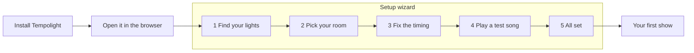
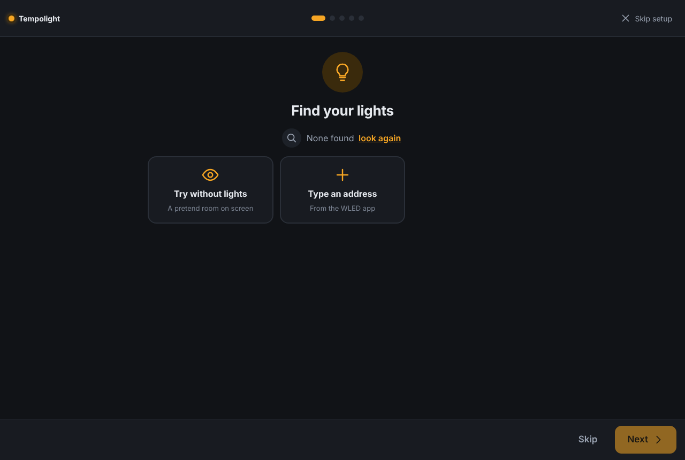
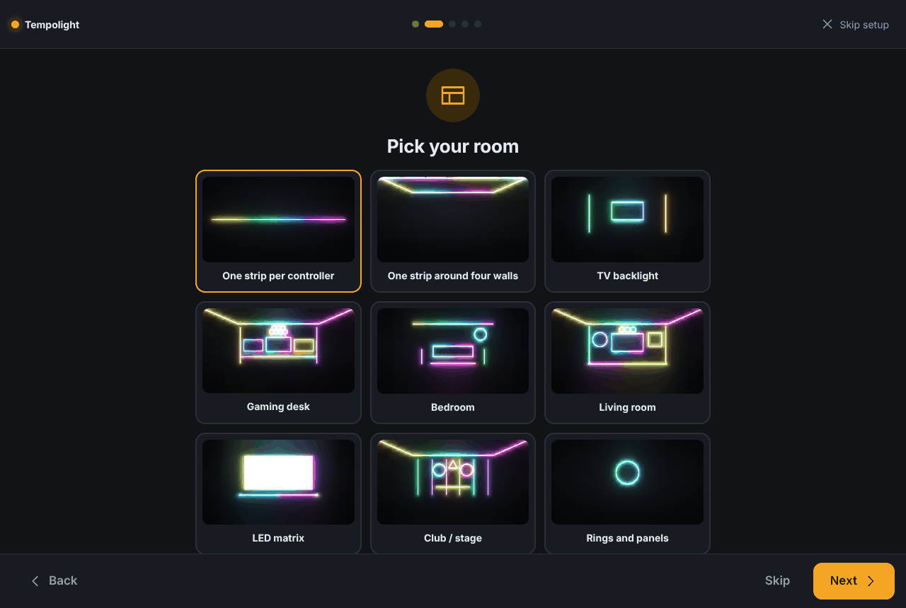
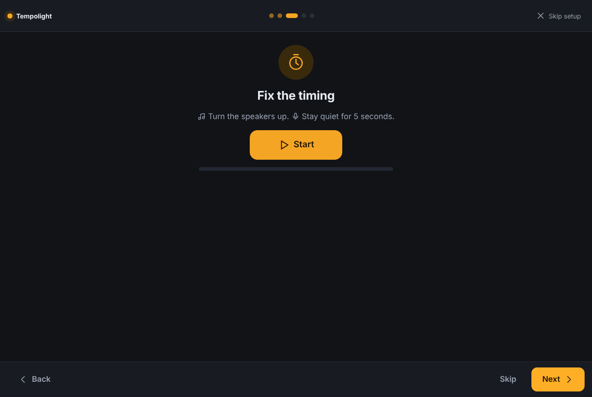
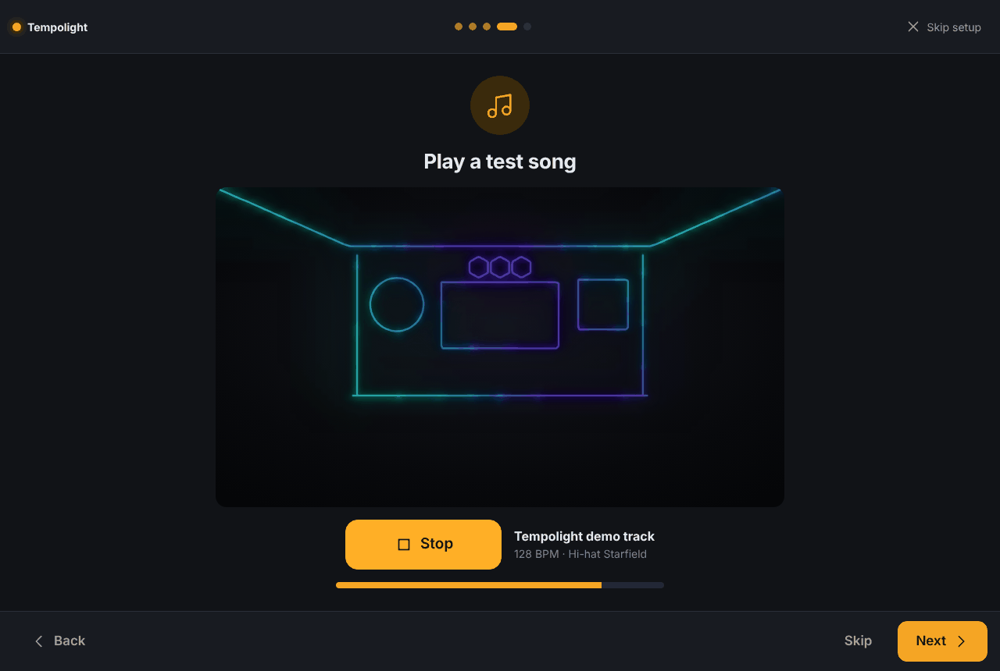
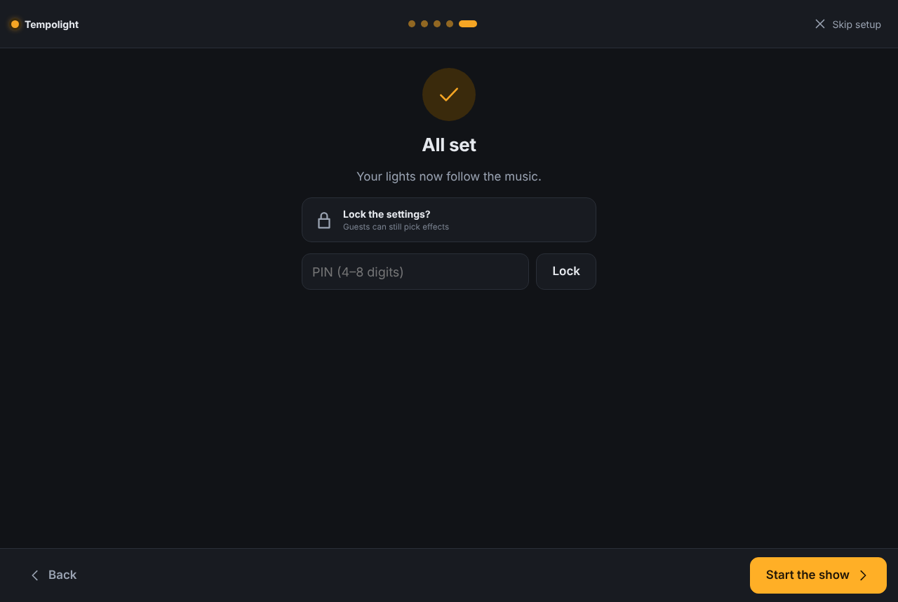

# Your first show

From nothing to lights moving with music in about ten minutes. You need a computer (Windows, Mac, Linux or a
Raspberry Pi) on the same Wi-Fi as your lights. No lights yet? You can still try everything with a pretend room on
screen, or in the [online demo](https://tempolight.pages.dev) without installing anything.

## 1. Install

Pick one. All of them run the same app; [install.md](../install.md) has every option in detail.

| Your computer | Easiest way |
| --- | --- |
| Windows 10/11 | Download `tempolight-windows-x64.exe` from the [latest release](https://github.com/D4RKGEEK/tempolight/releases/latest) and double-click it. If Windows says *Windows protected your PC*, click **More info** → **Run anyway** |
| Mac | Download `Tempolight-macos-arm64.dmg` (Apple silicon, M1 and later) or `Tempolight-macos-x64.dmg` (Intel), drag **Tempolight** to **Applications**. The first time, right-click it → **Open** → **Open** |
| Linux PC | `tempolight-linux-x64.tar.gz` from the release, or `brew install d4rkgeek/tempolight/tempolight` |
| Raspberry Pi | Flash the ready-made image: [raspberry-pi.md](../raspberry-pi.md). It opens at **http://tempolight.local** |
| Anything with Docker | [docker.md](docker.md) |

When Windows or macOS asks whether Tempolight may accept incoming connections, choose **Allow** (private networks).
Without it, your phone can't open Tempolight and some lights can't be found.

## 2. Open it

Starting Tempolight opens your browser at **http://localhost:8080**. If it doesn't, type that address yourself. The
window (or terminal) that opens also lists an **On your phone** address such as `http://192.168.1.20:8080`: open that
on any phone or tablet on the same Wi-Fi to control the lights from there, and use **Share → Add to Home Screen**
(iPhone) or **Install app** (Android) to keep it as an app.

## 3. The setup wizard

On the first start, with no lights added yet, a full-screen wizard opens by itself. The dots at the top show where
you are; **Back** and **Skip** are at the bottom, **Skip setup** (or the Esc key) at the top right closes it. You can
run it again any time from **Settings → About → Run setup again**.

### Step 1: Find your lights

The wizard looks for lights on your network straight away (*Looking for lights…*). It finds WLED controllers, Govee
lights with LAN Control, LIFX, WiZ, TP-Link Kasa, Yeelight and Twinkly lights, and PC lighting from OpenRGB.

- **Found some?** Each one is a tile. Tap a tile to add it (it gets a tick), or tap **add all**.
- **None found?** Tap **look again**, or tap **Type an address** and enter the IP address shown in the WLED app (for
  example `192.168.1.42`), then **Add**. Philips Hue and Nanoleaf aren't found by the scan: add them later on the
  Devices page ([connect-lights.md](connect-lights.md)).
- **No lights yet?** Tap **Try without lights**. It adds a *Virtual room*: a living room drawn on screen that shows
  exactly what real lights would.

The line at the bottom says *N lights ready*. **Next** works once at least one light is added.

### Step 2: Pick your room

Each picture is a room layout drawn with your own controllers. Tap the one closest to your room. If you're not sure,
**One strip per controller** is the simplest and always works. You can change everything later on the Room page
([room-and-zones.md](room-and-zones.md)).

### Step 3: Fix the timing

Speakers (Bluetooth ones especially) play the sound a little late, so the lights would flash before you hear the beat.
Turn the speakers up, tap **Start** and stay quiet for 5 seconds: Tempolight plays a few clicks, listens with the
microphone and sets the delay. It says, for example, *Done. Speakers: 180 ms. Lights set +160 ms.*

- *Nothing heard* or *The clicks were hard to hear*: turn the speakers up, move closer and tap **Again**.
- *This browser can't use the microphone here*: browsers only allow the microphone on `localhost` or a secure (https)
  page. Tap **Skip** and do it later on the computer running Tempolight (**Music → Timing → Fix the timing
  automatically**).

### Step 4: Play a test song

Tap **Play**. Tempolight first listens to the whole song (*Listening to it first… 40%*), then plays it with the lights.
Below the button you see the tempo and the effect that's showing. Your real lights do the same as the picture.

### Step 5: All set

Optional: type a PIN (4 to 8 digits) and tap **Lock**, so guests can't change your devices and settings (they can
still pick effects). Then tap **Start the show**. You land on the Home page.

## 4. Your first show

The Home page shows the live preview, what's playing, and the main controls. Play your own music:

1. Open **Music** in the menu.
2. Tap **Add songs…** and pick a few songs from your computer (MP3, M4A, WAV, OGG, FLAC). Nothing is uploaded: songs
   play in the browser, and each one is analysed first, so the lights know where the build-ups and drops are (they're
   marked on the progress bar).
3. Or play music anywhere else (Spotify, YouTube, a DJ app) and tap **Listen to this computer's sound** or **Listen
   with a microphone**. Which source is best for you: [music-sources.md](music-sources.md).

The **Lights** switch and the brightness slider at the top work on every page. The lights follow the music by
themselves (*Automatic*); pick an effect by hand on **Effects** and go back with **Back to automatic**.

## One look per song

Tempolight picks one effect for each song. It fits the song: fast dance music gets an effect that hits on every
kick, a ballad gets a calm one. The colours come from the song's mood.

The effect stays for the whole song. It still moves with the music: it speeds up and slows down with the tempo, gets
stronger in build-ups, changes colour at new parts of the song, and pumps and flashes at the drops.

- **Music** shows the look under the song map in *In sync*, for example *Kick Shockwave · Sunset (fast
  four-on-the-floor, high energy)*.
- Don't like it? Tap **Not this one**. You get the next best look, and that one won't come back for this song.
- Like it? Tap **Keep**. The song keeps this look.
- With live listening, Tempolight picks a look after a few seconds and keeps it for the song.

Want more change? Open **Effects** → *How effects are chosen* → **Variety**:

- **One look per song**: one effect for the whole song (the default).
- **Song parts**: one effect each for calm parts, build-ups and drops.
- **Show (changes often)**: effects change with the song, every few bars.

## Is it in sync?

The **In sync** panel at the top of **Music** tells you how well Tempolight follows the beat.

- **Locked**: the lights are on the beat.
- **Finding the beat**: it is still working out the tempo. Give it a few seconds.
- **Not hearing**: nothing to follow. Play a song or start listening.

The bar shows how sure it is, from 0 to 100. The dot marked **1** flashes on the first beat of each bar.

Under the meter, one line tells you why, or what to do:

- *Too quiet — turn it up or move the mic closer*: the sound is too soft to hear the beat.
- *No drums — following the melody*: a song without drums. The tempo is a guess, so it never says Locked.
- *Finding the beat…*: it hears music, but the beat isn't clear yet.
- *Following the song's beat map*: a song it knows. It knows every beat, build-up and drop ahead.
- *Beat from DJ Link* (or MIDI clock, Ableton Link): the beat comes from your DJ gear or music app.

On **Home**, a small dot before the status line shows the same thing: green is locked, amber is finding the beat,
grey is not hearing. Tap it to open **Music**.

### The song map

Below the meter is a map of the song playing now.

- The bars show how loud the song is.
- The colours are the parts: blue is calm, amber is a build-up, pink is a drop.
- The letters name the sections. Parts that repeat get the same letter, so a chorus that comes back is **B** again.
- A small pink mark is a drop. The dashed line is the next drop, and the line under the map counts down to it.
- The line with a dot on top is where the song is now. What is still to come is paler.

For songs played here or remembered, the whole map is there from the start. For a song heard live that Tempolight
doesn't know yet, the map grows as it plays.

## Where next

- [Connect more kinds of lights](connect-lights.md): Hue, Nanoleaf, LIFX, DMX fixtures and more
- [Draw your real room](room-and-zones.md), so effects move across it the way it really is
- [Spotify](../spotify.md): the lights follow Spotify with the whole beat map
- [Parties and DJs](party-and-dj.md), [smart home and voice](smart-home.md), [streamers and gamers](creators.md)
- Something not working? [troubleshooting.md](troubleshooting.md)
