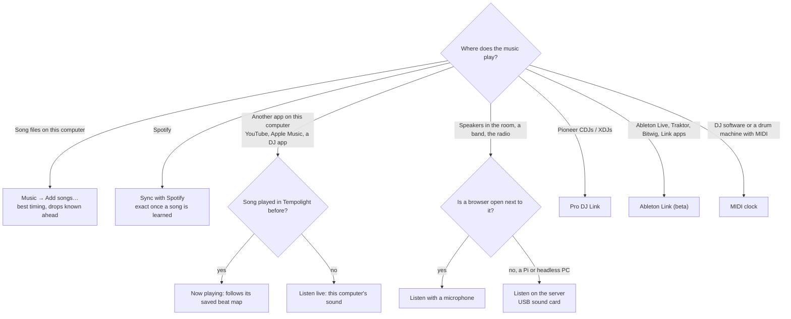
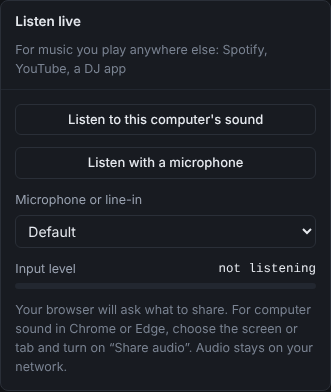
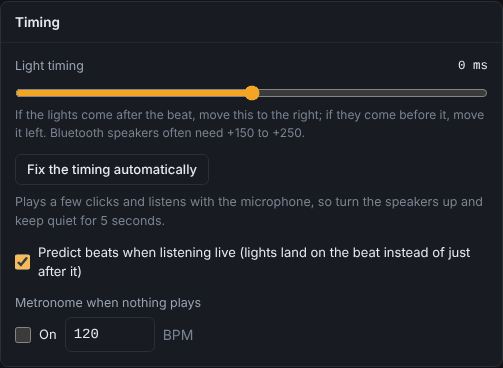
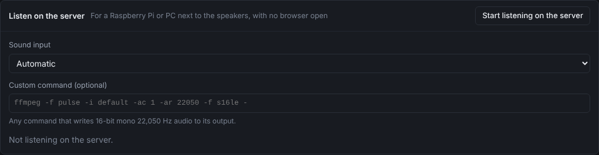
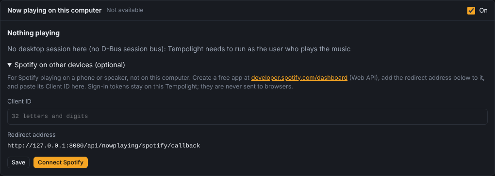

# Where the music comes from

Tempolight has to know the music to light it: at least what it hears right now, at best the whole song ahead of time,
so it knows where every beat, build-up and drop is. There are several ways in, and they combine. This page helps you
pick.

## The sources at a glance

| Source | Where | What Tempolight knows | Best for |
| --- | --- | --- | --- |
| Songs in the app | Music → Play songs | the whole song: beats, bars, build-ups, drops, before they play | parties with your own files; the best timing |
| Listen live: this computer's sound | Music → Listen live | what it hears, right now | Spotify, YouTube, any app, on the same computer as the browser |
| Listen live: microphone | Music → Listen live | what the microphone hears | live music, a speaker in the room, a phone as the "ear" |
| Listen on the server | Music → Listen on the server | what a sound card on the Tempolight computer hears | a Raspberry Pi or PC with no browser open |
| Now playing on this computer | Music → Now playing on this computer | which song an app plays and where it is in it | songs it has heard before: exact without listening |
| Sync with Spotify | Music → Sync with Spotify | the Spotify track, its position, and its learned beat map | Spotify on this computer, your phone or a speaker |
| Song memory | Music → Song memory | recognises a remembered song in about 15 s while listening live | the same songs again, from any source |
| Pro DJ Link | Settings → Integrations | tempo and bar position from the decks | Pioneer CDJ / XDJ setups |
| Ableton Link (beta) | Settings → Integrations | tempo and beat of a Link session | Live, Traktor, Bitwig, Link apps |
| MIDI clock | Live pads → MIDI controller | the beat (24 clocks a beat), bar from Start | DJ software, drum machines |
| Metronome | Music → Timing | a steady beat you set | testing, an ambient pulse |
| Tap the beat | Music → What Tempolight hears, or the **T** key on Live pads | tempo and beat from 4 taps | fixing a tempo it got wrong |

Hearing live is always the fallback: whenever a song isn't known, Tempolight reacts to what it hears, if it hears
anything.

## Songs in the app

**Music → Add songs…** (MP3, M4A, WAV, OGG, FLAC) or **Play the demo track**. Each song is analysed in the browser
before it plays (*Analysing … 40%*), so Tempolight knows the whole song: drops are marked on the progress bar and the
lights build up to them. Nothing is uploaded; only the beat map goes to the server.

Every song played this way is **remembered** (Music → Song memory): when it plays again from anywhere else (Spotify,
a DJ, the radio) while Tempolight listens live, it's recognised in about 15 seconds and followed with its full beat
map. Each remembered song also gets an automatic **show** (a timeline of effects, one block per part of the song),
which you can change under the song or in the show editor (**Edit show**).

## Listen live

- **Listen to this computer's sound**: the browser asks what to share. In Chrome or Edge choose the screen or the tab
  and turn on **Share audio**. What a browser can share depends on the browser and the system: on Windows the whole
  system's sound; on a Mac, without extra software, often only a browser tab. To hear the Spotify app, Apple Music or
  a DJ app on a Mac, set up a capture device as described in [hearing-music.md](../hearing-music.md).
- **Listen with a microphone**: pick the input under **Microphone or line-in** (a USB audio interface or line-in
  works too). The **Input level** bar should move with the music; *very quiet: turn it up or move closer* means it
  hardly hears anything.
- **Stop listening** ends it.

Browsers only allow capture on `localhost` or a secure (https) page: run the browser on the computer that runs
Tempolight (or the one that plays the music, opened as `http://localhost:8080` there), or use server capture. Phones
can't share their system sound; they can use the microphone on a secure page.

With a microphone, the lights see the music after the speakers play it, so **fix the timing** once: **Music → Timing
→ Fix the timing automatically** (speakers up, quiet for 5 seconds). By hand: move **Light timing** right if the
lights come after the beat; Bluetooth speakers often need +150 to +250 ms. **Predict beats when listening live**
(on by default) makes the lights land on the beat instead of just after it. It also lets slow lights (Hue, WiZ) and
fast ones (WLED) flash together: see [slow and fast lights](troubleshooting.md#slow-and-fast-lights-together).

## Listen on the server

For a Raspberry Pi or a PC next to the speakers with no browser open: plug in a USB sound card (line-in or a
microphone), pick it under **Sound input** (or leave *Automatic*) and press **Start listening on the server**. It
needs `ffmpeg` (or PulseAudio / ALSA tools on Linux: `sudo apt install ffmpeg`). From a terminal: `tempolight
--list-audio` lists the inputs, `tempolight --audio auto` starts listening at launch. **Custom command** takes any
command that writes 16-bit mono 22,050 Hz audio to its output. Setting up capture of the computer's own sound
(loopback) on each system: [hearing-music.md](../hearing-music.md).

## Now playing on this computer

Tempolight reads what Spotify, Apple Music and other players on the computer it runs on are playing (macOS: Spotify
and Music; Linux: any MPRIS player through playerctl; Windows: apps in the media controls). For a song it remembers,
the lights then follow the saved beat map at the player's position, *as if it played here*: nothing needs to be heard.
For other songs it says so and you listen live. Windows doesn't tell the track's position for every app; then
listening live is needed. Not available in Docker ([docker.md](docker.md)).

## Sync with Spotify

The lights follow the Spotify track that plays, on this computer or on your phone or a speaker, with its whole beat
map: learned the first time it plays while Tempolight listens, or shared by other installs. Everything about it is in
[spotify.md](../spotify.md).

## DJ sources

- **Pro DJ Link**: Settings → Integrations → *Pioneer Pro DJ Link*. Tempolight listens to the beat packets of CDJs
  and XDJs on the same network (plug the computer into the same switch as the decks) and takes the tempo and bar
  position from the deck that's on air. It only listens: it never joins as a player, so it can't disturb the setup.
- **Ableton Link (beta)**: Settings → Integrations → *Ableton Link*. Follows the tempo and beat of a Link session
  on the same network. Listen-only, never changes the tempo. Written from the open protocol and tested against a
  pretend peer; not yet checked with Ableton Live itself. Bars assume 4 beats.
- **MIDI clock**: Live pads → MIDI controller → **Connect**, then tick **Follow MIDI clock from** and pick the input.
  Needs a browser with Web MIDI (Chrome or Edge on a computer). *Start* sets beat 1 of the bar; without it the status
  says *the bar is a guess*.

More for DJs in [party-and-dj.md](party-and-dj.md).

## What it hears

**Music → What Tempolight hears** shows the spectrum, tempo, song part (*Calm*, *Build-up*, *Drop*, *Quiet*), style,
whether someone is singing, and the key and mood (which set the colours when the palette is *Automatic* and **Mood
colours** is ticked). The status bar at the bottom of every page shows the source, effect and tempo.

## Advanced

- Several sources at once: a song played in the app always comes first; Spotify sync and now playing follow their
  beat maps; live listening fills in the rest and, when both run, keeps a map locked to the kicks it hears.
- The audio stays on your network: the browser sends what it hears to the Tempolight server over its WebSocket.
- OSC (Settings → Integrations → *OSC control*) can set effects and scenes from a lighting desk or TouchOSC, and the
  HTTP API can also tap the tempo (`POST /api/action {"type": "tap"}`, see [api.md](../api.md)).
