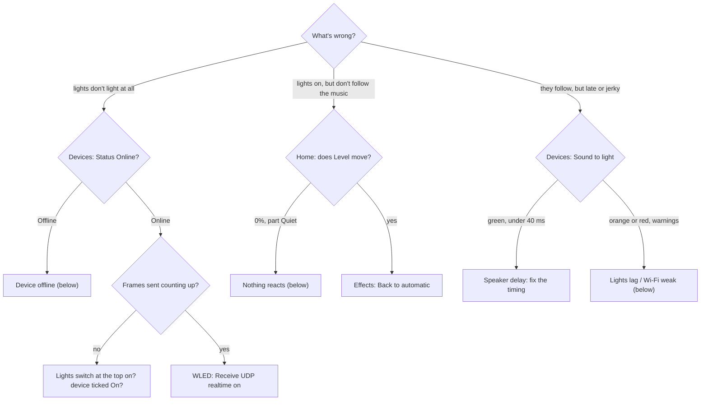
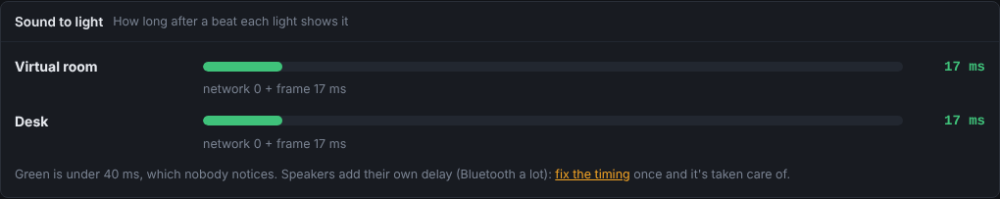

# Troubleshooting

Find what you see in the left column. Most problems are one of three things: the lights and Tempolight aren't on the
same network, Tempolight doesn't hear the music, or Wi-Fi is weak.

## The latency meter

**Devices → Sound to light** shows, for each light, roughly how long after a sound it shows it, and what may be
wrong. The same delay is in the **Delay** column of the Devices table, and Home shows a badge with the slowest light
(*Delay 34 ms · 1 warning*). Hover a bar (or read the line under it) to see what the delay is made of:

| Part | What it is |
| --- | --- |
| sound in | listening live only: the browser's capture and the trip to the server, or the sound card's buffer |
| listening | listening live only: the analysis reacts about 23 ms after the sound |
| network | half the round trip to the controller |
| frame | waiting for the next frame on both ends; slow lights add their own (Hue basic 100 ms, WiZ and Kasa 100 ms, LIFX and Yeelight 50 ms, Twinkly 40 ms, Nanoleaf and Govee 33 ms) |
| timing | your **Light timing** offset, taken off (positive shows the light earlier) |

**Green** is under 40 ms, which nobody notices; **orange** under 80 ms; **red** above. Songs played in the app don't
have the first two parts: their beat map is known ahead. What the meter can't see is your speakers' own delay
(Bluetooth adds a lot): that's what **Fix the timing automatically** measures.

The warnings it shows:

| Warning | What to do |
| --- | --- |
| *Not answering. Check it has power and is on the same Wi-Fi.* | see [Device offline](#device-offline) |
| *Weak Wi-Fi (40%): lights may stutter.* / *Very weak Wi-Fi: frames will be lost.* | see [Wi-Fi weak](#wi-fi-weak) |
| *Slow network: 70 ms each way to the controller.* | a busy or distant Wi-Fi, a mesh hop, or a VPN in between |
| *WLED isn't showing our stream.* | in WLED: Config → Sync Interfaces → turn on **Receive UDP realtime** |
| *Dropping frames: it shows 25 of the 60 a second we send.* | lower **Frame rate** in Settings (30–40), or improve the Wi-Fi |
| *WLED's own power limit is holding brightness back* | raise WLED's limit (LED Preferences) if your power supply allows it |
| *The power limit is holding brightness back right now.* | Tempolight's own **Power limit (A)** on the Devices page is working; raise it only if the supply allows |

## Lights lag behind the music

| Cause | Fix |
| --- | --- |
| speakers play late (Bluetooth, a TV's sound processing, a party PA) | Music → Timing → **Fix the timing automatically**, or move **Light timing** right (Bluetooth often +150 to +250 ms) |
| listening through a microphone across the room | sound takes 3 ms a metre; fix the timing with the microphone where it stays |
| weak Wi-Fi, frames dropped | see [Wi-Fi weak](#wi-fi-weak) |
| slow lights (Hue basic, WiZ, Kasa) | they take about 10 updates a second: give them calm effects with a [zone](room-and-zones.md#zones); Hue fast mode helps |
| the computer can't keep up | Settings → Lighting → **Performance**: *Low power*; the line under it shows the frame time and CPU |
| the lights come *before* the beat | move **Light timing** left |

## Nothing reacts to the music

| What you see | Cause | Fix |
| --- | --- | --- |
| Home: source *Idle*, **Level 0%** | nothing plays in Tempolight and it doesn't listen | play a song on the Music page, or start **Listen live** |
| Level stays at 0%, part **Quiet**, source ends in *(quiet)* | it listens, but hears silence | wrong input: pick another under **Microphone or line-in**; when sharing the computer's sound, tick **Share audio**; on a Mac, set up a capture device: [hearing-music.md](../hearing-music.md) |
| *very quiet: turn it up or move closer* under Input level | the microphone hardly hears it | move closer, turn up, or use a line-in |
| **Listen to this computer's sound** is missing | phones can't share system sound | use a song file, the microphone, or a computer |
| *Needs microphone access, which this browser only allows on localhost or HTTPS* | you opened Tempolight by its network address | open `http://localhost:8080` on the computer running Tempolight, or use **Listen on the server** |
| the lights show one effect and don't change | a fixed effect is picked | Effects → **Back to automatic** (or Home → Effect choice: *Automatic*) |
| everything is dim and calm | night mode or a zone's brightness | Settings → Night mode; Room → Zones |
| *No capture tool found on the server* | listening on the server needs ffmpeg | `sudo apt install ffmpeg` (or PulseAudio/ALSA tools), then reload |

## Device offline

| Cause | Fix |
| --- | --- |
| the light has no power, or is still starting | wait a minute; WLED's own page `http://<address>` should open |
| it got a new address from the router | Tempolight finds a WLED that moved by its name; otherwise type the new address in the Devices table. Give it a DHCP reservation in the router |
| Tempolight is on another network (guest Wi-Fi, a VPN, a second router) | put both on the same network and subnet |
| Docker without host networking | add lights by IP; [docker.md](docker.md) |
| Hue / Nanoleaf refuse after a reset | remove the device and add it again (link button / power button first) |
| Kasa: added, but never answers | Tapo and newer Kasa firmware need a TP-Link account and aren't supported |
| Yeelight answers once a second only | LAN Control on, and the firewall must let the light connect back ([connect-lights.md](connect-lights.md#yeelight)) |
| **Check** in the Devices row says *Offline: …* | the text after it is the reason (timeout, refused, …) |

## No lights found

| Cause | Fix |
| --- | --- |
| different networks (guest Wi-Fi, 5 GHz vs 2.4 GHz on routers that keep them apart, VLANs) | same network for both |
| Windows or macOS firewall blocked Tempolight | allow Tempolight on private networks (Windows: Windows Security → Firewall → Allow an app) |
| Docker Desktop | discovery can't work there: add by IP |
| Hue or Nanoleaf | never found by the scan: add them by address ([connect-lights.md](connect-lights.md)) |
| Govee, WiZ, Yeelight | turn on local control in their app first |

## Wi-Fi weak

The **Status** column shows Wi-Fi bars for WLED controllers, and the latency meter warns below 45%.

- Move the controller (or the router) closer, or turn the controller so its antenna isn't behind the LED power supply
  or metal.
- Use a 2.4 GHz network the controller sees well; many ESP boards only do 2.4 GHz.
- Lower the frame rate: Settings → Lighting → **Frame rate** 30–40 fps.
- For many LEDs or a busy network, an ESP32 with Ethernet (WLED supports several boards) solves it for good.
- In WLED, tick **Disable WiFi sleep** (Config → WiFi Setup).

## Wrong colours or LEDs

| What you see | Fix |
| --- | --- |
| red is green (or blue) | the colour order in WLED's LED Preferences (GRB or RGB) |
| only part of the strip lights | the LED count in Devices, or the shapes' counts on the Room page, is lower than the strip |
| a chase runs the wrong way | tick **Reverse** for that shape |
| effects jump in odd places | shapes overlap or are in the wrong order: Room → Controllers warns; use **Identify** |
| it's too dark at full brightness | the power limit is capping it (see the warnings above) |

## Spotify problems

The common ones (redirect URI, Premium, the 5-user limit, *Level 0%*, Docker on a Mac) have their own table:
[spotify.md → Troubleshooting](../spotify.md#troubleshooting).

## Docker

*Container name already in use*, port in use, no lights found, lost settings: [docker.md → Problems](docker.md#problems).

## Raspberry Pi and its setup hotspot

| What you see | Fix |
| --- | --- |
| http://tempolight.local doesn't open | some Android phones and older Windows don't resolve `.local`: find "tempolight" in your router's list and open `http://<its address>:8080` |
| **Tempolight-Setup** doesn't appear | wait 2 minutes after power-on; with an Ethernet cable plugged in it doesn't open by itself (use Settings → Wi-Fi → **Set up Wi-Fi again**) |
| the setup page doesn't open by itself | open `http://10.42.0.1` while on Tempolight-Setup; turn off mobile data if the phone keeps using it |
| the Pi joins, then Tempolight-Setup comes back | wrong password, or a 5 GHz-only network on a Pi 3 Model B or Zero 2 W (they only have 2.4 GHz) |
| hidden network | pick *Another network* and type its name |
| stutters on a Pi Zero or Pi 3 | Settings → Lighting → Performance: *Low power* (picked by itself on those) |

More in [raspberry-pi.md](../raspberry-pi.md#troubleshooting).

## Other

| What you see | Fix |
| --- | --- |
| *Port 8080 is already in use. Is Tempolight already running?* | it probably is: open http://localhost:8080. Or start with `--port 8081` |
| *Settings are locked. Unlock with the PIN in Settings.* | enter the PIN in Settings. Forgot it? Stop Tempolight, open `tempolight.json` in the data folder (`~/.tempolight`; on the Pi image `/var/lib/tempolight`), change `"lock": {…}` to `"lock": null`, start again |
| the phone can't open the address | same Wi-Fi? Allow Tempolight through the computer's firewall; use the *On your phone* address Tempolight prints |
| the camera won't start on a phone | phones need https for the camera: [room-and-zones.md](room-and-zones.md#map-with-the-camera) |
| Apple Home can't find Tempolight | same network, not Docker Desktop: [smart-home.md](smart-home.md#apple-home) |
| Home Assistant says nothing | Settings → Home Assistant must say *Connected*: [smart-home.md](smart-home.md#home-assistant) |

## Still stuck

Home → **Activity** shows what Tempolight did and any warnings. Open an issue at
[github.com/D4RKGEEK/tempolight/issues](https://github.com/D4RKGEEK/tempolight/issues) with what you see there, the
version (Settings → About) and how you installed it.
