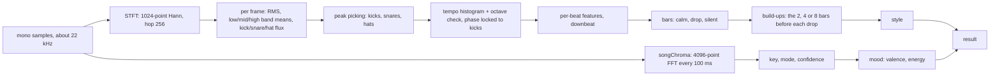

# Whole-song analysis

`preAnalyseCore(x, sr, onProgress)` in [`packages/engine/src/analysis.js`](../../packages/engine/src/analysis.js)
analyses a whole song once, before it plays. It runs in the browser when a song is added on the Music page
(`apps/web/audio.js` decodes the file, mixes to mono, halves the rate above 32 kHz so 44.1 or 48 kHz become ~22-24 kHz, and calls
it), in the server on each stretch of a Spotify track heard while learning it (`spotify-learn.js`), and in tests on synthetic songs. It is `async` only to yield (`setTimeout(0)` every
600 frames) so a page stays responsive; there is no I/O.



## Steps

**STFT.** 1024-point frames with a Hann window, hop 256 (11.6 ms at 22,050 Hz), a radix-2 FFT written inline. Per
frame it keeps the RMS, the mean magnitude in three bands (low 40-150 Hz, mid 300-2,000 Hz, high 4-11 kHz) and the
positive spectral flux (sum of magnitude increases) in three onset bands: kick 40-130 Hz, snare 180-320 Hz
(x 0.6) plus 1.8-5 kHz (x 0.4), hi-hat 7-11 kHz.

**Onsets.** `pick(flux, minGap, k, strength)` takes local maxima above `k` times the mean of a ±350 ms window, keeps
those stronger than `strength` times the 90th percentile of all peaks, and enforces a minimum gap. Kicks: gap 200 ms,
k 1.6, and the low band must also carry real energy (above 35% of its 90th percentile), so a bass line's attack doesn't
count. Snares: gap 100 ms, k 1.5. Hats: gap 60 ms, k 1.4.

**Tempo.** Kicks and snares together (backbeat genres need the snare) vote into a histogram of 60-180 BPM in half-BPM
steps: every pair of onsets less than 4 s apart, divided by 1 to 4 beats, adds a Gaussian (σ 0.7 BPM, weight 1/m).
A broad prior centred on 112 BPM breaks ties. Then an **octave check**: for the winner and its x2, /2, x1.5, /1.5,
x4/3 and x0.75 relatives (within 58-185 BPM), a phase fit (the resultant length of onsets on a circle of one beat,
searched ±1 BPM in 0.05 steps) times the square root of how many grid beats have an onset within 70 ms, times a
prior, picks the tempo and its offset. With 8 or more kicks the phase is re-fitted to the kicks alone, so off-beat
hi-hats can't pull beat 1 half a beat late. Tempos above 150 BPM are halved (lights read better at half time).

**Beats and bars.** Per beat: mean low, RMS, high and mid. The downbeat (`barOff`, 0-3) is the beat position whose
energy jumps (low band and RMS, squared) are largest, because new sections start on beat 1. Bars are 4 beats from
there.

**Song parts.** Each bar's low, RMS, high, snare count and low/mid dominance are normalised between their 10th and
90th percentiles over the song. A bar is:

- `silent`: normalised RMS under 0.05 and RMS under 30% of the median;
- `drop`: low band over 0.55, dominance over 0.5, RMS over 0.45 and at least 3 kicks in the bar;
- `calm`: otherwise.

A single bar different from both neighbours takes their state (except silence). **Build-ups**: before each drop that
follows a non-drop bar, the phrase of 2, 4 or 8 bars with the strongest rise in tension (snares + 2 x hi-hats +
0.5 x RMS, inside the phrase versus the phrase before, times √L) becomes `build`. Each first drop bar's start time is
a drop.

**Loudness envelope.** RMS every 20 ms, divided by the 95th percentile, as `env` (`Float32Array`). It drives
`songView().loud`, the silence check and song memory's fingerprint.

**Style.** From the song's character: hi-hats per second, snares per second, the share of beats with a kick on them,
the dynamic range (90th / 25th percentile of the envelope above 0.02) and the tempo:

| Condition | Style |
| --- | --- |
| not percussive (hats ≤ 2/s and snares ≤ 3.2/s), dynamic range > 2.5 | `emotional` |
| not percussive | `chill` |
| at least one drop, kicks on > 25% of beats, ≥ 110 BPM | `party` |
| < 102 BPM | `hiphop` |
| otherwise | `poprock` |

**Key, mood and chroma** come from [`tonal.js`](../../packages/engine/src/tonal.js):

- `songChroma()` runs a `ChromaTap` over the song: every 100 ms a 4096-point FFT (about 186 ms at 22 kHz, fine enough
  for semitones down to ~80 Hz); spectral peaks from 65 Hz to 4.2 kHz above 2% of the strongest are placed on the 12
  pitch classes at their interpolated frequency (weighted down above 1 kHz); each frame is scaled so its strongest
  class is 1 (all zeros for quiet or noisy frames). It also gives the median spectral-centroid brightness (350 Hz is 0,
  2.8 kHz is 1).
- `keyOf(avg)`: Pearson correlation of the average chroma with the 24 rotated Krumhansl-Schmuckler profiles; the best is
  the key. `confidence` grows with the gap to the runner-up; `majorness` (-1 to 1) compares the best major and minor fits.
- `moodOf(f)`: `energy` from percussion (hats, kicks on beats), tempo, brightness and onset rate (tempo and onsets count
  only as much as there are drums, because a piano piece's attacks pass for snares); `valence` from majorness
  (weighted by confidence), brightness and tempo. Both 0 to 1. `moodName()` turns them into a word (euphoric, happy,
  peaceful, wistful, melancholic, tense, intense).
- `packChroma()`: the 10-a-second frames averaged in pairs (5 a second), each class as 4 bits of `sqrt(v / max)`, so
  6 bytes a frame, base64. This is song memory's second fingerprint.

## Output

```js
{
  bpm, P,            // tempo and beat length in seconds (P = 60 / bpm)
  off, barOff,       // time of a beat (s) and which beat (0-3) of the grid starts a bar
  kicks, snares, hats, // onset times in seconds, sorted
  bars: [{t0, t1, state: "calm"|"build"|"drop"|"silent", level: 0..1}],
  drops,             // start times of drops
  env,               // Float32Array, loudness every 20 ms (1 ≈ loud)
  dur,               // seconds
  style,             // "party"|"poprock"|"hiphop"|"chill"|"emotional"
  key, mode, keyConfidence,  // "A", "minor", 0..1 (null when there are no notes)
  mood: {valence, energy},
  chroma,            // base64, 6 bytes per 200 ms (packChroma)
  features: {kickFrac, dyn, onsetRate, hatRate, snareRate, bright}
}
```

The browser sends this as `POST /api/song {name, analysis, clientId}` (typed arrays become plain arrays in JSON;
`runtime.setSong()` turns `env` back into a `Float32Array`). With song memory on and a song longer than 20 s, the
runtime keeps a compact copy (see [song memory](song-memory.md)) and plans a show for it.

## Reading it back with songView

[`signals.js`](../../packages/engine/src/signals.js) turns an analysis and a time into a *view*, the common shape the
director takes from every source:

| Field | Meaning |
| --- | --- |
| `g` | `gridAt(pre, t)`: `{has, P, phase (0-1 within the beat), idx (beat number), beatInBar (0-3), env (decay since the beat, 0.18 s), barPhase (0-1 within the bar), beatT (time of this beat)}` |
| `bpm`, `style` | from the analysis |
| `state` | the bar's part (a bar lasts until the next one starts, across gaps under 1 s), or `silent` once the envelope has stayed under 0.1 for 0.6 s (the gaps between the hits of a build-up aren't silence) |
| `buildP` | 0-1 progress through the current run of build bars |
| `loud` | mean envelope over the last 300 ms |
| `level` | `low` / `mid` / `peak` from the bar's level and the loudness |
| `kick`, `snare`, `hat` | time of the last of each (-9 when none) |
| `pulses`, `snares`, `pulseN` | kicks of the last second, snares of the last 0.7 s, index of the last kick |
| `dropT`, `nextDrop` | the last drop's time (-9 when none) and the next one's (null when none) |
| `key`, `mode`, `keyConf`, `mood` | whole-song key and mood |

`metronomeView(t, bpm, grid?)` gives the same shape for a steady beat (state `drop`, level `peak`), optionally on a
grid from DJ Link, MIDI clock or Ableton Link. `LiveAnalyser.view()` gives it for live audio
([live analyser](live-analyser.md)).

## Tests

`packages/engine/test/engine.test.js` and `tonal.test.js` run the analysis on synthetic songs from
`packages/engine/test/synth.js` (an EDM track at 128 BPM with a 4-bar intro, a 4-bar snare-roll build-up and an 8-bar
drop; ballads, pop, voice and plucked notes with known keys) and check the tempo, the drop's position, the parts and
the key. See [testing](testing.md).
