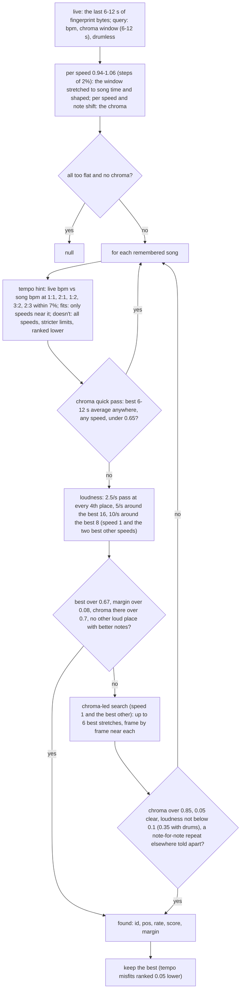
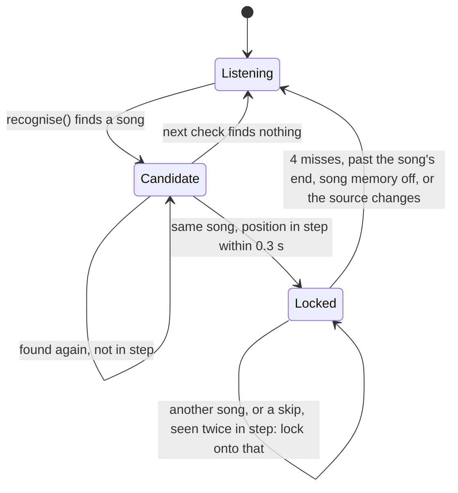

# Song memory

Songs Tempolight has analysed before are remembered, and recognised when they play again from anywhere (Spotify on
a phone, a DJ, the radio) while it listens live. Once a song is recognised, the lights follow its stored beat map, so
build-ups and drops are known ahead of time, as if the song were played in the app. The matching is in
[`packages/engine/src/memory.js`](../../packages/engine/src/memory.js) (pure); the following, locking and storage
in [`packages/server/src/runtime.js`](../../packages/server/src/runtime.js) (the "song memory" section).

## What is stored

A compact copy of a whole-song analysis, about 10-30 kB of JSON (18 kB for 2 minutes, 31 kB for 4), in `tempolight.json` under `songs`:

| Field | What |
| --- | --- |
| `id`, `name`, `at` | `m` + 8 random characters; the song name (≤ 120 characters); when it was remembered (ms) |
| `bpm`, `P`, `off`, `barOff`, `style`, `dur` | the beat grid and style |
| `kicks`, `snares`, `hats` | onset times in seconds, to the millisecond (every second hi-hat only) |
| `bars`, `drops` | `[{t0, t1, state, level}]`, drop times |
| `env` | base64: the loudness envelope at 10 a second, one byte each (`sqrt(min(1, v/1.5)) * 255`) |
| `fp` | base64: the loudness fingerprint, `fingerprint(pre.env)`: 10 bytes a second, `log10` loudness quantised to 0-255 |
| `ch` | base64: the chroma fingerprint (`packChroma`), 6 bytes per 200 ms; missing in entries from older versions |
| `key`, `mode`, `keyConfidence`, `mood` | when known |
| `bx` | base64, 4 bytes a bar, in the order of `bars`: energy (0-255), danceability (0-255), chord (0-23 into `CHORDS`, 255 none), singing (0/1). Missing in older entries, and in maps whose bars were laid out again |
| `ks` | base64, one byte per kick (`kickStrength x 255`), aligned with `kicks`; missing when the counts don't match |
| `sec` | sections as `[[bar0, bar1, label, state], ...]` (bar indices into `bars`, `bar1` exclusive); kept only when they fit the bars |
| `phrase` | `{len: 8 or 16, first}`: the phrase grid, bar indices |
| `show`, `showEdited`, `colors`, `cues`, `bright` | the song's show timeline (see [director and effects](director-and-effects.md#shows-and-timelines)); `showV` and `showKey` say what it was planned with (planner version, variety and look) |
| `look` | the song's look `{main, drop, build, calm, palette, params, why, v, rejected, locked}` (see [looks](director-and-effects.md#looks-one-effect-per-song)): picked when it is remembered, again when the picker changes unless `locked`; `rejected` are the effects turned down for it |
| `spotifyId`, `isrc`, `src`, `cov`, `gridSec` | added by Sync with Spotify: the track ID, where the map came from (`learned`, `shared`, `spotify-analysis`), and for partly learned songs the covered stretches `[[t0, t1], ...]` |

`memoryAnalysis(e)` turns an entry back into an analysis that `songView()` can use (the envelope expanded to 20 ms
steps). The newer fields come back as in the analysis (bars get `energy`, `dance`, `chord`, `vocal`; `kickStrength`,
`sections` with `t0`/`t1` from the bars, `phrase`). An older entry without `bx` but with `ch` still gets each bar's
`chord`, worked out from the stored chroma (`barChords(unpackChroma(ch), 5, bars)`); one without either simply has
none of them, and everything else works as before. Shaped fingerprints and unpacked chroma are cached per entry in a `WeakMap`, never on the entry, so they
can't end up in the saved file.

**When.** `runtime.setSong()` remembers every song played in the browser that is longer than 20 s (with
`settings.songMemory` on). An entry with the same name and a length within 1.5 s replaces the old one, keeping its
hand-edited show, colours, cues and brightness. Spotify learning saves through the same list (`spotify.js`).

**Limits.** One entry may be at most 400,000 characters of JSON (a long mix isn't remembered, with a note in the log).
All of them together: at most 60 songs and about 2,000,000 characters; the oldest go first. The demo keeps everything
in `localStorage` (~5 MB), which these limits fit.

## Recognising: `recognise(live, entries, query)`

The limits above are for a 12 s window; while fewer than 12 s have been heard (from 6 s) they rise linearly to
+0.1 on the loudness score, +0.04 on its margin and +0.03 on the chroma, and a tempo misfit adds +0.05, +0.03 and
+0.02.

- **Shorter windows.** `ChromaTap.window(n = 60, min = 30)` returns the last 12 s of chroma, or as little as 6 s while
  less has been heard, and the loudness window is the last 12 s or less (at least 6 s). On the synthetic songs a first
  match comes at 6-7 s, and the runtime's lock (two matches a second apart) at about 8 s instead of 14.
- **Speed.** A DJ may play a song a few percent fast or slow. The live window is resampled to song time at 0.94, 0.96,
  ... 1.06 x; the chroma is also tried moved by `12·log2(rate)` semitones (rounded to a half; a song sped up without key
  lock sounds higher, with key lock it doesn't). Speeds other than 1 need a slightly better score (`0.03 + 0.5·|rate - 1|`).
  A runner-up at another speed counts only if it is further than `3 + 60·|Δrate|` steps away (the same place shows a
  little further off at another speed). The result carries `rate` (song seconds per live second). Half-semitone shifts
  (3% without key lock) smear the chroma, so a drumless song sped up 3% like a record is often not found; with drums the
  loudness finds it.
- **Tempo as a hint.** The live tempo used to skip songs whose stored tempo didn't fit (x0.5, x1, x2 within 6%); a pop
  song through a bad speaker heard at 77.5 BPM instead of 116 was then never found. Now a fitting tempo (1:1, 2:1, 1:2,
  3:2, 2:3) narrows the speeds to those near it; a misfit only makes the limits stricter and ranks it lower.
- **Cost.** Each search runs coarse to fine with running sums for the norms; the live side is prepared once per query
  (cached on the `live` array, checked against its length and newest values) and shared by every song. Searching 7
  speeds costs about as much per song as the old single-speed search with a tempo that fits (about 1 ms for a 4-minute
  song on a laptop), and about 1.5 x without one.
- **Loudness fingerprint.** 10 values a second; a match looks at up to 12 s (120 values). Shaping (high-pass against a
  running mean) makes the volume irrelevant; clipping keeps one big jump (a song's end) from deciding alone. The
  runner-up must be at least 0.4 s away, because in a steady part a beat or a bar off looks alike, and following the
  right song a beat late is still wrong.
- **Chroma fingerprint.** For songs without drums (a weak loudness shape, an untrustworthy tempo) the chroma decides:
  the live window is paired into 5-a-second frames two ways (to line up with even and odd 100 ms song offsets),
  centred per frame. The quick pass compares 12 s *averages* from running sums (12 numbers per position, cheap on a
  Raspberry Pi); only near the best few is it correlated frame by frame. A loudness match must also agree in chroma
  (> 0.7) or it is dropped, and in a song that loops a place a few bars on with nearly the same loudness and better
  notes wins; a chroma match must not be contradicted by the loudness, and where a section comes back note for note
  (a second drop) the loudness of the stretch before must tell the two apart. Old entries without `ch` are
  matched on loudness alone.
- `pos` is the song position at the end of the live window, in seconds; `rate` the speed it was found at.
- `matchAt(live, e, pos, range, {chroma, rate})` follows at a given speed; `chromaMatch(chroma, e, pos, rate)` likewise.

**Measured** (synthetic songs: two EDM tracks, pop, two ballads; 8 conditions, from the start and from 40% in, a lock
= two agreeing matches a second apart): found 42/80 before, 64/80 now; median time to lock 14 s before, 8 s now; songs
played 3% faster or 4% slower (or 3% faster in a noisy room) were never found before, now 20 of 30 are. Low-passed pop (whose live tempo read wrong)
is found now. The remaining wrong locks are between the two EDM test tracks, which are the same chords, tempo and
structure at the same times. Unrelated songs (same key, chords and tempo) still never lock.

## Following: the lock

The runtime asks once a second of live audio (`songMemoryTick()`). The frame only takes a snapshot (fingerprint
queue, chroma window, kicks); the matching runs afterwards in slices of 4 ms (`setTimeout(0)` between them, one
remembered song per step), so a long list on a slow computer never makes the lights stutter. `perf.acc.memory`
counts the time.

- **Lock on** (`lockOn`): `refineByKicks(liveKicks, t, pos, songKicks, 0.2, rate)` slides the position ±200 ms in
  5 ms steps until the kicks heard land on the stored kicks (within 30 ms; at least 3 hits and half of the recent
  kicks), then `lock = {id, pos0, t0, rate, miss}`. The position at live time `t` is `pos0 + (t - t0) * rate`.
- **Rate**: `rateOf(an, e)`: the live tempo against the song's at x1, x2 or x0.5; within 6% and more than 1.5% off it
  is a DJ playing the song faster or slower; smaller differences are the estimate wobbling (rate 1). Drumless songs
  always use rate 1.
- **Staying locked**: every second `matchAt(q, e, expected, 0.2, query)` tries only positions within ±0.2 s of where the
  song should be, so a chorus that comes back can't throw it off; with chroma on both sides the score is
  `min(chroma, (loudness + chroma) / 2)`. Above 0.45: reset misses, ease the rate towards the live one, and nudge the
  position halfway towards `refineByKicks(..., 0.08)`. Too flat to tell: fine in a quiet part, but silence where the
  song is loud counts as 2 misses. Otherwise 1 miss. Four misses release the lock.
- **Switching**: a recognised match somewhere else (another song, or a skip within this one) is followed when seen
  twice in step and it scores at least 0.1 better than where we are (or where we are no longer fits).

While locked, the view is `songView(stored, lockPos)` with the live vocal estimate (and the live key and mood for
entries remembered before those existed). `status.recognised` is `{id, name, pos, dur}`; `status.sourceLabel` ends in
`(recognised)`. The show timeline of the song plays too ([shows](director-and-effects.md#shows-and-timelines)).

## Other ways a remembered song plays

- **Now playing** (`nowplaying.js`): a music app on this computer plays a track whose title (and artist, and length
  within 3 s) matches an entry: `rt.nowPlaying.follow()` gives the entry and the app's position, without listening.
- **Sync with Spotify** (`spotify.js`): matched by Spotify track ID first; learns unknown tracks by listening and
  merging stretches; see [spotify.md](../spotify.md).

## API

`GET /api/songs` lists entries (`cover` is the learned percentage of a partly learned song), `DELETE /api/songs/:id`
forgets one (and releases a lock on it), `PATCH /api/settings {songMemory: false}` turns remembering and recognising
off. See [api.md](../api.md#music).

## Tests

`packages/engine/test/memory.test.js` and `tonal.test.js`: recognition from 12 s of live sound with the kicks lined
up; never locking onto a repetitive part at the wrong beat; `matchAt` confirming the song where it should be and not
another; kicks lining up for a song played faster; drumless ballads recognised from the middle though the stored tempo
is off; unrelated songs in the same key, chords and tempo never locking; entries without chroma still matching on
loudness; and entries surviving a save and load unchanged. `analysis.test.js`: recognised after 8-9 s; low-passed
pop recognised with a wrong live tempo, and at 1:2, 3:2 and 2:3; songs 3% faster and 4% slower recognised with their
speed, and with key lock; the newer fields surviving a save, older entries without them still working, and a 4-minute
entry under 34 kB. See [testing](testing.md).
