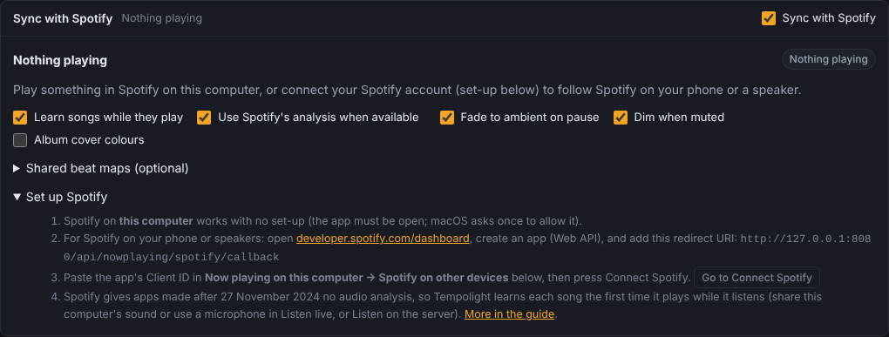
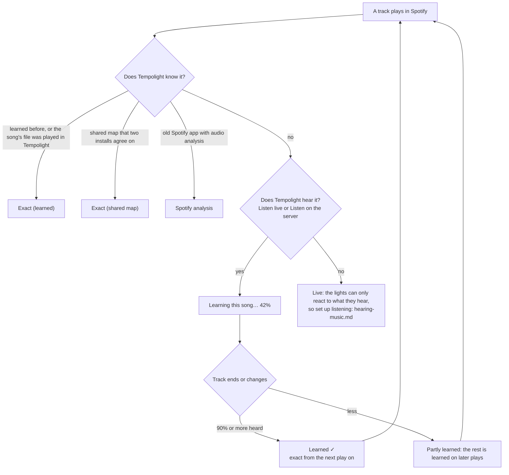
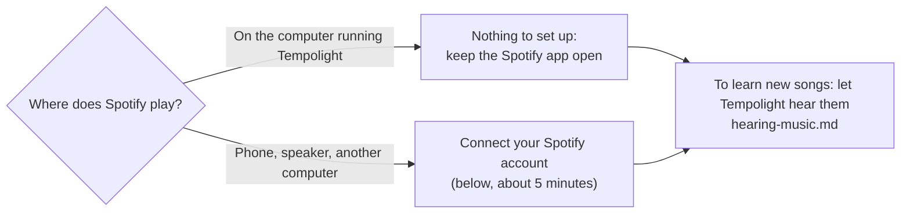
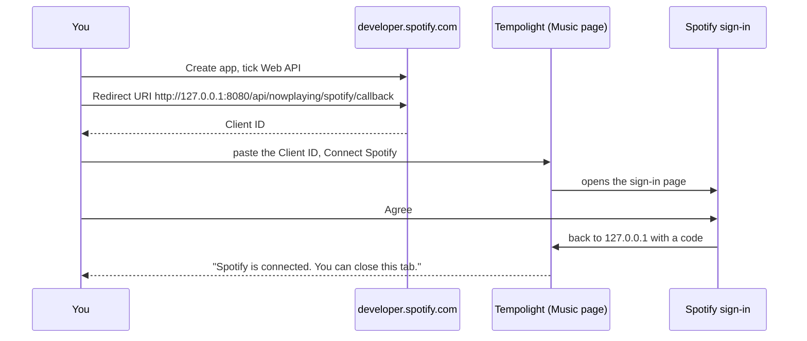
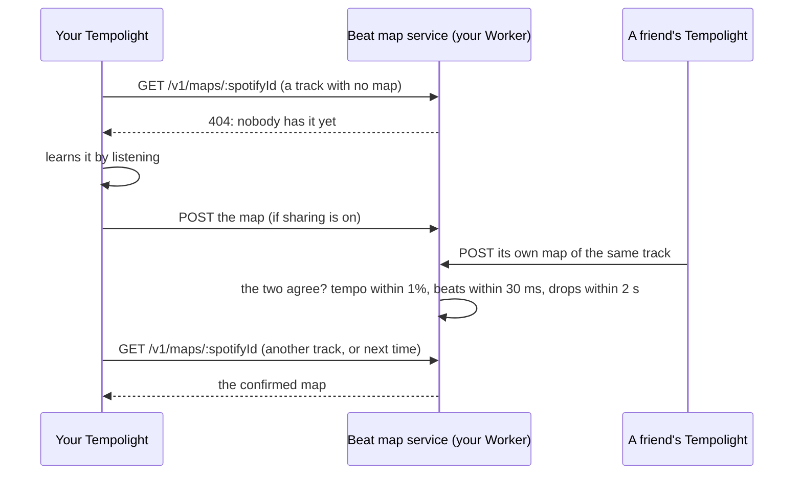

# Sync with Spotify

With **Sync with Spotify** on (Music page, on by default), the lights follow the Spotify track that's playing with its
whole beat map: beats, bars, build-ups and drops are known ahead, as if the song were played in Tempolight. It works
for Spotify on the computer Tempolight runs on (no set-up) and, once you connect your Spotify account, for Spotify on
your phone, a smart speaker or any other device.



## How a song gets its beat map

Spotify doesn't give new apps its audio analysis any more (since 27 November 2024). So Tempolight **learns each song
itself, by listening the first time it plays**, and keeps the map in song memory. From the second play on, the lights
follow the map exactly and nothing needs to be heard.



The badge at the top right of the panel says which it is:

| Badge | What drives the lights |
| --- | --- |
| **Exact (learned)** | a beat map in song memory, at Spotify's position |
| **Exact (shared map)** | a map other Tempolight installs learned and agree on ([shared beat maps](#shared-beat-maps)) |
| **Spotify analysis** | Spotify's own analysis (only Spotify apps made before 27 November 2024) |
| **Learning this song… 42%** | Tempolight is listening while it plays, to build the map |
| **Learned ✓** | the map has just been saved |
| **Live** | no map and not learning: what Tempolight hears, if it hears anything |
| **Paused** | the lights rest on the ambient look |
| **Nothing playing** | no track in Spotify (or the account isn't connected) |

The sentence under the track always says, in words, what's happening and what to do next.

## Set up



### Spotify on this computer

Nothing to do: Tempolight reads the Spotify app's track and position. On a Mac, macOS asks once whether Tempolight may
control Spotify (System Settings → Privacy & Security → Automation): allow it. On Linux it uses MPRIS (playerctl or
dbus-send). On Windows it reads the media controls, which don't give the track ID, so songs are matched by title,
artist and length.

### Spotify on other devices: connect your account

You make a free "app" in Spotify's developer dashboard. It's only a key for your own Tempolight; nothing is published.



1. Open [developer.spotify.com/dashboard](https://developer.spotify.com/dashboard), sign in with your Spotify account
   and press **Create app**.
2. Fill in any **App name** and **App description**. Under **Redirect URIs** add exactly the address Tempolight shows
   (Music → Now playing on this computer → Spotify on other devices → *Redirect address*), with port 8080:

   ```
   http://127.0.0.1:8080/api/nowplaying/spotify/callback
   ```

   - It must be `127.0.0.1`, **not** `localhost`: Spotify allows plain `http` only for that address.
   - The port is Tempolight's port. If you started it with `--port 8081`, the address says `8081`.
   - Press **Add** next to the field, so it shows in the list below it.
3. Under **Which API/SDKs are you planning to use?** tick **Web API**. Agree to the terms and **Save**.
4. Open the app's **Settings**: copy the **Client ID**.
5. In Tempolight: **Music → Now playing on this computer → Spotify on other devices (optional)**. Paste the Client ID
   and press **Connect Spotify**. (The Spotify panel's **Set up Spotify → Go to Connect Spotify** button takes you
   there.)
6. A Spotify page opens: **Agree**. It returns to a page that says *Spotify is connected. You can close this tab.*,
   and the panel says *Connected*.

**Signing in from a phone or another computer?** After you agree, that browser tries to open `127.0.0.1`, which is
itself, not Tempolight, so the page fails to load. That's expected: copy the whole address from its address bar
(`http://127.0.0.1:8080/api/nowplaying/spotify/callback?code=…`), paste it into the box Tempolight shows (*Signing in
on another device?*) and press **Finish**. Signing in on the computer that runs Tempolight avoids this.

**Spotify's limits for your app.** Since February 2026 an app in development mode needs its owner to have
**Spotify Premium**, and it can have at most **5 users**
([Spotify's migration guide](https://developer.spotify.com/documentation/web-api/tutorials/february-2026-migration-guide)).
Someone other than the owner signs in only after the owner adds them in the app's settings (**User Management**, by
their Spotify e-mail). For one household that's enough: each Tempolight uses its owner's own Client ID.

Tempolight uses PKCE (no client secret) and asks only for `user-read-playback-state` and
`user-read-currently-playing`. The tokens stay in `spotify-token.json` next to the settings, and are never sent to a
browser or put in backups. **Disconnect** forgets them.

### Let Tempolight hear new songs

Learning a song needs Tempolight to hear it once, while it plays: **Music → Listen live → Listen to this computer's
sound** (best: it's exactly what Spotify plays), **Listen with a microphone**, or **Listen on the server**. On a Mac
the Spotify app's sound can't be shared from the browser directly; [hearing-music.md](hearing-music.md) shows how to
set up listening on each system. While learning, the Home page's **Level** moves with the music; if it stays at 0%,
Tempolight hears silence (see [Troubleshooting](#troubleshooting)).

## The panel's switches

| Switch | Default | What it does |
| --- | --- | --- |
| Sync with Spotify | on | the whole feature |
| Learn songs while they play | on | listening builds beat maps |
| Use Spotify's analysis when available | on | for old Spotify apps; says *(not available to your Spotify app)* after the first 403 |
| Fade to ambient on pause | on | pause fades to the ambient look |
| Dim when muted | on | volume 0 dims the lights |
| Album cover colours | off | 2 or 3 colours from the cover become the palette while it's *Automatic* |
| Shared beat maps (optional) | off | see [Shared beat maps](#shared-beat-maps) |

Song memory (Music → Song memory) lists learned songs with a **Spotify · learned** badge, and the percentage for songs
learned only in part. **Forget** removes one, so it's learned again.

## Troubleshooting

| What you see | Why | Fix |
| --- | --- | --- |
| Spotify's page says **INVALID_CLIENT: Invalid redirect URI** or **redirect_uri: Not matching configuration** | the redirect URI in the dashboard isn't exactly Tempolight's | copy the *Redirect address* from Tempolight into the dashboard: `127.0.0.1` (not `localhost`), the same port, `/api/nowplaying/spotify/callback`, no slash at the end; press **Add** and **Save** in the dashboard, then **Connect Spotify** again |
| Spotify says the app is in development mode, or the user isn't registered | development-mode limits | the app's owner needs Premium; add other people under **User Management** (5 at most) |
| After **Agree**, the page doesn't load (on a phone) | `127.0.0.1` is the phone itself | paste the address into *Signing in on another device?* and press **Finish** |
| *Spotify signed Tempolight out. Connect again.* | the token was revoked or the Client ID changed | **Connect again** |
| *Spotify asked Tempolight to slow down: asking again in 30 s* | Spotify's rate limit | nothing: Tempolight waits as asked |
| Badge stays on **Live**, Home shows **Level 0%** and part **Quiet** | Tempolight isn't hearing anything, so it can't learn the song | start **Listen live** (or **Listen on the server**) and check the input level moves; on a Mac set up a capture device: [hearing-music.md](hearing-music.md) |
| **Learning** never reaches 100% | you skipped or seeked, or the song is long | it continues on the next play (stretches of 15 s or more count); a song is learned at 90% |
| Badge says **Nothing playing** while Spotify plays on the phone | the account isn't connected, or another account plays | connect (above); check *Spotify on …* shows the right device |
| **Docker on a Mac or Windows doesn't see the Spotify app** | the container can't see the apps on the computer around it | connect your Spotify account (above) instead: the Web API works from Docker. Learning still needs Tempolight to hear the music: a browser's *Listen live* on that computer (opened as `http://localhost:8080`). Or run Tempolight natively: [docker.md](guides/docker.md) |
| The lights are a little early or late | speaker delay | Music → Timing → **Fix the timing automatically**; while Tempolight also hears the music, the map locks to the kicks by itself |
| *Use Spotify's analysis* says *(not available to your Spotify app)* | your Client ID was made after 27 November 2024 | normal: songs are learned instead |

More problems and fixes: [guides/troubleshooting.md](guides/troubleshooting.md).

## Advanced: how it works

### How it stays in sync

- **Position.** When Spotify plays on this computer, its own player gives the position (read every second, exact to a
  few milliseconds); the Web API then only adds the track ID, the cover and the volume (asked every 5 s). Otherwise the
  Web API (`GET /v1/me/player`) gives it: asked every 3 s while a track plays on, every second for 5 s after a skip,
  seek or resume and in a track's last seconds, every 2 s while paused and every 3 s when nothing plays. A 429 answer
  is waited out for its Retry-After.
- Each reading is taken at the middle of its request (Spotify measures `progress_ms` while it answers). Spotify's
  `timestamp` field is documented as the time of the reading but is really the time of the last change of playback
  state ([spotify/web-api#1073](https://github.com/spotify/web-api/issues/1073)), so `progress_ms + (now - timestamp)`
  would be wrong while a track plays on. Tempolight uses a new `timestamp` only as a sign that something changed (a seek
  or resume, even a small one).
- Readings disagree by tens of milliseconds. A difference bigger than the jitter seen so far is a seek; a smaller one
  nudges the estimate (less for slow answers). The position the lights see never jumps for noise: it glides, at most 5%
  faster or slower than real time, so a correction can't make a beat flash twice. Skips, seeks and resumes jump.
- **Locked to the beat.** If Tempolight also hears the music (Listen live, or Listen on the server), the kicks it hears
  are lined up with the map's kicks every second, which corrects the Web API's position to within a few milliseconds.
- **Pause** fades the lights to the ambient look; **a skip** dips them and crossfades to the next song's map;
  **volume 0** dims them. Each can be turned off.
- **Album cover colours** (optional): the browser that shows the Music page loads the cover (Spotify's image server
  allows it), takes 2 or 3 dominant colours on a small canvas and sends them to Tempolight, which uses them as the
  palette while the track plays and the palette is Automatic. No image is decoded on the server.

### Learning songs

When a track with no map plays and Tempolight hears it (a browser sharing this computer's sound or using a microphone,
or the server's sound card), it keeps the sound as it comes, in stretches of continuous listening. For each 100 ms chunk,
the Spotify position at the moment the chunk was captured says where in the track the stretch starts; the median over
all chunks is much steadier than any single reading, and a chunk that suddenly says somewhere else (a seek, a pause, a
gap) starts a new stretch. When the track ends (or changes, or stays paused), each stretch of 15 s or more is analysed
like a song file and its times are moved onto the track's clock, so time 0 is the start of the track even when listening
began in the middle. In the tests, a song learned from 0:10 has its kicks within a few ms and its drop within 30 ms of
the song's own analysis.

A map that covers only part of a track is followed where it covers and learned further on later plays (merged onto one
beat grid, fitted through all the kicks). A track counts as learned when 90% of it is. Tips:

- Sharing the computer's sound is better than a microphone: it is what Spotify plays, before the speakers.
- With a microphone, fix the light timing first (Music → Timing → Fix the timing automatically).
- Learning keeps up to 15 minutes of sound in memory for the track that is playing (about 40 MB) and analyses it in
  slices between frames.

### Spotify's own analysis (older apps)

If your Client ID can still read `GET /v1/audio-analysis/{id}`, Tempolight converts it: the beat grid is fitted through
Spotify's beats and its bars set beat 1; kicks are segments that start on a beat with a hard attack and a dark timbre,
snares hard bright ones on beats 2 and 4, hi-hats softer bright ones between the beats; the loudness curve follows each
segment's loudness; a bar is a drop when it is among the loudest, its section is clearly louder than the quiet ones and
it has kicks, and the 2, 4 or 8 rising bars before a drop are its build-up; key, mode and chroma come from the track and
the segments' pitches. The first 403 is remembered for that Client ID and the endpoint isn't asked again (turning
"Use Spotify's analysis" off and on tries once more). Maps made from Spotify's analysis are never shared.

### Shared beat maps



Optional and off by default. A small service (a Cloudflare Worker with a D1 database, in `worker/beatmaps/`) where
Tempolight installs share the maps they learned, so a song someone else learned follows its full map the first time it
plays here.

- **What is sent**: the Spotify track ID and the map: tempo, beat grid, drum hit times, bars with their parts, drops, a
  loudness curve (10 bytes a second), key and mood, and which part of the track it covers. No title, no name, no
  account. Each install has a random ID (`beatmaps-install-id` next to the settings, never shown or backed up); the
  service stores it and the sender's IP address only as salted SHA-256 hashes.
- **When a map is used**: only once two different installs sent maps that agree: tempo within 1%, beats within 30 ms in
  the middle of what both heard, the drops within 2 s of each other (at least 60% of them), at least 20 s in common.
  Then the map that covers most of the track is served.
- **Checks**: at most 32 KB a map; every number finite and in range, times sorted and inside the track, the grid
  matching the tempo. Rate limits: 200 maps a day per install, 400 per IP address, 3000 reads an hour per IP (in
  `wrangler.jsonc`).

#### Deploy the service

You need a free Cloudflare account and Node.js. From the Tempolight folder:

```sh
cd worker/beatmaps
npx wrangler login
npx wrangler d1 create tempolight-beatmaps        # copy the database_id it prints into wrangler.jsonc
npx wrangler d1 execute tempolight-beatmaps --remote --file=schema.sql
npx wrangler secret put SALT                       # any long random text
npx wrangler deploy                                # prints the address, e.g. https://tempolight-beatmaps.<you>.workers.dev
```

Then in Tempolight: Music → Sync with Spotify → Shared beat maps: paste the address, Save, and turn on **Use shared
beat maps** and, if you like, **Share the songs I learn** (only maps that cover at least 60% of a track, learned by
listening, are sent). Friends running Tempolight can use the same address; a map is confirmed when two of you agree.

The service's API: `GET /v1/maps/:spotifyId` → `{map, installs, updated}` or 404; `POST /v1/maps/:spotifyId` with
header `x-install-id: <32 hex digits>` and body `{map}` → `{ok, confirmed, installs}`. The map format is described at
the top of `worker/beatmaps/src/map.js`. Its tests run under Node with an in-memory D1 (`npm test`).

## API

| Call | Body |
| --- | --- |
| `GET /api/spotify` | `{settings: {sync, learn, analysis, coverColours, pauseFade, muteDim, cloud: {url, use, share}}, on, connected, mode, modeName, via: "local"\|"web", track, map, learn, analysis: "unknown"\|"blocked"\|"off", account: {clientId, connected, redirectUri}, poll: {rttMs, jitterMs, nextInMs}, cloud: {last}, colors}` |
| `PATCH /api/spotify` | admin: any of the settings above (`cloud: {url?, use?, share?}`) |
| `POST /api/spotify/colors` | effects area: `{art: <cover URL>, colors: ["#rrggbb", "#rrggbb", "#rrggbb"]}` (what the browser took from the cover) |

`GET /api/status` has `spotify: {on, connected, mode: "off"|"idle"|"paused"|"exact"|"shared"|"analysis"|"learning"|"live",
modeName, via, error, track: {id, title, artist, album, dur, pos, playing, volume, art, device} | null, map: {id, name,
src: "learned"|"shared"|"spotify-analysis"|"file", cover} | null, learn: {state: "learning"|"analysing"|"learned", pct} | null,
locked}`. `GET /api/songs` gives `spotifyId`, `src` and `cover` (percent learned, for partly learned songs).

Song-memory entries learned or matched for Spotify have `spotifyId`, `src`, `isrc` (when Spotify gives it) and, while
only partly learned, `cov` (`[[from, to], ...]` seconds) and `gridSec`.

## What Tempolight doesn't do

It uses only the documented Web API with your own Client ID. It doesn't use the Spotify web player's private
endpoints, doesn't download, record or keep Spotify audio (the sound it hears while learning is analysed and thrown
away; only the beat map is kept), and doesn't share anything unless you turn sharing on.

## Background: how others sync lights to Spotify now

Notes from looking around (November 2026), for anyone working on this:

- Most Spotify light and visualiser projects were built on the audio-analysis endpoint and stopped working for new
  apps: [wiz-spotify-connected](https://github.com/sandarshsridhar/wiz-spotify-connected) (MIT) is archived for that
  reason; [Kaleidosync](https://github.com/zachwinter/kaleidosync) moved to analysing audio in the browser and to other
  sources. The Spotify community threads on the [403 errors](https://community.spotify.com/t5/Spotify-for-Developers/Web-API-Get-Track-s-Audio-Features-403-error/td-p/6654507)
  confirm there is no replacement endpoint.
- [Spotify's `timestamp` field](https://github.com/spotify/web-api/issues/1073) is the time of the last state change,
  not the time of the reading; `progress_ms` is the thing to trust, read at the middle of the request.
- [AcousticBrainz](https://acousticbrainz.org/download) has tempo and rhythm features for millions of recordings
  (keyed by MusicBrainz ID), but no beat positions, and it stopped collecting data in 2022, so it can't give a beat
  grid. Spotify's ISRC (`external_ids`, available again since March 2026) is kept with learned songs so maps could be
  matched across services later.
- Players such as librespot or spotifyd could give the audio itself, but taking Spotify's audio that way is against
  Spotify's terms, so Tempolight learns only from what it hears in the room or from the computer's own sound output.

The ideas here (learning from the sound and lining it up with the player's position, a shared map service with
agreement between installs) are Tempolight's own; no code from these projects is used.
