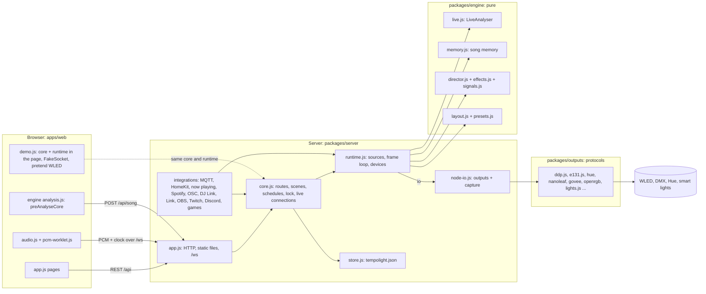
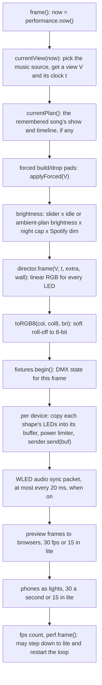
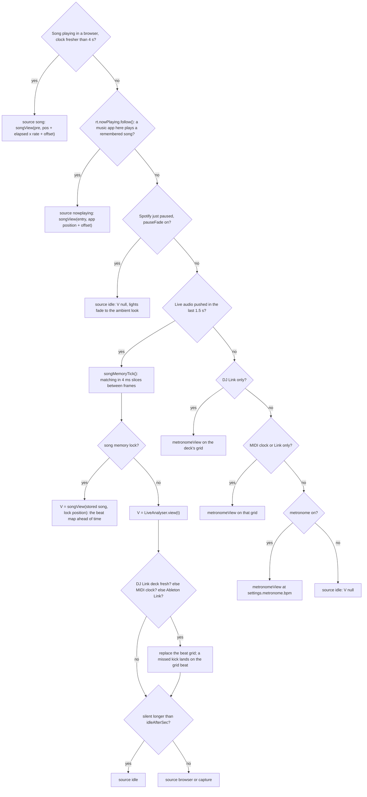
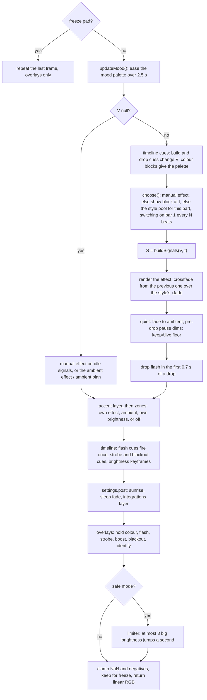

{/* Generated from docs/architecture.md by scripts/build-mintlify.js. Edit that file, then run: node scripts/build-mintlify.js */}

Tempolight is a Node.js 20+ app with no dependencies: ES modules, Node's built-ins, and a web app served as plain
files (no build step). It has four parts with firm boundaries between them, and the same core code runs both in the
server and, for the online demo, inside a browser.

This page is the big picture. The details of each part are in [internals/](#where-to-read-next).

## Packages and their boundaries

| Part | Folder | May use | Job |
| --- | --- | --- | --- |
| **Engine** | `packages/engine/src` | nothing (pure functions and classes, no I/O, no timers except `setTimeout(0)` yields in long analyses) | whole-song and live analysis, song memory, room layout, effects, the director |
| **Outputs** | `packages/outputs/src` | Node built-ins (`dgram`, `net`, `http`, `crypto`, `fetch`) | network protocols: DDP, E1.31/Art-Net, WLED JSON API, discovery, Hue (REST and Entertainment over DTLS), Nanoleaf, Govee, OpenRGB, LIFX, WiZ, Kasa, Yeelight, Twinkly, DMX universes, WLED audio sync |
| **Server core** | `packages/server/src` (environment-free modules) | the engine, and browser-safe outputs modules (`dmx.js`) | the API, scenes, schedules, PIN lock, live connections (`core.js`), the frame loop and devices (`runtime.js`) and what they import: `home.js`, `pro-api.js`, `lights.js`, `fixtures.js`, `beatsources.js`, `midiclock.js`, `latency.js`, `perf.js`, `scheduler.js`, `sun.js`, `defaults.js` |
| **Server Node layer** | `packages/server/src` (`app.js`, `node-io.js`, `index.js`, ...) | everything | HTTP server, static files, WebSocket, the settings file, sound capture, and the integrations that need sockets or files: Home Assistant (MQTT), HomeKit, now playing, Spotify, OSC, Pro DJ Link, Ableton Link, OBS/Twitch/Discord/games, updates, Wi-Fi setup |
| **Web app** | `apps/web` | browser APIs; imports the engine (`/engine/...`) and, in demo mode, the server core (`/packages/...`) | the UI, browser audio (song playback, microphone, system sound), song analysis in the browser, camera mapping, screen sync |

The boundary between the core and the Node layer is enforced: `scripts/build-site.js` follows every `import` from
`core.js` and `runtime.js` and stops the online demo's build if any of them reaches a `node:` module or a package.
Everything the core needs from the outside world comes in as **injected objects**:

- `createRuntime(store, { io, logger, now, host, cpuUsage })`: `io` is the network and sound card. On a PC or Pi it is
  `node-io.js` (re-exports of `packages/outputs` plus `capture.js` and `hostInfo()`); in the demo it is a set of pretend
  WLED controllers in `apps/web/demo.js`.
- `createCore({ store, runtime, env })`: `env` holds the version, id/token/PIN helpers, discovery and pairing
  functions, `startOsc`, `startProLink`, `startLink`, `update`, `wifi`, `quit`, `lan`. A missing function means "not
  available here" (the demo has no Hue pairing, so adding a Hue bridge answers *Hue needs Tempolight running on your
  network*).
- `store`: `{data, save(), flush(), reset(), firstRun}`. `store.js` keeps it in `tempolight.json`; the demo keeps it in
  `localStorage`.

`app.js` starts things in this order: the store (and settings from the environment, `env-settings.js`), the updater,
the runtime, the core, then Home Assistant, HomeKit, integrations, now playing and Spotify, each given `{core, store,
runtime}`. Those modules plug in by adding routes with `core.route(...)`, hooking runtime fields (`rt.nowPlaying`,
`rt.spotify`, `rt.pcmTap`, `rt.home`, `rt.mqtt`) and director hooks (`settings.ambientHook`, `settings.post`), and
listening with `core.onChange` / `core.onScene`. The core never imports them, which is what keeps it
environment-free.

## The frame loop

`runtime.startLoop()` runs `frame()` on a `setInterval` at `settings.fps` (default 60, at most 30 in low-power mode,
see [perf](/internals/runtime-and-outputs#performance-modes)). One frame:

Status messages are not part of the frame: `core.js` broadcasts `runtime.status()` to every WebSocket every 250 ms
(every 500 ms in low-power mode), and the device health loop runs every 10 s.

### 1. Source selection: `currentView(now)`

The first source that has something wins. Each returns a *view* `V` (what the music is doing, in the shape of
`songView()`), the music clock `t` it was taken at, and `extra` (live spectrum bands, waveform, bass level).

`status.source` is one of `song`, `nowplaying`, `browser`, `capture`, `djlink`, `midiclock`, `link`, `metronome`,
`idle`; `status.sourceLabel` says it in words (for example `Browser audio: One More Time (recognised) + DJ Link (CDJ-3000)`).

Live audio comes from one place at a time: a browser streaming PCM over the WebSocket, or the sound card (`capture.js`
runs `parec`, `arecord`, `ffmpeg` or a custom command that writes 16-bit mono at 22,050 Hz to stdout). A browser that
is sending wins over the sound card. Spotify (`spotify.js`) works through the same paths: it gives `rt.nowPlaying`
the Spotify track's beat map and position, dims or pauses, and taps the PCM (`rt.pcmTap`) to learn new songs.

Details: [live analyser](/internals/live-analyser), [song memory](/internals/song-memory).

### 2. Signals: `buildSignals(V, t, opts)`

Inside the director, the view becomes the **signals object `S`** every effect reads: beat grid and phase, envelopes of
the last kick, snare and hi-hat (scaled by the style's punch), the palette, loudness, spectrum, build-up progress,
seconds to the next drop. With no music (`V` null) the director uses `idleSignals()`, a slow made-up beat so ambient
effects still move. The fields are listed in [director and effects](/internals/director-and-effects#the-signals-object-s).

### 3. The director: `director.frame(V, t, extra, wall)`

The result is a `Float32Array` of `N * 3` linear RGB values, usually 0 to about 2 (effects add light, so bright
moments overshoot). `toRGB8()` maps it to bytes with a soft roll-off, `255 * (1 - exp(-1.6 * v * brightness))`, so
overshoot saturates gently instead of clipping.

### 4. Devices: buffers, power limit, senders

The room layout (`buildLayout(shapes)`) puts every LED of every shape in one array, in shape order
(`layout.chainStart[i]` is shape *i*'s first LED). `segmentRanges(shapes)` says where each shape's LEDs sit on its
controller: `from` if given, else right after the previous shape on that controller. Each frame, for each device:

1. Copy each of its shapes' bytes from `col8` into the device's buffer at the shape's range.
2. **Power limiter**: estimate the current as `size mA + sum(bytes) * mAperLed / 765` (default 60 mA per LED at full
   white, ~1 mA idle). Above `maxAmps`, scale the whole buffer down to fit; `status.devices[].limited` says so, and
   `amps` is the smoothed estimate.
3. `sender.send(buf)`: DDP, E1.31/Art-Net, Hue, Nanoleaf, Govee, OpenRGB or a smart-light sender (see
   [runtime and outputs](/internals/runtime-and-outputs)). DMX devices take a different path (`dmxOut`): fixtures
   turn their points' colours into channel values, a full universe ~40 times a second, always sent while enabled.

When the power is off, black is sent for 600 ms and then nothing (so WLED falls back to its own effects after its
realtime timeout); camera mapping replaces every buffer with one lit LED.

### 5. Broadcasts

- **Preview**: binary `[1, R, G, B, R, G, B, ...]` of `col8` (all LEDs in layout order) to browsers that asked with
  `{type: "preview", on: true}`, at 30 fps (15 in lite); a client whose socket buffer holds more than 256 KB is skipped.
- **Phones**: each phone that joined with `{type: "phone", on: true}` gets `[2, R, G, B, index]`, the average colour of its
  own slice of the room (weighted towards bright LEDs).
- **Status**: `{type: "status", ...}` every 250 ms from `core.js`; `{type: "log"}` for each activity message;
  `{type: "changed", what}` after anything is saved. Formats: [API, WebSocket](/websocket).

## Timing model

Two kinds of clock drive the lights, and the director only ever sees "music time" `t` in seconds.

| Source | Clock `t` | Where it comes from | Latency compensation |
| --- | --- | --- | --- |
| Song played in a browser | the song's position | the browser sends `{type: "clock", pos, playing, rate}` every 500 ms and on every play, pause and seek; the server extrapolates `pos + (now - at) * rate` between them | the browser subtracts `outputLatency + baseLatency` before sending, so `pos` is what the speakers play now. Then `syncOffsetMs` is added |
| Now playing / Spotify | the app's position | `nowplaying.js` (osascript, MPRIS, Windows media controls, Spotify Web API), smoothed by `spotify-sync.js` | `syncOffsetMs` |
| Song memory lock | position in the stored song | `pos0 + (liveT - t0) * rate`, re-anchored by `matchAt` and `refineByKicks` every second | the live clock plus up to 120 ms of extrapolation (below) |
| Live audio | the analyser's audio time | `an.t` = samples received / sample rate, minus half an FFT window | `t = an.t + min(0.12, time since the last chunk)`, plus `syncOffsetMs` when `predict` is on |
| DJ Link, MIDI clock, Link | a beat grid mapped onto the frame's `t` | `djGrid()`, `beats.grid()` | network jitter is smoothed (DJ Link follows beats at 25%; MIDI clock maps the browser's clock with the smallest arrival delay of the last 10 s) |
| Metronome, idle | wall clock seconds | `performance.now() / 1000` | none |

**Song clock vs live clock.** A song analysed ahead of time knows its future: drops, build-ups and bars come from the
analysis, so effects can count down to a drop (`S.dropIn`) and the director can black out the planned pause before
it. Live listening only knows the past; it reacts within about one analysis hop (11.6 ms) plus onset smoothing. With
`predict` on (default), a live kick that fits the locked beat grid is placed on the grid beat, and the offset is
applied, so lights land on the beat instead of just after it. Song memory turns a live stream back into a song clock
once it recognises a remembered song.

**Offsets.** `settings.syncOffsetMs` (-500 to 500, from Settings or the one-tap timing fix in `calibrate.js`) is added to
the music clock: positive shows the light earlier. It is the only user-facing knob; everything else is measured. The
[latency meter](/internals/runtime-and-outputs#health-and-latency) adds up audio-in, analysis (23 ms), half the
controller's HTTP round trip and the frame time, minus the offset, per device.

**Wall clock.** Overlays (flash, strobe, identify), the photosensitivity limiter, mood easing and the sunrise use
`wall` (`performance.now() / 1000`), not music time, so a seek never replays a flash or freezes a strobe. The director
also notices when music time jumps back (a seek, a newly recognised song) and restarts its crossfade and beat counter.

## Where to read next

| Page | What |
| --- | --- |
| [internals/engine-analysis.md](/internals/engine-analysis) | whole-song analysis: STFT, onsets, tempo, bars, build-ups and drops, key, mood, chroma |
| [internals/live-analyser.md](/internals/live-analyser) | streaming analysis: drum gating, tempo, song parts, vocals, chroma, fingerprint taps |
| [internals/song-memory.md](/internals/song-memory) | fingerprints, recognition, following a song, limits and storage |
| [internals/director-and-effects.md](/internals/director-and-effects) | the signals object, the effect contract, pools, styles, custom effects, shows, palettes, safe mode |
| [internals/runtime-and-outputs.md](/internals/runtime-and-outputs) | device kinds and senders, rebuilds, health and latency, power limit, mapping, DMX, performance |
| [internals/data-model.md](/internals/data-model) | `tempolight.json`: every key with its type and default; secrets kept elsewhere |
| [internals/web-app.md](/internals/web-app) | pages, routing, lazy modules, demo mode, service worker |
| [internals/testing.md](/internals/testing) | unit tests, fakes, browser tests, firmware tests, bench and smoke |
| [internals/extending.md](/internals/extending) | adding a device kind, an integration, an API route, a setting |
| [internals/security.md](/internals/security) | PIN lock, tokens, guest areas, Origin check, secrets, rate limits |
| [api.md](/api) | every API route and the WebSocket protocol |
| [protocols.md](/protocols) | the wire formats the outputs speak |
