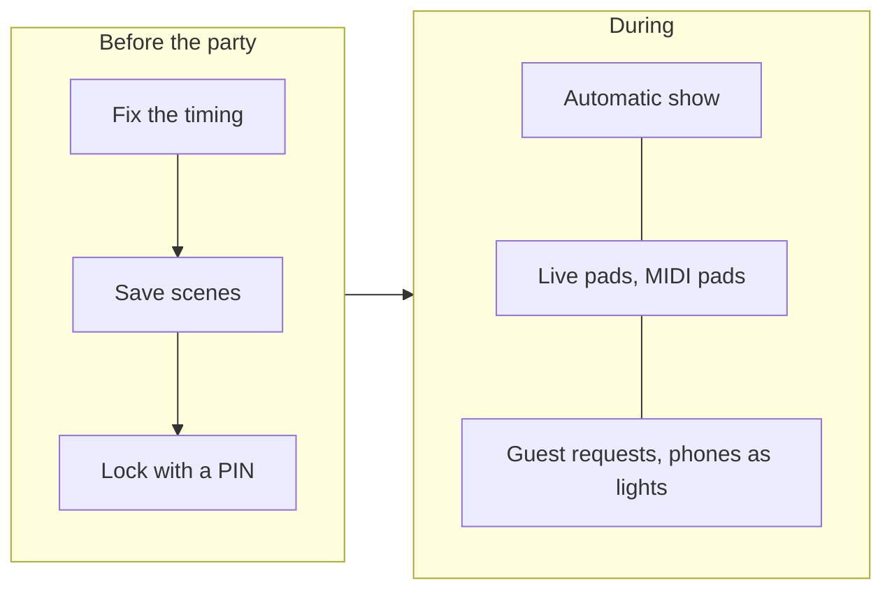
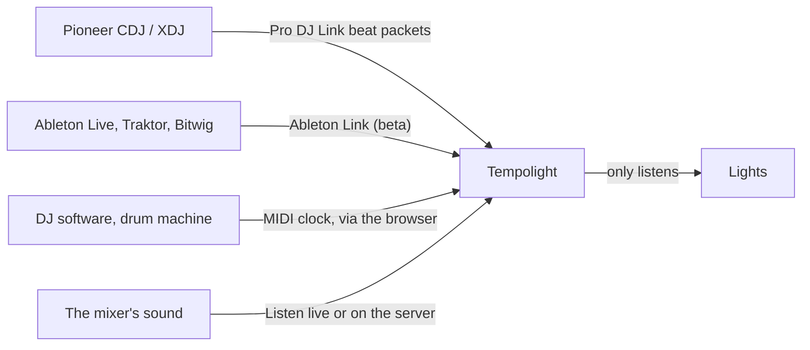

{/* Generated from docs/guides/party-and-dj.md by scripts/build-mintlify.js. Edit that file, then run: node scripts/build-mintlify.js */}

Tempolight runs a party on its own: it hears or knows the music, builds up with the build-ups and hits the drops. This
page is about taking control when you want to: playing the lights live, scenes, guests and their phones, and DJ gear.

## Before the party

1. **Fix the timing** where the speakers are: Music → Timing → **Fix the timing automatically**. A party PA or
   Bluetooth speaker adds a delay the lights must know about.
2. **Pick the music source** ([music-sources.md](/guides/music-sources)). Song files in the app (or songs Tempolight
   already remembers) give the best drops: they're known before they come.
3. **Save scenes** for the moods you'll want: set up effects, colours and brightness, then Home → **Save as scene**
   (or Scenes & schedules → **Save current as scene**). New installs come with Party mode, Chill mode, Movie mode,
   Focus mode and Relax.
4. **Lock it** (picture below): Settings → **Lock**, choose what guests may still do (**Pick effects**, **Use scenes**, **Use live
   pads**, **Brightness and power**), type a PIN and **Lock settings**. The device you locked from stays unlocked;
   everyone else needs the PIN for devices, the room, schedules and settings. **Lock now on this device** locks yours
   too.
   

5. **Photosensitive-safe mode** if anyone may be sensitive to flashing light: Settings → Lighting →
   *Photosensitive-safe mode (at most 3 flashes a second)*. Over the whole show (pads, drops, games and chat), big
   jumps in brightness are held to 3 a second; strobes from chat become a single flash; DMX strobes and lasers stay
   off.

## Live pads

**Live pads** (in the menu) plays the lights like an instrument, on top of whatever is showing. Keyboard shortcuts
work while the page is open:

| Pad | Key | What it does |
| --- | --- | --- |
| Flash | Space | a white hit (or the **Flash colour** you picked) |
| Strobe | S | strobe while held |
| Blackout | B | dark until pressed again |
| Freeze | F | hold the picture until pressed again |
| Build & drop | U | an 8-second build-up, then a drop |
| Drop now | D | full energy for 8 seconds |
| Next effect | N | skip to another effect |
| Boost | X | brighter while held |
| Tap tempo | T | tap 4 times on the beat |
| Clear all | Esc | undo everything the pads did |
| Fog | G | fog while held (only shown with a DMX fog machine) |

**Colour hold**: tap a colour to keep the whole room in it, tap again to let go. The pads work from a phone too: open
Tempolight on the phone and keep the Live pads page open.

## MIDI pads

Any MIDI pad controller (Akai MPD, Novation Launchpad, a DJ controller's pads) can play the pads, in Chrome or Edge on
a computer:

1. Plug it in, then Live pads → MIDI controller → **Connect**. It says *Connected: …* with the controller's name.
2. Notes 36 to 45 (the bottom pads on most controllers) play the pads in the order of the table above.
3. To change one: press **Learn**, tap a pad on the page, then hit the key on the controller. Press **Learn** again
   to stop. The mapping is kept in that browser.

## Scenes and schedules

A scene remembers the effect (or *Automatic* with a style), colours and brightness. Apply one with a tap on Home or
Live pads, from the [Stream Deck](/streamdeck), Home Assistant, Siri or a schedule. **Scenes & schedules** also
renames scenes, **Update to current** saves what's showing into a scene, and **Schedules** runs scenes at set times
("Chill evening at 19:00 on weekdays", "Lights off at 01:00").

## Guest requests

Guests ask for songs from their phones:

1. Music → **Guest requests**: make sure **On** is ticked (it is by default).
2. Show the QR code (or the link under it) to your guests. It opens a *Request a song* page: they type a song and
   **Send request**, and vote with ▲ for the ones already asked.
3. The most wanted are on top. Press **Played** when you've played one, **Clear** to start over.

It works while settings are locked. Phones must be on the same Wi-Fi as Tempolight.

## Phones as lights

Every phone in the crowd becomes part of the show:

1. Live pads → **Phones as lights** shows a QR code (and the link). Show it on a screen or print it.
2. Guests on the same Wi-Fi scan it and see *Be a light*. They turn their brightness up and tap **Start**.
3. Each phone shows its own part of the room, so a crowd holding phones up moves with the show. The panel counts the
   phones that joined.

Crowd tips:

- Put the QR code where people wait: the bar, the entrance, on the DJ booth screen.
- Ask everyone to hold phones up at the drop: that's the moment it looks best.
- A guest Wi-Fi often can't reach Tempolight. Use a network where phones and Tempolight see each other.
- In the online demo, open the link in another browser tab to try it.

## Recording a clip

Home → **Record clip** records 15 seconds of the live preview with the music and offers to share or save it.

## DJ gear

All three only listen: Tempolight never sends anything to the DJ's gear, never joins as a player and never changes the
tempo. Combine them with live listening (a line from the mixer's booth or record output into a sound card) so effects
also react to the sound itself.

### Pioneer Pro DJ Link

1. Connect the computer running Tempolight to the same network switch as the linked CDJs or XDJs (Ethernet is
   best).
2. Settings → Integrations → tick **Pioneer Pro DJ Link: take the beat from CDJs and XDJs on this network**.
3. Tempolight follows the tempo (with pitch) and the bar position of the deck that's on air; the mixer's on-air flags
   decide between two playing decks. A stopped deck lets go after two beats.

### Ableton Link (beta)

Settings → Integrations → tick **Ableton Link**. Tempolight follows the tempo and beat of a Link session on the same
network (Ableton Live, Traktor, Bitwig, many phone apps). Written from the open protocol and tested against a pretend
peer; not yet checked against Live itself. Bars assume 4 beats.

### MIDI clock

Live pads → MIDI controller → **Connect**, then tick **Follow MIDI clock from** and pick the input that receives the
clock (from DJ software, a drum machine, or a USB-MIDI interface). The status says *Following …: 128 BPM*. Press
Start on the sending side so Tempolight knows beat 1; until then it says *the bar is a guess*. Chrome or Edge on a
computer; keep that page open.

### Lighting desks and Companion

OSC (Settings → Integrations → *OSC control on UDP port*, 9000 by default) takes `/tempolight/effect laser`,
`/tempolight/scene Party`, `/tempolight/flash`, `/tempolight/blackout 1`, `/tempolight/brightness 0.5` and more from
TouchOSC, Bitfocus Companion or a lighting desk.

## Advanced

- **DMX fixtures** (pars, moving heads, lasers, fog) follow the same show: [connect-lights.md](/guides/connect-lights#dmx-fixtures).
- **Show editor**: Music → Song memory → **Edit show** puts effect blocks, colour blocks, flash, strobe, blackout,
  build and drop cues and brightness keyframes on the song's waveform, snapping to beats and bars.
- **Variety** (Effects page) sets how often effects change: one look per song (the default), one per song part, or a
  show that changes every few bars. **Change effect every N beats** sets the pace of a show, and the **Accent layer**
  adds an effect on top.
- The pads in the API: `POST /api/action {"type": "flash"}` and so on ([api.md](/api)).
