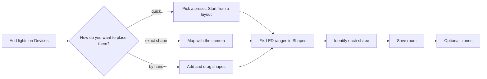
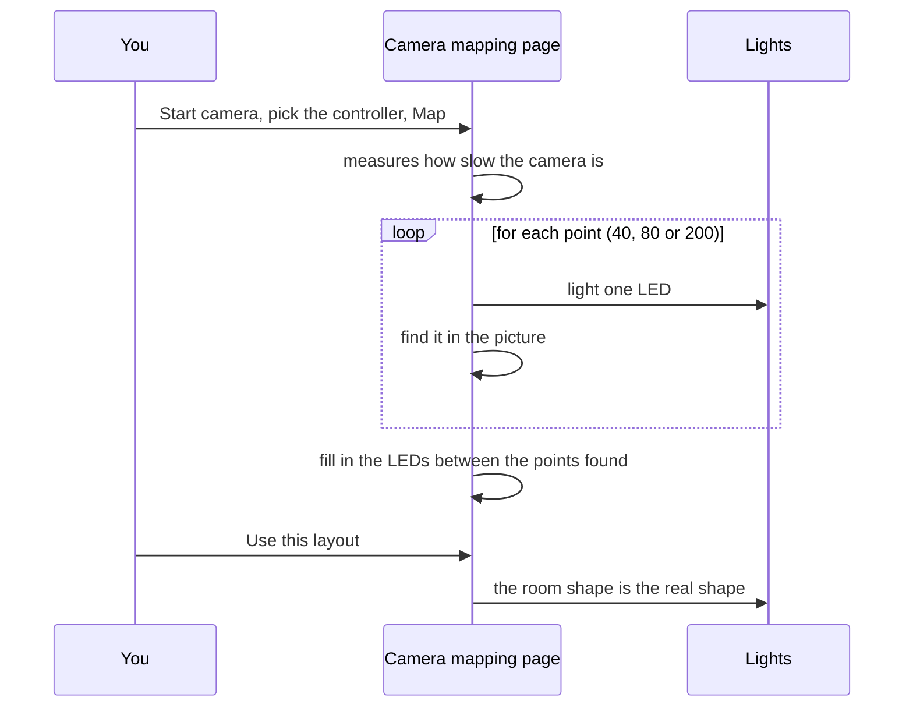

{/* Generated from docs/guides/room-and-zones.md by scripts/build-mintlify.js. Edit that file, then run: node scripts/build-mintlify.js */}

Tempolight draws effects across your *room*, not along a strip: a wave travels from the left wall to the right one, a
shockwave starts in the middle of the room, a drop lights the ceiling and the desk together. For that it needs to
know where your lights are. The **Room** page (under *Setup* in the menu) is where you tell it.

The picture at the top is a 16 × 9 view of one wall (and the ceiling edge). Coloured shapes are your lights: while
you edit, each shape gets its own colour and the selected one is brighter; once saved, the picture shows the live
show. Nothing changes on the real lights until you press **Save room** (**Discard** throws your changes away).

## Start from a preset

**Start from a layout → Preset**, then **Use this layout**. It replaces the current shapes, with LED counts fitted to
your controllers.

| Preset | What it draws | Controllers it uses |
| --- | --- | --- |
| One strip per controller | each controller a straight strip, stacked up the wall. The simplest start | any number |
| One strip around four walls | one strip split into left, back, right and front walls | 1 |
| TV backlight | a frame behind the TV, floor-lamp poles on a second controller | 1–2 |
| Gaming desk | ceiling cove, three monitors, desk edge, light bars and hexagon panels | 1–3 |
| Bedroom | ceiling strip, headboard frame, under-bed glow, bedside lamps, a moon ring | 1–2 |
| Living room | ceiling cove, TV frame, ring light, square frame, hexagons, poles, floor strip | 1–3 |
| LED matrix | a matrix panel (serpentine wiring), a floor strip and poles on a second controller | 1–2 |
| Club / stage | ceiling cove, six poles, two big rings, a triangle, a DJ booth front | 1–4 |
| Rings and panels | each controller a ring, in a row (light rings, round panels, fans) | any number |

With fewer controllers than a preset uses, its shapes share the controllers you have; with more, the extra ones get a
strip along the floor, so nothing stays dark. Change any of it in the table.

## The shape editor

Each row of **Shapes** is one piece of your lights:

| Column | What it is |
| --- | --- |
| Name | anything, for example "Left wall" |
| Type | Straight strip, Pole (vertical), Bent strip, Ring, Rectangle / frame, Hexagon, Triangle, Matrix panel. *Points* are shapes made by camera mapping, Nanoleaf, Hue or Twinkly (one light at each point) |
| Controller | which device drives it |
| First LED | the first LED number of this shape on that controller, counting from 0 like WLED. Leave it on *auto* to continue after the previous shape on the same controller |
| LEDs | how many LEDs it has |
| Uses LEDs | the range it ends up using, for example `100–199` |
| Reverse | tick it if a chase runs the wrong way |
| Zone | which [zone](#zones) it belongs to |

**Example:** one 300-LED strip around a room: *Left wall* LEDs 0–99, *Back wall* 100–199, *Right wall* 200–299. Three
rows, same controller, First LED on auto, 100 LEDs each.

- **Move a shape:** drag it in the picture. Select a row to change its size and position below the table: *Centre X
  (0–16)*, *Centre Y (0–9, 0 = top)*, *Length* / *Width* / *Height* / *Radius*, *Rotate (°)*, *Columns* and *Rows*
  for a matrix, and *LED 0 position (0–1 around)* for rings and frames (where on the shape LED 0 is).
- **Add a shape:** pick the type next to **Add shape** and press it. **Copy** duplicates a row, **Delete** removes it.
- **Check it:** after saving, **Identify** lights one shape in white with LED 0 blinking, so you can see which shape is
  which and where it starts.
- **Controllers** (at the bottom) shows which LEDs each controller drives and warns when shapes overlap or a
  controller has fewer LEDs than its shapes use (*uses 320 LEDs but the controller has 300*). **Send segments to
  WLED** writes the ranges into WLED as segments.

## Map with the camera

For strips that bend around furniture, trees or an odd-shaped room, a camera can find where every LED really is.

1. **Room → Map with the camera…**
2. Darken the room, lean the phone or laptop on something so it doesn't move, and get all the lights you want in the
   picture. Keep people out of view.
3. **Start camera**, pick the controller, pick **Quick (40 points)**, **Normal (80 points)** or **Detailed (200
   points)**, and press **Map**. Each LED lights up in turn for a moment.
4. When it's done, **Use this layout**. Mirrors and reflections are skipped and missed points are filled in.

**Camera on a phone:** browsers only allow the camera on a secure page. `http://192.168.1.20:8080` isn't one, so on a
phone you need Tempolight over https (a reverse proxy or tunnel with a certificate). A laptop's camera works with
Tempolight opened as `http://localhost:8080` on that laptop. Works with WLED, Govee in segments mode and OpenRGB.

## Zones

A zone is a group of shapes with its own rules. Examples: a *TV* zone that turns off during movies, a calm *Ceiling*
while the desk parties, a *Bedroom* zone for the [wake-up sunrise](/wake-up).

1. **Zones → Add zone** (if a shape is selected, it joins the new zone).
2. Name it and choose what it shows:
   - **Follows the main effect**: like the rest of the room, with its own **Brightness**.
   - **Its own effect**: pick the effect in the next column.
   - **The ambient light**: the calm look from Settings → Lighting → *When nothing plays*.
   - **Off**.
3. Put shapes in the zone with the **Zone** column in Shapes, then **Save room**.

Zone settings apply straight away; shape membership applies when you save the room. Zones are also targets for other
things: the game and OBS colours on the [Integrations](/guides/creators) page, the wake-up sunrise, and lights that
update slowly (give a Hue zone a calm effect while WLED strips run the drop).

## Advanced

- **The coordinate system** is 16 units wide and 9 high, `y = 0` at the top. Effects that go "floor to ceiling" use
  `y`; "left to right" uses `x`; "around" and "along" follow each shape's own LED order.
- **The room in the API:** `GET /api/layout` (every LED's position), `PUT /api/room` (`{shapes}`), `POST
  /api/room/preset` (`{id}`), `PUT /api/zones`; see [api.md](/api).
- **Backups** (Settings → Backup) include the room and zones.
