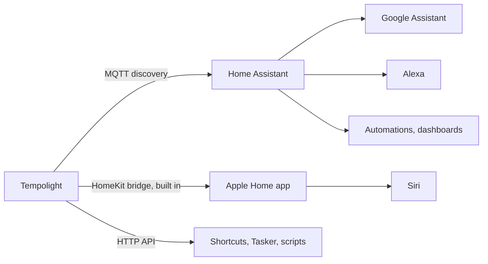

{/* Generated from docs/guides/smart-home.md by scripts/build-mintlify.js. Edit that file, then run: node scripts/build-mintlify.js */}

| You use | Set up | Then |
| --- | --- | --- |
| Home Assistant | [Home Assistant](#home-assistant) (MQTT), or the [add-on](#the-home-assistant-add-on) | dashboards, automations, Google Assistant and Alexa through HA ([voice.md](/voice)) |
| iPhone, iPad, HomePod | [Apple Home](#apple-home) | "Hey Siri, turn on Party mode", Home app scenes and automations |
| Nothing else | the HTTP API | Shortcuts, Tasker, Stream Deck, scripts ([voice.md](/voice#without-home-assistant)) |

## Home Assistant

Tempolight talks to Home Assistant through an MQTT broker and announces itself (MQTT discovery), so it appears by
itself.

1. **In Home Assistant:** Settings → Add-ons → Add-on store → install and start **Mosquitto broker**, then add the
   **MQTT** integration when Home Assistant offers it (Settings → Devices & services).
2. Make a Home Assistant user for Tempolight (Settings → People → Users), or use any user: Mosquitto accepts Home
   Assistant users.
3. **In Tempolight:** Settings → **Home Assistant**: tick **Connect to Home Assistant through MQTT**, enter the
   **MQTT broker** (`mqtt://homeassistant.local:1883`, or your Home Assistant's IP address), the **User name** and
   **Password**, then **Save**. The panel's title says *Connected* (or *Problem: …* with the reason).
4. **In Home Assistant:** Settings → Devices & services → MQTT lists a **Tempolight** device.

What you get:

| Entity | What it does |
| --- | --- |
| `light.tempolight_lights` | on/off, brightness, effect |
| `scene.party_mode`, `scene.chill_mode`, … | one per Tempolight scene, same name; added and removed as you change scenes |
| `scene.tempolight_off` | turns the lights off |
| `select.tempolight_scene` | a scene picker |
| `sensor.tempolight_tempo`, song part, music source | for automations ("when a drop starts…") |
| Flash, Drop now, Next effect buttons | the live pads |

Examples and automations: [voice.md](/voice#scripts-and-automations).

### The Home Assistant add-on

On Home Assistant OS or Supervised, Tempolight can run on the Home Assistant machine itself:

1. Settings → Add-ons → Add-on store → **⋮ → Repositories**, add `https://github.com/D4RKGEEK/tempolight`, close.
2. Find **Tempolight** in the store (reload the page if needed), **Install** (it builds on your machine, a few minutes
   the first time), **Start**, then **Open web UI** (port 8080).
3. With the Mosquitto broker add-on installed, the add-on connects to it by itself: nothing to type.

It runs with host networking, so it finds your lights like a normal install. Options and details:
[the add-on's documentation](https://github.com/D4RKGEEK/tempolight/blob/main/homeassistant/tempolight/DOCS.md).

## Apple Home

Tempolight is a HomeKit bridge itself: no Homebridge, no hub needed for use at home (a home hub, such as a HomePod
or Apple TV, is needed for Siri away from home and for automations).

1. In Tempolight: **Settings → Apple Home → On**. After a moment it says *Ready to pair* and shows a setup code and a
   QR code.
2. On the iPhone (on the same Wi-Fi): open the **Home** app → **+** → **Add Accessory** → scan the QR code. Or tap
   **More options…** and pick **Tempolight XXXX** from the list, then type the setup code.
3. The Home app warns that it's an uncertified accessory: that's expected, tap **Add Anyway**.
4. Pick a room for each accessory, and done. The panel now says *Paired* and lists the paired devices.

What appears in the Home app:

| Accessory | What it does |
| --- | --- |
| **Tempolight** (a light) | on/off, brightness, colour. Picking a colour holds it; turning **Music reactive** on lets the music choose colours again |
| **Music reactive** (a switch) | on: effects follow the music (automatic); off: keep the current effect |
| One switch per scene (**Party mode**, **Chill mode**, …) | on applies the scene, and stays on while the show matches it; turning the active scene's switch off turns the lights off |

So *"Hey Siri, turn on Party mode"*, *"Hey Siri, set Tempolight to 30 percent"* and Home app scenes and automations
work. Renaming or adding scenes in Tempolight keeps the rooms and automations you made in the Home app.

- **Several people:** share your home in the Home app; don't pair again.
- **Moving to another home:** remove Tempolight in the Home app, then **Reset pairing** in Tempolight (it gets a new
  setup code).
- **Not found by the iPhone:** both must be on the same network (not a guest network), and Tempolight must not run in
  Docker Desktop ([docker.md](/guides/docker)). The panel shows *iPhones may not find Tempolight: …* when announcing itself
  failed.

## Voice: Google Assistant and Alexa

Google Assistant and Alexa reach Tempolight through Home Assistant (with or without Home Assistant Cloud). Every
Tempolight scene becomes a scene you can say: *"Hey Google, activate Party mode"*. Step by step, with and without Nabu
Casa, and how to pick names that assistants understand: [voice.md](/voice).

## Wake up, sleep and the ambient plan

The **Home & sleep** page has a sunrise wake-up (weekly times or linked to your phone's alarm, with snooze), a sleep
timer that fades out, and an hourly ambient plan for when no music plays. With [zones](/guides/room-and-zones#zones), the
sunrise can light only the bedroom. Phone alarm links for iPhone Shortcuts, Home Assistant and Tasker:
[wake-up.md](/wake-up).

## Night mode and schedules

- **Settings → Night mode and location:** from a time (or `sunset`) until a time (or `sunrise`), brightness is capped,
  colours stay warm and there are no strobes or drop flashes. **Use my location** fills in where you are, for sunrise
  and sunset times.
- **Scenes & schedules → Schedules:** run a scene, lights on or off, or a brightness at a time (or at sunset/sunrise
  with minutes before or after), on chosen days. Times are the clock of the computer Tempolight runs on.

## Advanced

- MQTT topics are under `tempolight/` (the base) with discovery under `homeassistant/`; both can be changed with
  `TEMPOLIGHT_MQTT_BASE` and `TEMPOLIGHT_MQTT_PREFIX`. Plain MQTT 3.1.1 on port 1883; TLS isn't supported.
- With a PIN lock, Home Assistant and Apple Home keep working: they don't go through the browser lock.
- The HTTP API for everything else: [api.md](/api).
