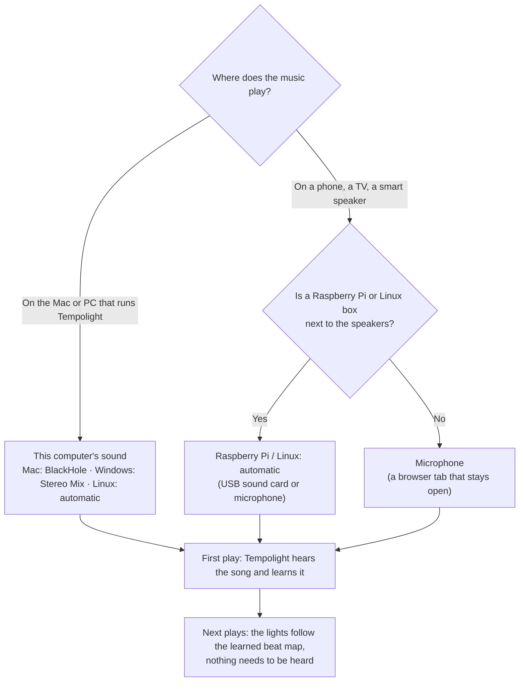
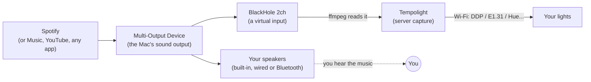
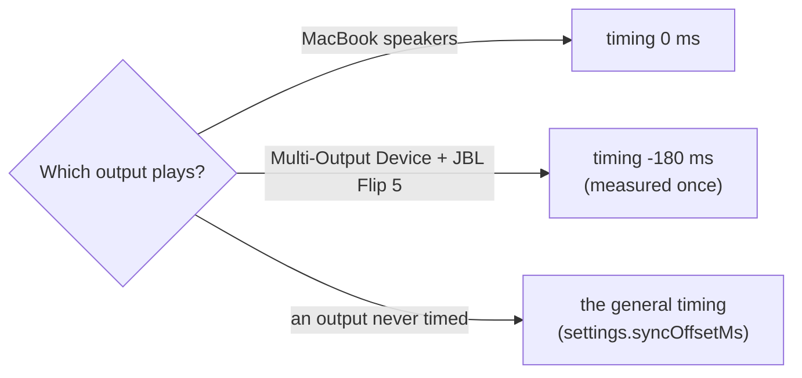
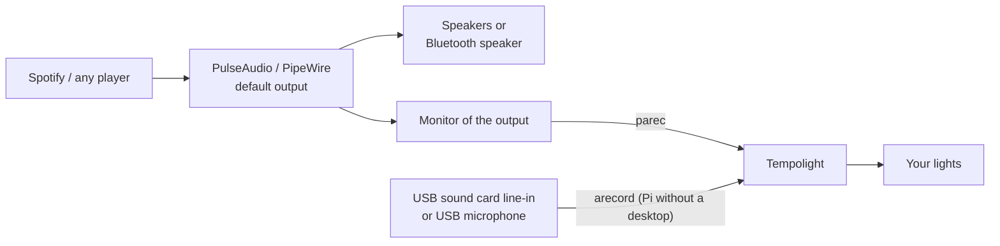

{/* Generated from docs/hearing-music.md by scripts/build-mintlify.js. Edit that file, then run: node scripts/build-mintlify.js */}

Songs you play **in Tempolight** (the Music page) are analysed first, so they need nothing else. Music that plays
**anywhere else** — Spotify, Apple Music, YouTube, a DJ app — has to reach Tempolight somehow:

- A song Tempolight has **learned** (or remembers, or that has a shared beat map) needs nothing: when Spotify plays it,
  the lights follow its beat map at Spotify's position. See [Spotify](/spotify).
- A song it **hasn't learned yet** has to be **heard** the first time it plays. While it plays, Tempolight listens,
  reacts live and learns the song, so next time it follows the beat map.

If nothing captures the sound, the Music page says *"Spotify on this computer · lights follow the live audio"*, the
level stays at **0%** and the lights don't react. The fix is to tell Tempolight how to hear the music: open the
**Music** page and use the panel at the top, **How should Tempolight hear your music?** (it is also a step of the
setup wizard, and the **Fix →** link on the Home and Music status line opens it).



There are three ways:

| | How it hears | Needs | After set-up |
| --- | --- | --- | --- |
| **This computer's sound** | records what the computer plays, on the server | Mac: BlackHole + ffmpeg. Windows: Stereo Mix + ffmpeg. Linux: PulseAudio / PipeWire | just play music: no browser tab, no microphone. Starts by itself when Tempolight starts |
| **Microphone** | a browser's microphone, sent to Tempolight | a browser tab with Tempolight open | starts by itself when Spotify plays a song Tempolight hasn't learned; the tab must stay open |
| **Raspberry Pi / Linux: automatic** | the first sound input on the Pi (USB sound card line-in, or a USB microphone) | a sound input | starts at every boot |

The status line on **Home** and **Music** tells you how it's going:

- `Hearing Spotify ✓ · One More Time · learning 42%` — it hears the song and is learning it.
- `Following Spotify ✓ · One More Time · learned` — a learned song: nothing needs to be heard.
- `Can't hear anything → Fix` — music plays but nothing reaches Tempolight. The line says why; **Fix** opens the panel.

## This computer's sound on a Mac (BlackHole)

macOS doesn't let apps record what the Mac plays. [BlackHole](https://existential.audio/blackhole) is a free sound
driver that does: it is an output and an input at once, so whatever is played to it can be recorded. A
**Multi-Output Device** sends the sound to your speakers *and* to BlackHole, so you still hear everything.



### 1. Install BlackHole and ffmpeg

In Terminal ([Homebrew](https://brew.sh)):

```sh
brew install blackhole-2ch ffmpeg
```

Or download BlackHole 2ch from [existential.audio/blackhole](https://existential.audio/blackhole) and ffmpeg from
[ffmpeg.org](https://ffmpeg.org/download.html). If BlackHole doesn't show up afterwards, restart the Mac (or run
`sudo killall coreaudiod`). The panel ticks **BlackHole installed** and **ffmpeg installed** when it finds them
(press **Check again**).

### 2. Make a Multi-Output Device (once, 2 minutes)

1. Open **Audio MIDI Setup** (⌘ Space, type *Audio MIDI Setup*).
2. Click **+** at the bottom left and choose **Create Multi-Output Device**.
3. Tick your speakers — the MacBook speakers, a USB / wired speaker, or your **Bluetooth speaker** — and **BlackHole 2ch**.
4. Set **Primary Device** (older macOS: *Master Device*) to your **speaker**, not BlackHole.
5. Tick **Drift Correction** for **BlackHole 2ch** (not for the speaker).
6. Right-click the Multi-Output Device → **Use This Device For Sound Output**. (Or pick it in System Settings →
   Sound → Output, or Option-click the volume icon in the menu bar.)

Optional: double-click its name to call it *Speakers + Tempolight*.

### 3. Turn on listening

Press **Turn on listening** in the panel. Tempolight records BlackHole on the server (with ffmpeg) and remembers it:
it starts again by itself every time Tempolight starts. The first time, macOS asks whether **Terminal** (or the
Tempolight app) may use the **microphone**: allow it — that's how macOS lets apps read any input, BlackHole included.

Play something in Spotify. The checklist ticks **Multi-Output Device … is the Mac's output** and **Tempolight hears
it** when sound arrives through BlackHole, and the status line says `Hearing Spotify ✓`. From now on you only play
Spotify: no browser tab, no microphone. Each new song is learned the first time it plays.

### Volume

**The volume keys don't change a Multi-Output Device.** Set the volume on the speaker itself (its own buttons, or
for the built-in speakers in Audio MIDI Setup → the speaker → Output volume), and keep Spotify's own volume up.
(Spotify's volume also sets how loud Tempolight hears it; it adapts, but very quiet is harder to follow.)

### A Bluetooth speaker

Tick the Bluetooth speaker in the Multi-Output Device (step 2) and make it the **Primary Device**. Bluetooth speakers
play **about 150–250 ms late**, while BlackHole is instant, so the lights would flash before you hear the beat.
Tempolight sees that a Bluetooth speaker is in use and shows **Bluetooth speakers play late — fix the timing**:

1. Press **Fix the timing** (Music page → Timing → *Fix the timing automatically*). It plays a few clicks and listens
   with the browser's microphone, so turn the speaker up and keep quiet for 5 seconds.
2. The light timing it finds (for example −180 ms) is kept **for that speaker**. The MacBook speakers keep theirs
   (usually about 0 ms). When the Mac's output changes, the timing switches by itself.



You can also move the **Light timing** slider by hand: the lights early → move it left (negative), late → right.
**Timing per speaker** lists what each one keeps; *Forget* goes back to the general timing.

A Multi-Output Device doesn't tell which speakers it contains, so Tempolight assumes that a connected Bluetooth
speaker is one of them (it says *looks like a Bluetooth speaker*).

## This computer's sound on Windows (Stereo Mix)

1. Install ffmpeg: `winget install ffmpeg` (or from [ffmpeg.org](https://ffmpeg.org/download.html)), then restart Tempolight.
2. Turn on **Stereo Mix**: Settings → System → Sound → **More sound settings** → **Recording** tab → right-click the
   list → **Show Disabled Devices** → right-click **Stereo Mix** → **Enable**.
3. In the panel, press **Check again**, then **Turn on listening**.

No Stereo Mix (many laptops and USB / Bluetooth headphones don't have it)? Install the free
[VB-CABLE](https://vb-audio.com/Cable/), set *CABLE Input* as the output, and tick *Listen to this device* on
*CABLE Output* (Recording tab → Properties → Listen) with your speakers, so you still hear it. Tempolight finds
*CABLE Output*. Otherwise use the **Microphone**.

Bluetooth on Windows is found on a best-effort basis (from the names of the sound devices); if it isn't, fix the
timing once with the slider or *Fix the timing automatically*.

## This computer's sound on Linux, and a Raspberry Pi



- **A desktop (PulseAudio or PipeWire):** one click — **This computer's sound** → **Listen to this computer**.
  Tempolight records the *monitor* of the default output, which follows the output when it changes (a Bluetooth
  speaker connecting). Needs `parec`: `sudo apt install pulseaudio-utils` (PipeWire: `pipewire-pulse` provides it).
  A Bluetooth output (`bluez_output.*` / `bluez_sink.*`) is detected and gets its own timing, as on a Mac.
- **A Raspberry Pi next to the speakers (no desktop):** plug a USB sound card into the amplifier's line-out (or use a
  USB microphone), then **Raspberry Pi / Linux: automatic** → **Use it**. It uses the first input it finds and starts
  at every boot. `sudo apt install alsa-utils` if no input is found. See [Raspberry Pi](/raspberry-pi).

## Microphone

Any browser with Tempolight open can listen with its microphone (a phone near the speakers works too).

1. **Microphone** → pick the microphone → **Use the microphone**.
2. The choice is remembered in this browser and on the server. When Spotify (or another player) plays a song
   Tempolight hasn't learned and nothing else sends it sound, the microphone **starts by itself**, and it stops a
   minute after the music stops.
3. **Keep the tab open.** It can be in the background, but closing it stops the listening. If the browser wants a tap
   first, the Music page says *Tap or click anywhere on this page to start listening*.

Browsers only allow the microphone on `http://localhost` or HTTPS: open Tempolight as `http://localhost:8080` on the
computer itself.

## Troubleshooting

**Level 0% while Spotify plays**
- The panel says what is missing. On a Mac, the usual causes: the Mac's output isn't the Multi-Output Device (System
  Settings → Sound → Output), BlackHole isn't ticked in it, or macOS hasn't allowed **Terminal** (or Tempolight) to use
  the microphone — System Settings → Privacy & Security → **Microphone**. A denied permission gives pure silence.
- Spotify muted, or its volume at 0: Tempolight hears silence too.
- *Listening on the server stopped: …* — ffmpeg isn't installed, or BlackHole was removed. Press **Check again**.
- Linux: `pactl info` should show the default sink you hear; `parec --device=@DEFAULT_MONITOR@ | head -c 100000 | wc -c`
  should print a number when music plays.

**Sound gone (or Tempolight hears nothing) after a Bluetooth speaker reconnects**
- macOS often switches the output to the speaker alone when it reconnects. Pick the **Multi-Output Device** again
  (Option-click the volume icon). If the speaker shows unticked in Audio MIDI Setup, tick it again (and make it the
  Primary Device).
- The light timing switches with the output by itself; if the lights are suddenly early, the output changed.

**The volume keys don't work**
- That's macOS with a Multi-Output Device: set the volume on the speaker, or per device in Audio MIDI Setup.

**The lights flash before (or after) the beat**
- Fix the timing for that speaker (Music → Timing → *Fix the timing automatically*), or move the slider: early → left.

**Sound comes back to the lights but not to the speakers**
- The Mac's output is BlackHole itself. Use the Multi-Output Device instead.

## For scripts: the API

- `GET /api/hearing` — the panel's view: the platform, the recommended way, the checklist (`computer.steps`, each
  `ok` / `no` / `maybe` / `todo`), the server capture and the sound output.
- `POST /api/hearing/check` — the same, detecting again now.
- `POST /api/hearing/use` `{"choice": "computer" | "mic" | "pi" | ""}` — turns the way on (and server capture on or off).
- The status (WebSocket and `GET /api/status`) has `hearing` (`via`, `sound`, `level`, `capture`, `output`, `problem`)
  and `offsetMs`, the light timing in use.
- `PATCH /api/settings` `{"syncOffsetMs": -180}` sets the timing of the output playing now (the general one when the
  output isn't known); `{"syncOffsetMs": -180, "output": "<key>"}` for a given output; `{"syncOffsets": {"<key>": null}}`
  forgets one.
