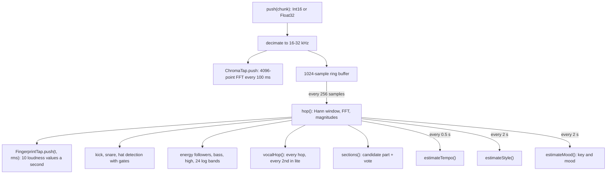

{/* Generated from docs/internals/live-analyser.md by scripts/build-mintlify.js. Edit that file, then run: node scripts/build-mintlify.js */}

`LiveAnalyser` in [`packages/engine/src/live.js`](https://github.com/D4RKGEEK/tempolight/blob/main/packages/engine/src/live.js) turns a stream of samples into
the same *view* of the music that whole-song analysis gives (see [engine analysis](/internals/engine-analysis#reading-it-back-with-songview)),
using only the past. The runtime makes one per live source (`runtime.pushPcm()`): a browser streaming PCM over the
WebSocket, or the server's sound card through `capture.js`. It has no I/O; tests push synthetic songs into it.

```js
const an = new LiveAnalyser(22050); // any rate from 16 to 96 kHz: above 32 kHz it averages 2 samples, above 64 kHz 4
an.push(int16OrFloat32Chunk);       // as often as samples arrive
const V = an.view(an.t, { predict: true });
const extra = an.extras();          // {bands, wave, bassL} for buildSignals()
```

## Per sample, per hop, per estimate



The analyser's clock `an.t` is samples received divided by the (decimated) rate, minus half an FFT window (the
centre of the newest frame). It only moves when samples arrive; the runtime adds up to 120 ms of extrapolation between
chunks (see [timing model](/architecture#timing-model)).

## Drum detection with gates

Each hop computes positive spectral flux in three bands and feeds an adaptive detector: a hit when the flux is above
`mean + k * sd` of the last 70 hops (~0.8 s), above 1.4 x the mean, and the band's refractory time has passed (kick
200 ms, snare 140 ms, hat 70 ms). Plain flux would let bass notes, piano and guitar attacks pass for drums, so each
also has to pass gates:

| Hit | Flux band | Extra conditions |
| --- | --- | --- |
| Kick | 40-110 Hz, k 1.6 | RMS above 0.0015; the kick band's flux **per bin** is more than 4 x the high bands' per bin (hats and noise don't leak in); the 40-110 Hz level is 1.35 x its average over the last ~120 ms (a sustained bass note doesn't jump); and beats the 150-320 Hz flux per bin (snare body) |
| Snare | 180-320 Hz x 0.6 + 1.8-5 kHz x 0.4, k 1.8 | loud enough; 1.8-5 kHz carries more than 5% of the 100-2,000 Hz level (real noise up high) |
| Hi-hat | 7-10.5 kHz, k 1.4 | loud enough; 7-10.5 kHz carries more than 1.5% of the 100-2,000 Hz level |

Kicks, snares and hats are kept for 30 s; `onsets` (`[t, weight]`, kick 1, snare 0.5) for 10 s.

## Levels and spectrum

- `eFast` (τ 0.25 s), `eSlow` (τ 4 s) and `eMax` (a peak hold decaying 3% a second) of the RMS; `loud = eFast / eMax`.
- `bass` (40-150 Hz, τ 0.15 s), `mid` (300-2,000 Hz), `high` (4-10 kHz), each with a decaying maximum.
- `bands`: 24 log-spaced bands from 40 Hz to 10 kHz, each normalised by its own decaying maximum and smoothed (fast
  attack, slower release). Effects read them as `S.bands`; WLED audio sync sends 16 of them.
- `wave`: the last 256 samples, for the Waveform effect.

## Tempo

`estimateTempo()` twice a second: from the kicks of the last 10 s when there are at least 6, else from all onsets.
The same pairwise histogram as the whole-song analysis (60-180 BPM, Gaussian σ 0.8, weighted), with a prior around
122 BPM, or 78 BPM when the style is `emotional` or `chill` (slow songs prefer the slow reading). A new tempo within
3 BPM eases in (70/30); a different one must win 3 times in a row. The phase is the circular mean of the last 6 s of
onsets (newer ones weigh more, τ 3 s), followed at 35% a step. A tap (`action {type: "tap"}`, three taps or more)
sets `bpm` and `phase` directly.

`grid(t)` is `gridAt({P: 60/bpm, off: phase, barOff}, t)` once there is a tempo, else `{has: false}`. `barOff` is set
at each detected drop (the drop lands on beat 1).

## Song parts: candidate and vote

`sections()` each hop picks a candidate:

| Candidate | When |
| --- | --- |
| `silent` | `loud < 0.06` or `eFast < 0.0015` |
| `drop` | the bass dominance (log bass/mid, smoothed 0.4 s) is 0.5 above its 30th percentile of the last 30 s, a kick in the last 0.9 s, `loud > 0.45`, at least 2 kicks in 1.2 s |
| `build` | no bass drop, and either 2.5+ snares a second while loud, or the fast energy rising above the slow one while the highs are up |
| `calm` | otherwise |

The state changes only when the candidate holds for 70% of a window: 0.12 s for a drop, 0.2 s for silence, 0.6 s for
the rest, so drops and silence switch fast and a flickering cue can't freeze the state. A drop after a build-up or
silence (or after more than 4 s in another state) records `dropT`. `buildP` in the view is the build's age over 7 s,
capped at 1 (live listening can't know when the drop comes). `quietFor` is how long it has been silent; the runtime
goes idle after `settings.idleAfterSec` (default 8 s).

## Style

`estimateStyle()` every 2 s over the last 30 s (after the first 8 s): the same rules as the whole-song analysis
(hat and snare rates, kicks on beats, dynamic range of the energy, tempo, drops in the last 3 minutes). A new style
must come out twice in a row. `features` keeps the inputs, for the mood.

## Vocal detection

`vocalHop()` estimates *someone is singing* (0-1, `an.vocal`, eased over 0.25 s), for the Vocal Glow effect and
`status.vocal`. A voice is a clear tone in 150-1,000 Hz whose pitch wanders, with harmonics filling 300-3,500 Hz:

- **tonality**: spectral flatness of 250-3,500 Hz (low flatness = tones) and the share of energy in sharp peaks;
- **band share**: 250-3,500 Hz against the lows and highs;
- **wander**: the strongest peak in 150-1,000 Hz, to a fraction of a bin (parabolic fit on log magnitudes), tracked
  for 0.5 s; small smooth moves (vibrato, slides) count, back-and-forth jumps between two chord notes don't;
- **held**: a plucked guitar note with vibrato wanders too, but fades (about 10 dB a second); a sung note is held.

The product of these, when loud enough, is the raw estimate. In low-power mode it runs every second hop, covering two.

## Key, mood and chroma

`this.ctap` is a `ChromaTap` (see [engine analysis](/internals/engine-analysis#steps)) at the decimated rate, so live chroma
and a remembered song's chroma line up frame for frame. `estimateMood()` every 2 s: chroma is accumulated with a
40 s decay; after about 6 s of notes `keyOf()` gives a key, and a different key must win twice in a row. The mood
(`moodOf()` with the live features and the smoothed brightness) eases towards its target with a 15 s time constant.
Both are null until there is enough to go on, and not updated while silent. In low-power mode the chroma tap computes
every second frame and repeats the one before.

## Taps for song memory

- `an.tap` (`FingerprintTap`): the RMS of every hop, averaged to 10 values a second and log-quantised to a byte, last
  20 s (`tap.q`).
- `an.ctap.window(60)`: the last 121 chroma frames (12 s at 10 a second), or null when fewer than 30% of them have
  clear notes.
- `an.memoryQuery()`: `{bpm, chroma, drumless}`; `drumless()` is true with fewer than 6 kicks in the last 15 s (the
  live tempo is then a guess and isn't used to rule songs out).

See [song memory](/internals/song-memory).

## The view

`view(t, {predict})` returns the `songView()` shape with live values: `g` from the tempo, `state`, `buildP`,
`dropT`, `nextDrop: null`, the last kick/snare/hat, `pulses`, `vocal`, `quietFor`, `live: true`, the key and mood.
`level` is `low` under 0.4 loudness, `mid` under 0.75, else `peak`. With `predict` (on by default, `settings.predict`)
and a locked grid with a kick in the last 2 s, the kick is placed on the grid's beat (`g.beatT`), so a beat-driven
effect lands on time rather than one analysis delay late.

## Tests

`packages/engine/test/live.test.js` pushes synthetic songs through it and checks the tempo, the drop and the style of
an EDM track (also at 48 kHz), that a slow ballad is never treated as silence, and the vocal estimate (high for singing
over drums, low for drums, a steady pad or piano); `memory.test.js` and `tonal.test.js` cover the taps. See [testing](/internals/testing).
