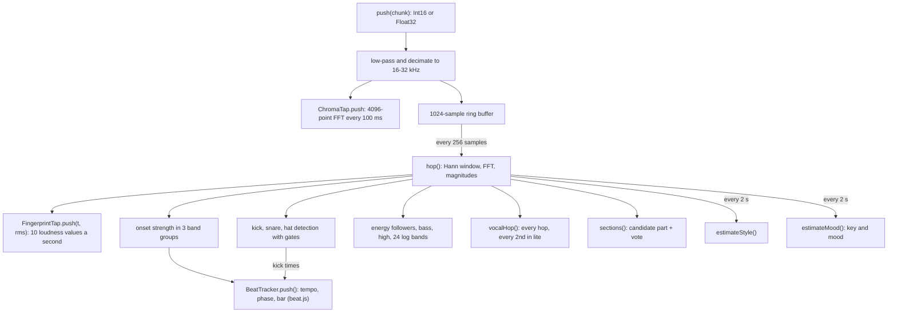

{/* Generated from docs/internals/live-analyser.md by scripts/build-mintlify.js. Edit that file, then run: node scripts/build-mintlify.js */}

`LiveAnalyser` in [`packages/engine/src/live.js`](https://github.com/D4RKGEEK/tempolight/blob/main/packages/engine/src/live.js) turns a stream of samples into
the same *view* of the music that whole-song analysis gives (see [engine analysis](/internals/engine-analysis#reading-it-back-with-songview)),
using only the past. The runtime makes one per live source (`runtime.pushPcm()`): a browser streaming PCM over the
WebSocket, or the server's sound card through `capture.js`. It has no I/O; tests push synthetic songs into it.

```js
const an = new LiveAnalyser(22050); // any rate from 16 to 96 kHz: above 32 kHz it keeps 1 sample in 2, above 64 kHz 1 in 4
an.push(int16OrFloat32Chunk);       // as often as samples arrive
const V = an.view(an.sampleT, { predict: true }); // sampleT (= now): the newest sample's time
an.conf;                            // 0-1: how sure the beat grid is
const extra = an.extras();          // {bands, wave, bassL} for buildSignals()
```

## Per sample, per hop, per estimate



The analyser's clock `an.t` is samples received divided by the (decimated) rate, minus half an FFT window (the
centre of the newest frame, about 23 ms back). Kicks, snares and hats are stamped on it. `an.sampleT` (also `an.now`)
is the time of the newest sample on the same clock. The beat grid is in plain audio time, so draw it at `sampleT`:
drawn at `an.t` it shows every beat 23 ms late. The runtime reads `sampleT` and adds up to 120 ms of extrapolation
between chunks (see [timing model](/architecture#timing-model)).

Above 32 kHz the samples pass a low-pass filter first (a 43-tap half-band filter for 2x, 79 taps for 4x), so cymbals
above the new Nyquist frequency don't fold down into the hi-hat band.

## Onset strength

Each hop measures 24 log-spaced bands (40 Hz-10 kHz) and compresses them: `log(1 + 3000 * level)`. The onset strength
of a band is how much it rose against the loudest of itself and its two neighbours two hops ago (SuperFlux style: a
vibrato or a slide doesn't count). Rises are summed in three groups: kick (40-160 Hz), body (160-1,250 Hz) and
snare/hat (1.25-10 kHz). The beat tracker gets the three groups and their weighted sum.

## Drum detection with gates

**Kicks** come from the kick group's onset strength. A kick candidate:

- rises above 4 x the background between hits (a follower that falls fast and rises slowly), above 35% of the median
  of the last 8 kicks' peaks, and above 0.15;
- rises mostly below 126 Hz, more than 0.8 x the body group, and more than 1.3 x the snare/hat group (a snare alone
  is noise that rises in every band), unless it is a strong one (0.6 x the median peak: a kick with a snare on it);
- carries real low energy (5% of the recent maximum: a pluck's click rises a lot in log terms in a quiet low band);
- comes 200 ms after the last candidate. The detector re-arms when the rise falls to half its peak.

There is no "the low level must jump" test any more: under a sidechained or sustained bass the level hardly moves,
but its log rise still shows. A bass note or a noisy snare also rises down low, so a candidate is only a kick once
its pitch falls: within 5 hops (~58 ms) the energy below 80 Hz, against 80-160 Hz, must grow to 3 x its share at the
onset or just before it, and to 1.4 x its share at the onset. The kick keeps its onset time, so it is reported up to
58 ms after it starts. `kickStrength` (0-1) is its peak against the median of the last 8 kicks.

**Snares and hi-hats** use positive spectral flux and an adaptive detector: a hit when the flux is above
`mean + k * sd` of the last 70 hops (~0.8 s), above 1.4 x the mean, and the refractory time has passed:

| Hit | Flux band | Extra conditions |
| --- | --- | --- |
| Snare | 180-320 Hz x 0.6 + 1.8-5 kHz x 0.4, k 1.8, 140 ms | loud enough; 1.8-5 kHz carries more than 5% of the 100-2,000 Hz level (real noise up high) |
| Hi-hat | 7-10.5 kHz, k 1.4, 70 ms | loud enough; 7-10.5 kHz carries more than 1.5% of the 100-2,000 Hz level |

Kicks, snares and hats are kept for 30 s.

## Levels and spectrum

- `eFast` (τ 0.25 s), `eSlow` (τ 4 s) and `eMax` (a peak hold decaying 3% a second) of the RMS; `loud = eFast / eMax`.
- `bass` (40-150 Hz, τ 0.15 s), `mid` (300-2,000 Hz), `high` (4-10 kHz), each with a decaying maximum.
- `bands`: 24 log-spaced bands from 40 Hz to 10 kHz, each normalised by its own decaying maximum and smoothed (fast
  attack, slower release). Effects read them as `S.bands`; WLED audio sync sends 16 of them.
- `wave`: the last 256 samples, for the Waveform effect.

## Beat tracking

`BeatTracker` in [`packages/engine/src/beat.js`](https://github.com/D4RKGEEK/tempolight/blob/main/packages/engine/src/beat.js) takes one frame per hop: the onset
strengths, the band levels and the kicks. It allocates nothing per frame. The style never feeds it.

**Tempo.** Every 0.25 s (every 0.5 s once locked for 6 s) it autocorrelates the last 8 s of each group's onset curve,
each normalised by its own energy, and sums them. Each tempo from 50 to 200 BPM gets the autocorrelation at its beat
and half of it at two beats, times a fixed preference: a log-normal around 120 BPM (σ 1.1 octaves). The scores are
averaged with the last estimate. Then:

- A near tie with a tempo 3/2, 2/3, 4/3 or 3/4 as fast: the one with a kick or snare on more of its beats wins
  (syncopated kicks make those look periodic too).
- The first tempo is taken after 1.3 s of sound. For 6 s after that, a better one takes over after 2 estimates.
- Later, a new tempo must score 10% more than the current one and win 3 times in a row; twice, half, 3/2 or 2/3 as
  fast must win 10 times (5 s). The margin is waived for 3/2-type changes that put drums on more beats.
- Half as fast is refused while nearly every beat still has a hit and the slower tempo is further from 120 BPM (a
  half-time drop over steady hats, dubstep).

**Phase and fine tempo.** Every 4 frames a comb sums the onset curve at the beat period over the last 4.5 s (older
beats weigh less, τ 2.5 s). It tries the period and up to 4% either side, and fits a parabola to find the best period
and phase. When kicks fall on at least 6 of the last 8 beats (four on the floor), the kicks set the phase instead:
under a sidechain pump the swell after each kick rises more than the ducked kick and would pull the grid onto the
off-beat.

- An error under 12% of a beat moves the grid 12% of the way, and the period 6% of the way (not while the music thins
  out into a break).
- A bigger error is a different phase. It must beat the comb at the current phase by 30% for 0.8 s, then the grid
  jumps there.

**Breaks.** "Something is heard" means the onset curve's 2 s and 0.6 s averages are both above a quarter of its 20 s
average. Otherwise the tempo and the phase are held and the grid runs on, so it is still in step when the drums
return.

**Bar position.** At each beat, once the next one has passed, it scores the beat: the kick group's peak, minus 0.6 x
the body group's peak (snares fall on 2 and 4), plus 15 x the harmonic change. The harmonic change compares each band's
floor (its quietest frame, so hits and their tails don't count) in the beat after against the beat before, over
160 Hz-5 kHz: chords change on beat 1. Scores add up per beat of the bar and decay 3% a beat. A new beat 1 must lead
by 0.5 for 4 beats. (A detected drop no longer moves beat 1: a late-detected drop put it on the wrong beat.)

**Grid.** The tracker keeps the latest beat's time and number, so the beat count stays continuous while the tempo
moves. `grid(t)` is `gridAt({P, off, barOff}, t)` once there is a tempo, else `{has: false}`.

**Confidence.** `an.conf` (0-1) follows the comb's peak (how much the best phase stands out) times how much has been
heard lately. It falls in a break or when the beats are unclear. `view()` has it as `V.conf`.

**Taps.** A tap tempo (`action {type: "tap"}`) sets `an.bpm` and then `an.phase`; that moves the grid there, and the
tracker carries on from it.

## Song parts: candidate and vote

`sections()` each hop picks a candidate:

| Candidate | When |
| --- | --- |
| `silent` | `loud < 0.06` or `eFast < 0.0015` |
| `drop` | the bass dominance (log bass/mid, smoothed 0.4 s) is 0.5 above its 30th percentile of the last 30 s, a kick in the last 0.9 s, `loud > 0.45`, at least 2 kicks in 1.2 s, and (with a sure grid, `conf > 0.4`) the last kick on a beat. Or, at once: during a build-up, a strong kick on beat 1 with the bass coming up (unsmoothed dominance 0.3 up) and `loud > 0.35`. Or: already a drop, kicks still coming on the beat and `loud > 0.35` |
| `build` | no bass drop, and either 2.5+ snares a second while loud, or the fast energy rising above the slow one while the highs are up |
| `calm` | otherwise |

The state changes only when the candidate holds for 70% of a window: 0.12 s for a drop, 0.2 s for silence, 0.6 s for
the rest, so drops and silence switch fast and a flickering cue can't freeze the state. A drop on beat 1 after a
build-up switches at once. After a change the vote starts afresh, so the state can't bounce straight back. A drop
after a build-up or silence (or after more than 4 s in another state) records `dropT`. `buildP` in the view is the build's age over 7 s, capped at 1. `nextDrop` comes from the drop
countdown (below). `quietFor` is how long it has been silent; the runtime goes idle after `settings.idleAfterSec`
(default 8 s).

## Drop countdown

[`drops.js`](https://github.com/D4RKGEEK/tempolight/blob/main/packages/engine/src/drops.js) (`an.drops`, a `DropPredictor`) notices a drop coming a few
seconds ahead, for songs it has never heard. `hop()` runs every analysis hop and gathers 0.25 s blocks of the
spectral centroid (200 Hz-10 kHz, from the 24 band levels), the energy above 3 kHz, the total energy, the RMS and the
snares of the last second. Every block:

- **Riser score**: least-squares slopes over the last 4 s (16 blocks), per second.
  `0.6 * sqrt(clamp(centroid slope / 0.12) * clamp(high-energy slope / 0.15)) + 0.4 * clamp(snare-rate slope / 0.6)`
  (the snare term only while both others rise), plus 0.15 when the song part reads `build` and the score is over
  0.3. Held over 0.6 for 2 s, the riser is on; under 0.2 for 2 s, the build-up fizzled. No score in the first 3 s of a
  drop. (From the audit prototype `lab/structure/exp2c_riser.mjs`: 3.2-5.2 s warning before drops, no false alarm on
  pop.)
- **Phrase grid**: beats are counted from an anchor, the first sound after silence (weak: the app may have joined
  mid-song) or a drop that lasted 2 bars (strong: at the predicted time when it came within a bar of it). Beats, not
  the grid's bar lines: without kicks the tracker's downbeat is often a beat or two out, its beats rarely are. With the
  riser on, the prediction is the 4-bar line from the anchor at least a bar ahead that scores best: 16 bars from the
  anchor 1, 8 bars 0.95, 4 bars 0.55, times `exp(-(time ahead) / 8 bars)`. No anchor: the grid's next bar lines.
- **Pre-drop dip**: after a steady second (the last 4 blocks within 0.6x of each other: a roll or a riser, not single
  hits), a block under half their loudest. The drop is then in the next bar: the predicted time if it is there (a dip
  heard late, at the drop itself), else the anchor's phrase line, else the grid's next bar line. `conf` goes to 0.9.
- **Hysteresis**: a prediction stays put until the dip moves it, the drop is heard (within 4 beats of it; a "drop"
  heard much earlier during a build-up that goes on is a roll's loud stretch and is ignored), the predicted time
  passes by 0.6 beat without one (then the next phrase line, once, unless a dip said "now"; then it is dropped), or the
  riser fizzles. After a dip or a second miss it waits for a new riser.
- **Confidence** `conf`: `0.3 + 0.2 * (riser age / 3 s) + 0.15 * (score / 0.8) + 0.15 * (phrase alignment) + 0.15 *
  (anchor: a drop 1, the song start 0.5) - 0.15 * misses`, at least 0.9 after a dip, times the grid's sureness
  (`(conf - 0.3) / 0.4`). Party, pop/rock and hip-hop only; calm and emotional songs only from 0.85. Before the
  style is known, hi-hats (1.5 a second or more) make a song one for the countdown, a drumless one is calm.

The view has `nextDrop` (the predicted time on the analyser's clock, null when there is none), `dropConf` (0..1) and
`dropSource: "predicted"`; whole-song views (`songView`) have `dropConf: 1` and `dropSource: "memory"` whenever a
drop lies ahead. Lights and effects act from `dropConf` 0.5 (`S.dropIn` is 99 below that). The runtime's status
reports it as `drop: {next, at, conf, source, building}` (see the [API](/api)).

Measured by `npm run eval:feel` (scripts/feel-eval.js), live, on the synthetic songs: the right drop time
5.2 s ahead of both feel-song drops and of `edm()`'s, 12.9 s ahead of long-edm's first; long-edm's second drop comes
28 bars after the first (off the 8-bar grid), so the countdown first points 4 bars later and the dip corrects it only
0.2 s ahead. No false prediction on any of them, majorPop() or minorBallad(). The Python test track
(scripts/test-songs/edm_track.py, a noise riser and a roll): 4.2 and 4.4 s ahead.

## Style

`estimateStyle()` every 2 s over the last 30 s (after the first 8 s): the same rules as the whole-song analysis
(hat and snare rates, kicks on beats, dynamic range of the energy, tempo, drops in the last 3 minutes). It is chosen
once per song: the first style must come out twice in a row, a change after that 5 times in a row (10 s). After 6 s
of silence (a new song) it chooses afresh. `features` keeps the inputs, for the mood.

## Vocal detection

`vocalHop()` estimates *someone is singing* (0-1, `an.vocal`, eased over 0.25 s), for the Vocal Glow effect and
`status.vocal`. A voice is a clear tone in 150-1,000 Hz whose pitch wanders, with harmonics filling 300-3,500 Hz:

- **tonality**: spectral flatness of 250-3,500 Hz (low flatness = tones) and the share of energy in sharp peaks;
- **band share**: 250-3,500 Hz against the lows and highs;
- **wander**: the strongest peak in 150-1,000 Hz, to a fraction of a bin (parabolic fit on log magnitudes), tracked
  for 0.5 s; small smooth moves (vibrato, slides) count, back-and-forth jumps between two chord notes don't;
- **held**: a plucked guitar note with vibrato wanders too, but fades (about 10 dB a second); a sung note is held.

The product of these, when loud enough, is the raw estimate. In low-power mode it runs every second hop, covering two.

## Key, mood and chroma

`this.ctap` is a `ChromaTap` (see [engine analysis](/internals/engine-analysis#steps)) at the decimated rate, so live chroma
and a remembered song's chroma line up frame for frame. `estimateMood()` every 2 s: chroma is accumulated with a
40 s decay; after about 6 s of notes `keyOf()` gives a key, and a different key must win twice in a row. The mood
(`moodOf()` with the live features and the smoothed brightness) eases towards its target with a 15 s time constant.
Both are null until there is enough to go on, and not updated while silent. In low-power mode the chroma tap computes
every second frame and repeats the one before.

## Taps for song memory

- `an.tap` (`FingerprintTap`): the RMS of every hop, averaged to 10 values a second and log-quantised to a byte, last
  20 s (`tap.q`).
- `an.ctap.window(60)`: the last 121 chroma frames (12 s at 10 a second), or null when fewer than 30% of them have
  clear notes.
- `an.memoryQuery()`: `{bpm, chroma, drumless}`; `drumless()` is true with fewer than 6 kicks in the last 15 s (the
  live tempo is then a guess and isn't used to rule songs out).

See [song memory](/internals/song-memory).

## The view

`view(t, {predict})` (t defaults to `sampleT`) returns the `songView()` shape with live values: `g` from the beat
tracker, `conf`, `state`, `buildP`, `dropT`, `nextDrop`, `dropConf`, `dropSource` (see above), the last kick/snare/hat, `kickStrength`, `pulses`, `vocal`,
`quietFor`, `live: true`, the key and mood.

`level` comes from the loudness smoothed over ~1 s (it swings with every beat): `low` under 0.4, `mid` under 0.75,
else `peak`, with 0.05 of hysteresis either side, and held for at least 1 s.

With `predict` (on by default, `settings.predict`), a locked grid, `conf` above 0.3 and a kick in the last 2 s, the
kick is placed on the grid's beat (`g.beatT`), so a beat-driven effect lands on time rather than one analysis delay
late. When the tracker is unsure, the kicks heard drive the lights instead.

## Tests

`packages/engine/test/live.test.js` pushes synthetic songs through it and checks the tempo, the drop and the style of
an EDM track (also at 48 kHz), that a break holds the beat grid, that a slow ballad is never treated as silence, and the vocal estimate (high for singing
over drums, low for drums, a steady pad or piano); `memory.test.js` and `tonal.test.js` cover the taps.
`drops.test.js` covers the drop countdown: at least 2 s of the right time before the feel song's and `edm()`'s
drops, nothing on pop or a ballad, no flapping, a build-up that fizzles out cancelled, and the director's build ramp.
`beat.test.js` runs the beat-tracking evaluation (`npm run eval:beat`) against its saved baseline. See [testing](/internals/testing).
