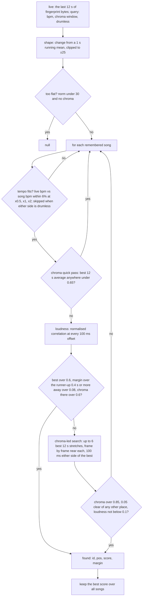
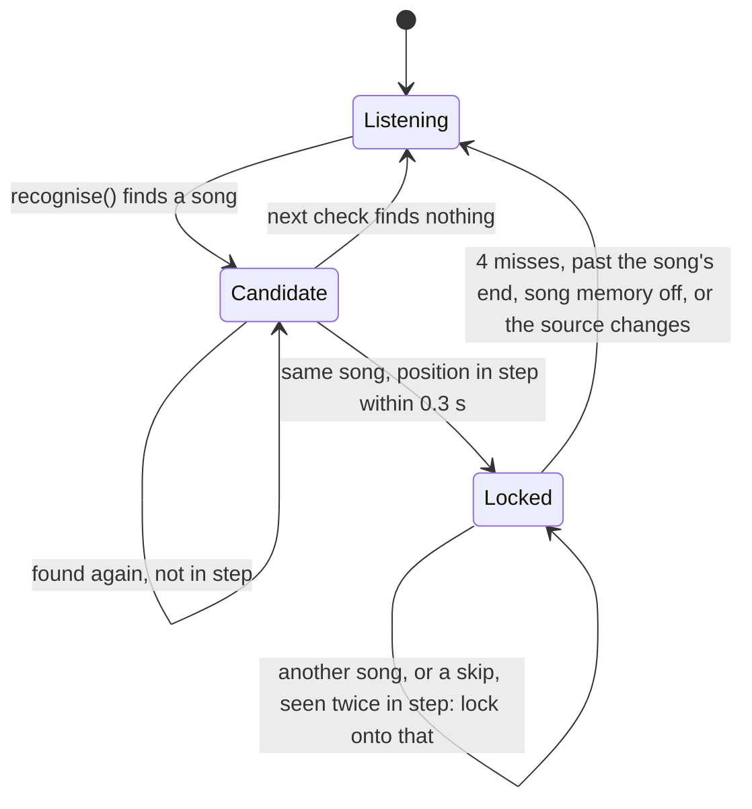

{/* Generated from docs/internals/song-memory.md by scripts/build-mintlify.js. Edit that file, then run: node scripts/build-mintlify.js */}

Songs Tempolight has analysed before are remembered, and recognised when they play again from anywhere (Spotify on
a phone, a DJ, the radio) while it listens live. Once a song is recognised, the lights follow its stored beat map, so
build-ups and drops are known ahead of time, as if the song were played in the app. The matching is in
[`packages/engine/src/memory.js`](https://github.com/D4RKGEEK/tempolight/blob/main/packages/engine/src/memory.js) (pure); the following, locking and storage
in [`packages/server/src/runtime.js`](https://github.com/D4RKGEEK/tempolight/blob/main/packages/server/src/runtime.js) (the "song memory" section).

## What is stored

A compact copy of a whole-song analysis, about 10-20 kB of JSON, in `tempolight.json` under `songs`:

| Field | What |
| --- | --- |
| `id`, `name`, `at` | `m` + 8 random characters; the song name (≤ 120 characters); when it was remembered (ms) |
| `bpm`, `P`, `off`, `barOff`, `style`, `dur` | the beat grid and style |
| `kicks`, `snares`, `hats` | onset times in seconds, to the millisecond (every second hi-hat only) |
| `bars`, `drops` | `[{t0, t1, state, level}]`, drop times |
| `env` | base64: the loudness envelope at 10 a second, one byte each (`sqrt(min(1, v/1.5)) * 255`) |
| `fp` | base64: the loudness fingerprint, `fingerprint(pre.env)`: 10 bytes a second, `log10` loudness quantised to 0-255 |
| `ch` | base64: the chroma fingerprint (`packChroma`), 6 bytes per 200 ms; missing in entries from older versions |
| `key`, `mode`, `keyConfidence`, `mood` | when known |
| `show`, `showEdited`, `colors`, `cues`, `bright` | the song's show timeline (see [director and effects](/internals/director-and-effects#shows-and-timelines)) |
| `spotifyId`, `isrc`, `src`, `cov`, `gridSec` | added by Sync with Spotify: the track ID, where the map came from (`learned`, `shared`, `spotify-analysis`), and for partly learned songs the covered stretches `[[t0, t1], ...]` |

`memoryAnalysis(e)` turns an entry back into an analysis that `songView()` can use (the envelope expanded to 20 ms
steps). Shaped fingerprints and unpacked chroma are cached per entry in a `WeakMap`, never on the entry, so they
can't end up in the saved file.

**When.** `runtime.setSong()` remembers every song played in the browser that is longer than 20 s (with
`settings.songMemory` on). An entry with the same name and a length within 1.5 s replaces the old one, keeping its
hand-edited show, colours, cues and brightness. Spotify learning saves through the same list (`spotify.js`).

**Limits.** One entry may be at most 400,000 characters of JSON (a long mix isn't remembered, with a note in the log).
All of them together: at most 60 songs and about 2,000,000 characters; the oldest go first. The demo keeps everything
in `localStorage` (~5 MB), which these limits fit.

## Recognising: `recognise(live, entries, query)`

- **Loudness fingerprint.** 10 values a second; a match looks at 12 s (120 values). Shaping (high-pass against a
  running mean) makes the volume irrelevant; clipping keeps one big jump (a song's end) from deciding alone. The
  runner-up must be at least 0.4 s away, because in a steady part a beat or a bar off looks alike, and following the
  right song a beat late is still wrong.
- **Chroma fingerprint.** For songs without drums (a weak loudness shape, an untrustworthy tempo) the chroma decides:
  the live window is paired into 5-a-second frames two ways (to line up with even and odd 100 ms song offsets),
  centred per frame. The quick pass compares 12 s *averages* from running sums (12 numbers per position, cheap on a
  Raspberry Pi); only near the best few is it correlated frame by frame. A loudness match must also agree in chroma
  (> 0.6) or it is dropped; a chroma match must not be contradicted by the loudness. Old entries without `ch` are
  matched on loudness alone.
- `pos` is the song position at the end of the live window, in seconds.

## Following: the lock

The runtime asks once a second of live audio (`songMemoryTick()`). The frame only takes a snapshot (fingerprint
queue, chroma window, kicks); the matching runs afterwards in slices of 4 ms (`setTimeout(0)` between them, one
remembered song per step), so a long list on a slow computer never makes the lights stutter. `perf.acc.memory`
counts the time.

- **Lock on** (`lockOn`): `refineByKicks(liveKicks, t, pos, songKicks, 0.2, rate)` slides the position ±200 ms in
  5 ms steps until the kicks heard land on the stored kicks (within 30 ms; at least 3 hits and half of the recent
  kicks), then `lock = {id, pos0, t0, rate, miss}`. The position at live time `t` is `pos0 + (t - t0) * rate`.
- **Rate**: `rateOf(an, e)`: the live tempo against the song's at x1, x2 or x0.5; within 6% and more than 1.5% off it
  is a DJ playing the song faster or slower; smaller differences are the estimate wobbling (rate 1). Drumless songs
  always use rate 1.
- **Staying locked**: every second `matchAt(q, e, expected, 0.2, query)` tries only positions within ±0.2 s of where the
  song should be, so a chorus that comes back can't throw it off; with chroma on both sides the score is
  `min(chroma, (loudness + chroma) / 2)`. Above 0.45: reset misses, ease the rate towards the live one, and nudge the
  position halfway towards `refineByKicks(..., 0.08)`. Too flat to tell: fine in a quiet part, but silence where the
  song is loud counts as 2 misses. Otherwise 1 miss. Four misses release the lock.
- **Switching**: a recognised match somewhere else (another song, or a skip within this one) is followed when seen
  twice in step and it scores at least 0.1 better than where we are (or where we are no longer fits).

While locked, the view is `songView(stored, lockPos)` with the live vocal estimate (and the live key and mood for
entries remembered before those existed). `status.recognised` is `{id, name, pos, dur}`; `status.sourceLabel` ends in
`(recognised)`. The show timeline of the song plays too ([shows](/internals/director-and-effects#shows-and-timelines)).

## Other ways a remembered song plays

- **Now playing** (`nowplaying.js`): a music app on this computer plays a track whose title (and artist, and length
  within 3 s) matches an entry: `rt.nowPlaying.follow()` gives the entry and the app's position, without listening.
- **Sync with Spotify** (`spotify.js`): matched by Spotify track ID first; learns unknown tracks by listening and
  merging stretches; see [spotify.md](/spotify).

## API

`GET /api/songs` lists entries (`cover` is the learned percentage of a partly learned song), `DELETE /api/songs/:id`
forgets one (and releases a lock on it), `PATCH /api/settings {songMemory: false}` turns remembering and recognising
off. See [api.md](/api#music).

## Tests

`packages/engine/test/memory.test.js` and `tonal.test.js`: recognition from 12 s of live sound with the kicks lined
up; never locking onto a repetitive part at the wrong beat; `matchAt` confirming the song where it should be and not
another; kicks lining up for a song played faster; drumless ballads recognised from the middle though the stored tempo
is off; unrelated songs in the same key, chords and tempo never locking; entries without chroma still matching on
loudness; and entries surviving a save and load unchanged. See [testing](/internals/testing).
