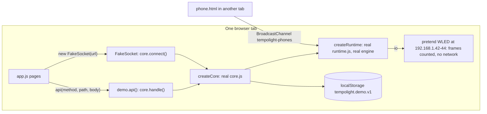

{/* Generated from docs/internals/web-app.md by scripts/build-mintlify.js. Edit that file, then run: node scripts/build-mintlify.js */}

`apps/web` is the UI: plain ES modules, no framework and no build step. The Node server serves it as files
(`app.js` in `packages/server/src`), and the online demo is the same files with the server core running in the page.

## Files

| File | What |
| --- | --- |
| `index.html`, `style.css` | the shell: sidebar, top bar (power, brightness, connection), `#page`, `#toast` |
| `app.js` | the router, the API and WebSocket clients, and the pages that are always loaded: Home, Music, Effects, Live pads, Scenes & schedules, Devices, Settings |
| `audio.js`, `pcm-worklet.js` | songs (decode, analyse with `/engine/analysis.js`, play, send the clock) and live listening (microphone, system sound); the worklet mixes to mono, resamples to 22,050 Hz and posts 512-sample Int16 chunks |
| `preview.js` | the room preview: LEDs as glowing tape with a bloom, drawn from the binary preview frames |
| `latency.js`, `homestrip.js` | the latency chip, badge and panel; the small Home & sleep strip on Home |
| lazy pages | `room.js` (Room), `mapper.js` + `mapping.js` (Camera mapping), `timeline.js` + `timeline.css` (Show editor), `homesleep.js` (Home & sleep), `integrations.js` (Integrations) |
| lazy parts | `wizard.js` + `setup.css` (setup wizard), `dmx.js` (DMX panels on Devices), `midiclock.js` (MIDI clock on Live pads), `nowplaying.js`, `spotify.js` (Music page panels), `homekit.js` (Settings), `qr.js`, `calibrate.js` (one-tap timing fix), `screen.js` (screen sync) |
| `demo.js` | demo mode: the server core and runtime in the page |
| `phone.html` | `/phone`: a phone as a light |
| `request.html` | `/request`: guest song requests |
| `obs.html` | `/obs`: the OBS browser source (preview and now playing, transparent) |
| `sw.js`, `manifest.webmanifest`, `icons/` | installable app (PWA) and offline use |
| `*.test.js` | unit tests of the pure parts (`calibrate`, `mapping`, `qr`), run by `npm test` |

The server also serves `packages/engine/src` at `/engine/` and `packages/` at `/packages/` (the app imports the
engine; the demo imports the server core), plus aliases: `/phone`, `/request`, `/obs`, `/playground`
(`apps/playground`, the effect playground) and `/demo.mp3`. Any other path without an extension gets `index.html`.
Text files are sent brotli- or gzip-compressed with an ETag; URLs with `?v=` are cached for a year.

## Routing and pages

Pages are hash routes, `#/<name>[/<arg>]`:

| Hash | Page | Module |
| --- | --- | --- |
| `#/home` (default) | Home | app.js |
| `#/music` | Music | app.js (+ nowplaying.js, spotify.js) |
| `#/timeline/<song id>` | Show editor | timeline.js (lazy) |
| `#/effects` | Effects | app.js |
| `#/live` | Live pads | app.js (+ midiclock.js) |
| `#/scenes` | Scenes & schedules | app.js |
| `#/sleep` | Home & sleep | homesleep.js (lazy) |
| `#/room` | Room | room.js (lazy; lock screen when locked) |
| `#/map` | Camera mapping | mapper.js (lazy; lock screen when locked) |
| `#/devices` | Devices | app.js (+ dmx.js) |
| `#/integrations` | Integrations | integrations.js (lazy) |
| `#/settings` | Settings | app.js (+ homekit.js) |

`route()` reads `location.hash`, asks the current page `canLeave()` (the Show editor with unsaved changes stays),
calls its `destroy()`, turns the preview off if it was on, and calls the new page's function with the `#page`
element. A page function returns an object with any of:

```js
{ onStatus(m) {},   // every status message (4 a second)
  onChanged(what) {}, // a Set of what changed ("devices", "scenes", "show", ..., "all")
  onLog(e) {}, onAudio() {},
  preview: true,    // wants the binary preview frames
  canLeave() { return true; }, destroy() {} }
```

`lazyPage(load, name)` shows *Loading…*, imports the module the first time, then calls `module[name](el)`; a page
that was left meanwhile is not drawn. The first visit only downloads what Home needs.

`app` holds the shared state: `state` (`GET /api/state`), `status` (the last status message), `layout`
(`GET /api/layout`), `frame` (the last preview frame), `token`, `log`. `{type: "changed"}` messages are collected and
`GET /api/state` is fetched again (`scheduleRefresh`); a change to devices, scenes or the room redraws the page.

## Talking to the server

- `api(method, path, body)`: `fetch` with JSON and `x-tempolight-token` when unlocked; non-2xx throws an `Error`
  with `status` and the server's `error` text. `act(fn, ok)` adds a toast, and on 403 forgets the token.
- `ws`: one WebSocket to `/ws?token=...`, reconnecting every 1.5 s; `ws.send(o)` for JSON, `ws.sendBinary(b)` for
  audio (skipped when more than 1 MB is buffered). Message formats: [API, WebSocket](/websocket).
- The token from `POST /api/unlock` is kept in `localStorage` (`tl.token`); so are the theme and a few per-page
  choices (`tl.*` keys).

Songs: `audio.js` decodes the file, runs `preAnalyseCore` (progress on the Music page), posts `POST /api/song {name,
analysis, clientId: ws.id}`, plays it with Web Audio and sends `{type: "clock"}` every 500 ms and on every change, with
`outputLatency + baseLatency` taken off. While it plays it also streams the song's own PCM as a live source
(`Song: <name>`), so spectrum effects get real bands.

## Demo mode

With `<meta name="tempolight-demo">` in the page (the online demo, built by `scripts/build-site.js`) or `?demo` in
the address, `boot()` imports `demo.js` before anything else, and `api()` and the WebSocket go to it instead of the
network.



- `createRuntime(store, { io })` with an `io` of pretend controllers (`FAKE_WLED`: Living room 300 LEDs, Desk 144,
  Ceiling 240): `getInfo` answers after a few ms (good Wi-Fi, for the latency meter), `discoverWled` finds all three,
  `DDPSender.send()` counts frames, capture is unavailable.
- `createCore({ store, runtime, env })` with an `env` of browser stand-ins: random ids from `crypto.getRandomValues`,
  a light FNV hash for the demo PIN (the server uses scrypt), no Hue, Nanoleaf, OpenRGB, smart lights, OSC, DJ Link,
  updates or Wi-Fi (those calls answer that they need Tempolight on your network).
- The store is `localStorage` with the same debounce; on the first visit the pretend controllers are "discovered" and
  laid out with the `living` preset.
- `demo.api()` has the same contract as `fetch`ing the server (a JSON round trip of the result, HttpError codes as
  `status`); `FakeSocket` has the WebSocket interface the app uses and delivers messages in microtasks.
- Phones join from another tab of the same browser over a `BroadcastChannel`.
- Node-only features (now playing, HomeKit, integrations) are not loaded; their panels explain.

`scripts/build-site.js` copies the app, the engine and exactly the server modules `core.js` and `runtime.js` import
(following the imports, failing on any `node:` import), sets the demo meta tag and the version, and writes the service
worker's build id and Cloudflare `_headers`. `scripts/e2e-demo.js` tests the result as static files.

## Service worker and PWA

`sw.js` makes the app installable (`manifest.webmanifest`, icons) and usable offline:

- **Network first**: every GET for this origin goes to the network; good answers are copied into the cache
  `tempolight-<build>`; the cache is used only when the network fails (navigations fall back to `/index.html`).
- `/api/*` and `/ws` are never cached or intercepted.
- On install it caches the shell (`/`, `index.html`, `style.css`, `app.js`, `audio.js`, `preview.js`,
  `pcm-worklet.js`, the manifest, icons, `homestrip.js`, `latency.js`, `setup.css`); 5 s after the first load the
  page posts `"precache"` and it fetches the lazy pages and parts too, so every page opens offline.
- On activate it deletes caches of other builds. `__BUILD__` is replaced by `build-site.js`; served from the Node
  server it stays literal, which is fine because network-first always fetches new files.
- It is only registered in a secure context (HTTPS or `localhost`), so a phone on `http://192.168.x.x` runs without it.

## Tests

`apps/web/*.test.js` (pure helpers), `scripts/e2e-browser.js` (every page in Chromium against a real server and
pretend WLED), `scripts/e2e-demo.js` (the built demo as static files). See [testing](/internals/testing).
