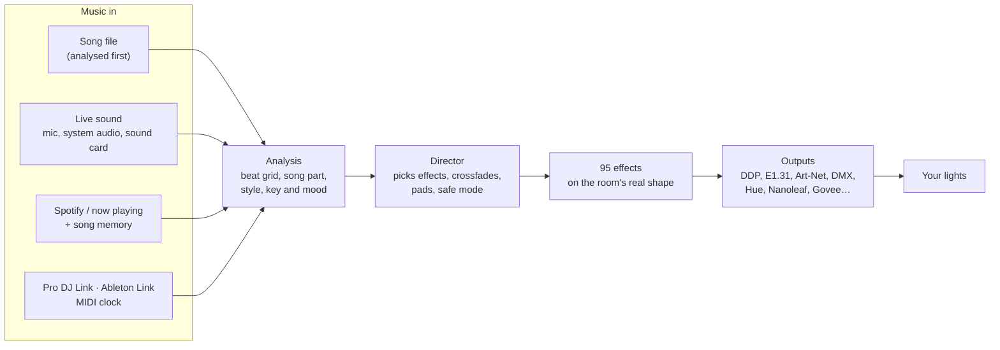

{/* Generated from docs/index.md by scripts/build-mintlify.js. Edit that file, then run: node scripts/build-mintlify.js */}

<Columns cols={2}>
  <Card title="It knows what's coming" icon="music">
    Songs are analysed before they play, songs heard before are recognised in about 8 seconds, and for a new song it hears the build-up and counts down to the drop 3 to 5 seconds ahead. A live beat tracker lands on 91% of beats.
  </Card>
  <Card title="One room, not one strip" icon="house">
    Draw your room once (or map it with a phone camera) and 95 effects sweep across walls, spin around rings and ripple out from the centre.
  </Card>
  <Card title="Many kinds of lights" icon="lightbulb">
    WLED, E1.31/Art-Net, DMX fixtures, Philips Hue, Nanoleaf, Govee, LIFX, WiZ, Kasa, Yeelight, Twinkly, OpenRGB, and the phones of your guests.
  </Card>
  <Card title="Light to run" icon="feather">
    Node.js and nothing else. A one-file app, Docker, a Raspberry Pi image or a Home Assistant add-on; a low-power mode for a Pi Zero.
  </Card>
</Columns>

## Start here

Pick the path that sounds like you. Every path starts with Tempolight running somewhere: [Install](/install) lists
every way (a one-file app, Homebrew, winget, Docker, a Raspberry Pi image, the Home Assistant add-on, or from source).
Or paste one prompt into Claude and let it do the setup: [Set up Tempolight with Claude](/setup-with-claude).
Every feature, with where to find it in the app: [What you can do](/guides/what-you-can-do).

<Columns cols={2}>

<Card title="I have WLED lights at home" icon="house">

1. [Getting started](/getting-started): what you need, WLED settings, the setup wizard.
2. [Install](/install) on your computer, or flash the [Raspberry Pi image](/raspberry-pi) for lights that are
   always on.
3. Draw your room and pick favourite effects: [Effects](/effects).
4. Wake up to a sunrise and fall asleep to a fade-out: [Wake-up and sleep](/wake-up).

</Card>

<Card title="I listen on Spotify" icon="disc-3">

1. [Sync with Spotify](/spotify): exact sync, songs learned on their first play, optional shared beat maps.
2. No Spotify? Tempolight also follows what Apple Music and other players on the same computer are playing, or
   listens to the computer's sound ([Getting started → Music sources](/getting-started#music-sources)).
3. Lights a little late? Use the one-tap timing fix
   ([Troubleshooting](/getting-started#troubleshooting)).

</Card>

<Card title="I DJ or throw parties" icon="headphones">

1. [Effects](/effects) and the Live pads: flash, strobe, blackout, build & drop, with keyboard shortcuts and MIDI.
2. Pioneer Pro DJ Link, Ableton Link and MIDI clock as beat sources, DMX fixtures over Art-Net/sACN:
   [Protocols](/protocols).
3. Guests' phones become lights and guests request songs with a QR code; a PIN lock keeps them out of your setup.
4. Streaming? [OBS, Twitch, Discord and games](/integrations), and the [Stream Deck plugin](/streamdeck).

</Card>

<Card title="I run a smart home" icon="house-plug">

1. The [Home Assistant add-on](https://github.com/D4RKGEEK/tempolight/blob/main/homeassistant/tempolight/DOCS.md), or any install with MQTT: Tempolight appears by
   itself ([API → Home Assistant](/api#home-assistant)).
2. Apple Home: Tempolight is a HomeKit bridge, so Siri works ([API → Apple Home](/api#apple-home-homekit)).
3. [Voice control](/voice) with Google Assistant and Alexa through Home Assistant.
4. Scenes, schedules, sunrise and sunset times, night mode and an [ambient plan](/wake-up#ambient-plan).

</Card>

<Card title="I'm a developer" icon="wrench">

1. [Architecture](/architecture): the engine, the outputs and the server, and how a frame is made.
2. [HTTP and WebSocket API](/api) and [the protocols](/protocols) on the wire.
3. [Tempolight Lite](/tempolight-lite): the WLED usermod for an ESP32 with a microphone (beta).
4. [Contributing](https://github.com/D4RKGEEK/tempolight/blob/main/CONTRIBUTING.md): new effects are one object in `packages/engine/src/effects.js`.

</Card>

</Columns>

## How it works

The whole story, step by step, is in [Architecture](/architecture).

## See it

<Columns cols={2}>

<Frame>
  
</Frame>

<Frame>
  
</Frame>

<Frame>
  
</Frame>

<Frame>
  
</Frame>

</Columns>

## Help and feedback

- Something not working? Start with [Getting started → Troubleshooting](/getting-started#troubleshooting), then
  [open an issue](https://github.com/D4RKGEEK/tempolight/issues).
- What's done, what's beta and what's next: [Roadmap](/roadmap) and the
  [changelog](https://github.com/D4RKGEEK/tempolight/blob/main/CHANGELOG.md).
- Tempolight is MIT licensed and made by volunteers. [Contributions are welcome](https://github.com/D4RKGEEK/tempolight/blob/main/CONTRIBUTING.md).
